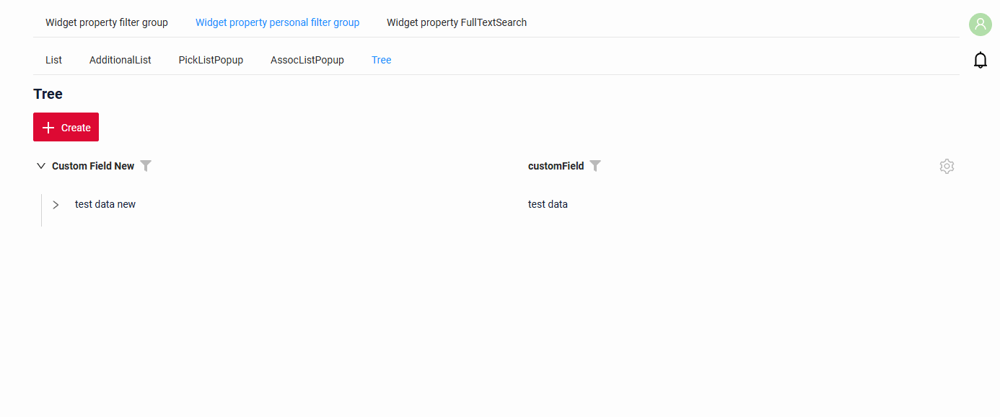
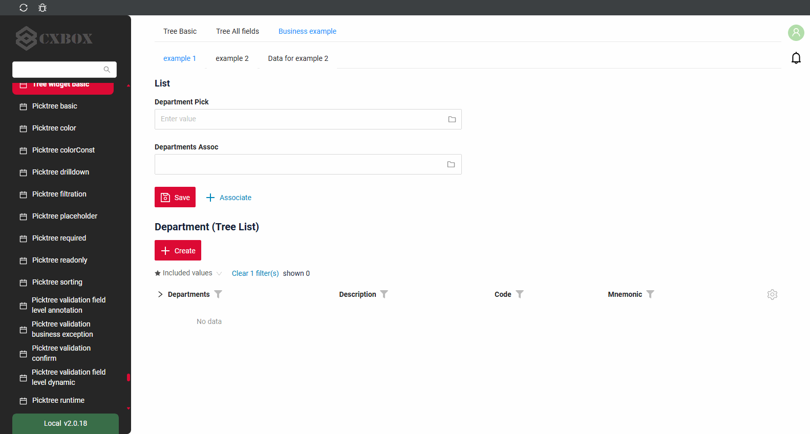
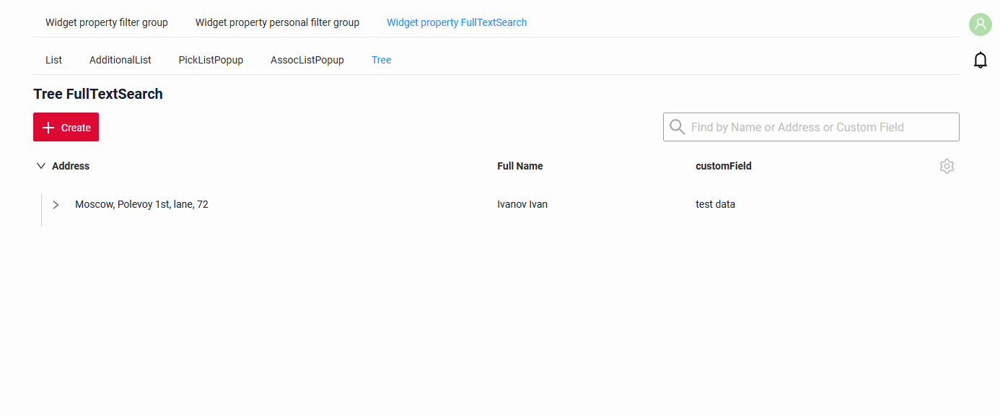
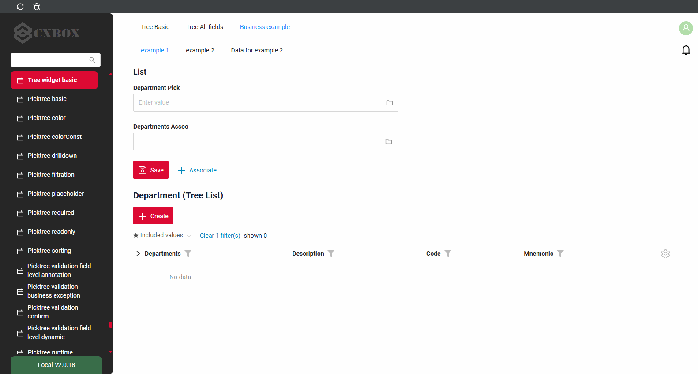
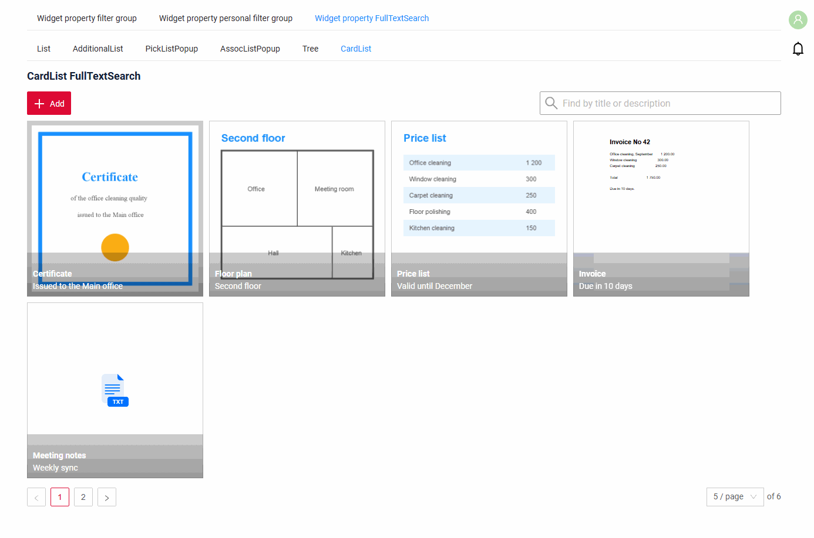
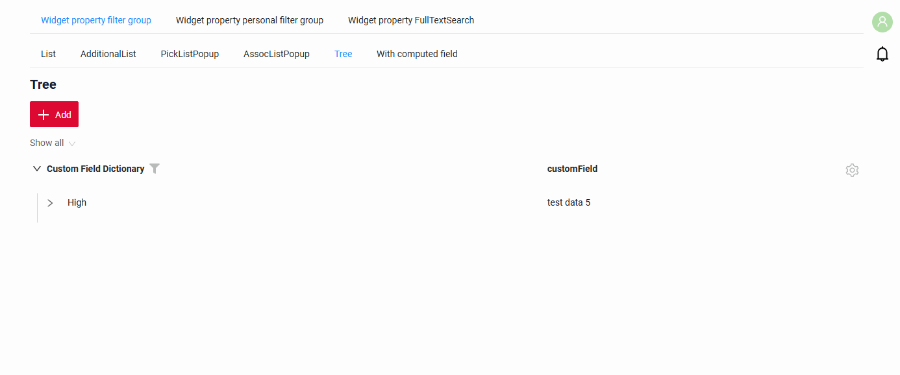
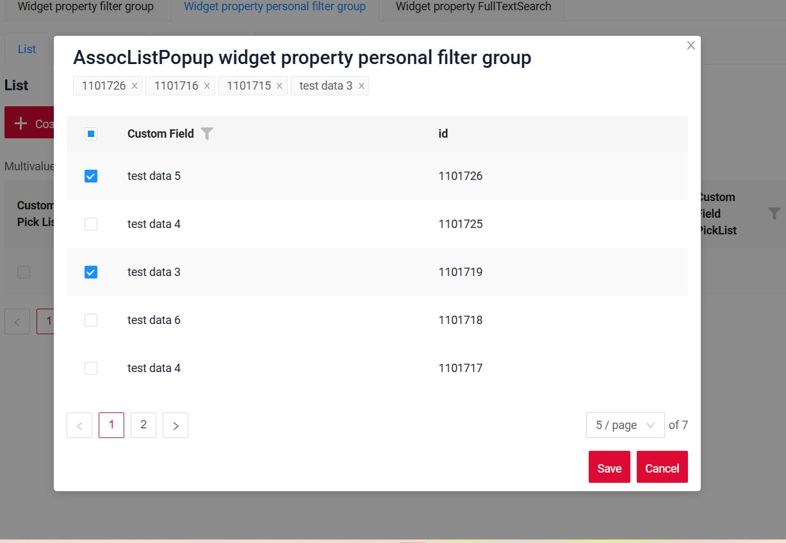

# Фильтрация { #filtration }
 
* [по полям](#by_fields)
* [по полнотекстовому поиску](#by_fulltextsearch)
* [по персональной группе фильтров](#by_personal_filter_group)
* [по группе фильтров](#by_filter_group)
<!-- default filtration  -->

## <a id="by_fields">по полям</a>
Доступность операций фильтрации для каждого типа поля см. в разделе [Поля](/ru/widget/fields/fieldtypes/).

Каждому типу поля нужна своя операция фильтрации, которую отправляет фронтенд.
Стандартные типы полей и соответствующие им способы фильтрации см. в разделе [SearchOperation для фильтрации](/ru/widget/fields/filtersearchoperation).

Эта функция доступна:

* [Виджет List](/ru/widget/type/list/list)
([:material-play-circle: Живой пример]({{ external_links.code_samples }}/ui/#/screen/myexample3616/view/myexample3616list){:target="_blank"}
[:fontawesome-brands-github: GitHub]({{ external_links.github_ui }}/{{ external_links.github_branch }}/src/main/java/org/demo/documentation/widgets/property/filtration/filtergroup){:target="_blank"}
)
* [Виджет AdditionalList](/ru/widget/type/additionallist/additionallist)
([:material-play-circle: Живой пример]({{ external_links.code_samples }}/ui/#/screen/myexample3616/view/myexample3616additionallist){:target="_blank"}
[:fontawesome-brands-github: GitHub]({{ external_links.github_ui }}/{{ external_links.github_branch }}/src/main/java/org/demo/documentation/widgets/property/filtration/filtergroup){:target="_blank"}
)
* [Виджет GroupingHierarchy](/ru/widget/type/groupinghierarchy/groupinghierarchy)
([:material-play-circle: Живой пример]({{ external_links.code_samples }}/ui/#/screen/myexample3121/view/myexample3121gh){:target="_blank"}
[:fontawesome-brands-github: GitHub]({{ external_links.github_ui }}/{{ external_links.github_branch }}/src/main/java/org/demo/documentation/widgets/groupinghierarhy/base){:target="_blank"}
)
* [Виджет AssocListPopup](/ru/widget/type/assoclistpopup/assoclistpopup)
([:material-play-circle: Живой пример]({{ external_links.code_samples }}/ui/#/screen/myexample3616/view/myexample3616assoc){:target="_blank"}
[:fontawesome-brands-github: GitHub]({{ external_links.github_ui }}/{{ external_links.github_branch }}/src/main/java/org/demo/documentation/widgets/property/filtration/filtergroup/forassoc){:target="_blank"}
)
* [Виджет PickListPopup](/ru/widget/type/picklistpopup/picklistpopup)
([:material-play-circle: Живой пример]({{ external_links.code_samples }}/ui/#/screen/myexample3616/view/myexample3614picklistpopup){:target="_blank"}
[:fontawesome-brands-github: GitHub]({{ external_links.github_ui }}/{{ external_links.github_branch }}/src/main/java/org/demo/documentation/widgets/property/filtration/fulltextsearch/forpicklist){:target="_blank"}
)
* [виджета Tree](/ru/widget/type/tree/tree)
([:material-play-circle: Живой пример]({{ external_links.code_samples }}/ui/#/screen/myexample3616/view/myexample3616tree){:target="_blank"}
[:fontawesome-brands-github: GitHub]({{ external_links.github_ui }}/{{ external_links.github_branch }}/src/main/java/org/demo/documentation/widgets/property/filtration/filtergroup){:target="_blank"}
)
* [виджета AssocTreePopup](/ru/widget/type/assoctreepopup/assoctreepopup)
([:material-play-circle: Живой пример]({{ external_links.code_samples }}/ui/#/screen/myexample3261/view/myexample3261list){:target="_blank"}
[:fontawesome-brands-github: GitHub]({{ external_links.github_ui }}/{{ external_links.github_branch }}/src/main/java/org/demo/documentation/widgets/tree/base/inner){:target="_blank"}
)
* [виджета PickTreePopup](/ru/widget/type/picktreepopup/picktreepopup)
([:material-play-circle: Живой пример]({{ external_links.code_samples }}/ui/#/screen/myexample3261/view/myexample3261list){:target="_blank"}
[:fontawesome-brands-github: GitHub]({{ external_links.github_ui }}/{{ external_links.github_branch }}/src/main/java/org/demo/documentation/widgets/tree/base/inner){:target="_blank"}
)
* [виджет Pie1D](/ru/widget/type/pie1d/pie1d): работает только в [табличном режиме](/ru/widget/type/pie1d/pie1d/#tablemode)
([:material-play-circle: Живой пример]({{ external_links.code_samples }}/ui/#/screen/myexample4264){:target="_blank"}
[:fontawesome-brands-github: GitHub]({{ external_links.github_ui }}/{{ external_links.github_branch }}/src/main/java/org/demo/documentation/widgets/pie1d/filtration){:target="_blank"}
)
* [виджет Column2D](/ru/widget/type/column2d/column2d): работает только в [табличном режиме](/ru/widget/type/column2d/column2d/#tablemode)
([:material-play-circle: Живой пример]({{ external_links.code_samples }}/ui/#/screen/myexample4268){:target="_blank"}
[:fontawesome-brands-github: GitHub]({{ external_links.github_ui }}/{{ external_links.github_branch }}/src/main/java/org/demo/documentation/widgets/column2d/filtration){:target="_blank"}
)
* [виджет Line2D](/ru/widget/type/line2d/line2d): работает только в [табличном режиме](/ru/widget/type/line2d/line2d/#tablemode)
([:material-play-circle: Живой пример]({{ external_links.code_samples }}/ui/#/screen/myexample4272){:target="_blank"}
[:fontawesome-brands-github: GitHub]({{ external_links.github_ui }}/{{ external_links.github_branch }}/src/main/java/org/demo/documentation/widgets/line2d/filtration){:target="_blank"}
)

### Как это выглядит? { #how-does-it-look }
=== "Виджет List"
    
=== "Виджет AdditionalList"
    
=== "Виджет GroupingHierarchy"
    
=== "Виджет AssocListPopup"
    
=== "Виджет PickListPopup"
    
=== "Виджет Tree"
    
=== "Виджет AssocTreePopup"
    
=== "Виджет PickTreePopup"
    
=== "Виджет Pie1D"
    
=== "Виджет Column2D"
    

## <a id="by_fulltextsearch">по полнотекстовому поиску</a>
`FullTextSearch` — когда пользователь вводит текст в поле полнотекстового поиска, виджет фильтрует строки, соответствующие запросу
(критерии поиска настраиваются и обычно проверяют, есть ли соответствующее значение хотя бы в одной колонке).
Это помогает пользователям быстро находить нужную информацию в виджете List.

Эта функция доступна:

* [Виджет List](/ru/widget/type/list/list)
(  [:material-play-circle: Живой пример]({{ external_links.code_samples }}/ui/#/screen/myexample3616/view/myexample3614list){:target="_blank"}
  [:fontawesome-brands-github: GitHub]({{ external_links.github_ui }}/{{ external_links.github_branch }}/src/main/java/org/demo/documentation/widgets/property/filtration/fulltextsearch){:target="_blank"}
)
* [Виджет AssocListPopup](/ru/widget/type/assoclistpopup/assoclistpopup)
(  [:material-play-circle: Живой пример]({{ external_links.code_samples }}/ui/#/screen/myexample3616/view/myexample3614assoclistpopup){:target="_blank"}
  [:fontawesome-brands-github: GitHub]({{ external_links.github_ui }}/{{ external_links.github_branch }}/src/main/java/org/demo/documentation/widgets/property/filtration/fulltextsearch/forassoc){:target="_blank"}
)
* [Виджет PickListPopup](/ru/widget/type/picklistpopup/picklistpopup)
([:material-play-circle: Живой пример]({{ external_links.code_samples }}/ui/#/screen/myexample3616/view/myexample3614picklistpopup){:target="_blank"}
[:fontawesome-brands-github: GitHub]({{ external_links.github_ui }}/{{ external_links.github_branch }}/src/main/java/org/demo/documentation/widgets/property/filtration/fulltextsearch/forpicklist){:target="_blank"}
) 
* [виджета Tree](/ru/widget/type/tree/tree)
(  [:material-play-circle: Живой пример]({{ external_links.code_samples }}/ui/#/screen/myexample3616/view/myexample3614tree){:target="_blank"}
  [:fontawesome-brands-github: GitHub]({{ external_links.github_ui }}/{{ external_links.github_branch }}/src/main/java/org/demo/documentation/widgets/property/filtration/fulltextsearch){:target="_blank"}
)
* [виджета AssocTreePopup](/ru/widget/type/assoctreepopup/assoctreepopup)
([:material-play-circle: Живой пример]({{ external_links.code_samples }}/ui/#/screen/myexample3261/view/myexample3261list){:target="_blank"}
[:fontawesome-brands-github: GitHub]({{ external_links.github_ui }}/{{ external_links.github_branch }}/src/main/java/org/demo/documentation/widgets/tree/base/inner){:target="_blank"}
)
* [виджета PickTreePopup](/ru/widget/type/picktreepopup/picktreepopup)
([:material-play-circle: Живой пример]({{ external_links.code_samples }}/ui/#/screen/myexample3261/view/myexample3261list){:target="_blank"}
[:fontawesome-brands-github: GitHub]({{ external_links.github_ui }}/{{ external_links.github_branch }}/src/main/java/org/demo/documentation/widgets/tree/base/inner){:target="_blank"}
)
* [виджет Pie1D](/ru/widget/type/pie1d/pie1d): работает только в [табличном режиме](/ru/widget/type/pie1d/pie1d/#tablemode)
([:material-play-circle: Живой пример]({{ external_links.code_samples }}/ui/#/screen/myexample4265){:target="_blank"}
[:fontawesome-brands-github: GitHub]({{ external_links.github_ui }}/{{ external_links.github_branch }}/src/main/java/org/demo/documentation/widgets/pie1d/fulltextsearch){:target="_blank"}
)
* [виджет Column2D](/ru/widget/type/column2d/column2d): работает только в [табличном режиме](/ru/widget/type/column2d/column2d/#tablemode)
([:material-play-circle: Живой пример]({{ external_links.code_samples }}/ui/#/screen/myexample4269){:target="_blank"}
[:fontawesome-brands-github: GitHub]({{ external_links.github_ui }}/{{ external_links.github_branch }}/src/main/java/org/demo/documentation/widgets/column2d/fulltextsearch){:target="_blank"}
)
* [виджета CardList](/ru/widget/type/cardlist/cardlist)
  (  [:material-play-circle: Живой пример]({{ external_links.code_samples }}/ui/#/screen/myexample3616/view/myexample3614cardlist){:target="_blank"}
  [:fontawesome-brands-github: GitHub]({{ external_links.github_ui }}/{{ external_links.github_branch }}/src/main/java/org/demo/documentation/widgets/property/filtration/fulltextsearch/forcardlist){:target="_blank"}
  )
* [виджет Line2D](/ru/widget/type/line2d/line2d): работает только в [табличном режиме](/ru/widget/type/line2d/line2d/#tablemode)
([:material-play-circle: Живой пример]({{ external_links.code_samples }}/ui/#/screen/myexample4273){:target="_blank"}
[:fontawesome-brands-github: GitHub]({{ external_links.github_ui }}/{{ external_links.github_branch }}/src/main/java/org/demo/documentation/widgets/line2d/fulltextsearch){:target="_blank"}
)

### Как это выглядит? { #how-does-it-look_1 }
=== "Виджет List"
    
=== "Виджет AssocListPopup"
    
=== "Виджет PickListPopup"
    
=== "Виджет Tree"
    
=== "Виджет AssocTreePopup"
    
=== "Виджет PickTreePopup"
    
=== "Виджет Pie1D"
    
=== "Виджет Column2D"
    
=== "Виджет CardList"
    

## <a id="by_personal_filter_group">по персональной группе фильтров</a>

`Personal filter group` — заполненный пользователем фильтр можно сохранить для каждого отдельного пользователя.

Заполненный пользователем фильтр можно сохранить для каждого отдельного пользователя.

Эта функция доступна:

* [List](/widget/type/list/list) (
[:material-play-circle: Живой пример]({{ external_links.code_samples }}/ui/#/screen/myexample3616/view/myexample3616list){:target="_blank"}
[:fontawesome-brands-github: GitHub]({{ external_links.github_ui }}/{{ external_links.github_branch }}/src/main/java/org/demo/documentation/widgets/property/filtration/filtergroup){:target="_blank"}
)

* [Tree](/widget/type/tree/tree) (
[:material-play-circle: Живой пример]({{ external_links.code_samples }}/ui/#/screen/myexample3616/view/myexample3616tree){:target="_blank"}
[:fontawesome-brands-github: GitHub]({{ external_links.github_ui }}/{{ external_links.github_branch }}/src/main/java/org/demo/documentation/widgets/property/filtration/filtergroup){:target="_blank"}
)

* [AdditionalList](/widget/type/additionallist/additionallist) (
[:material-play-circle: Живой пример]({{ external_links.code_samples }}/ui/#/screen/myexample3616/view/myexample3616additionallist){:target="_blank"}
[:fontawesome-brands-github: GitHub]({{ external_links.github_ui }}/{{ external_links.github_branch }}/src/main/java/org/demo/documentation/widgets/property/filtration/filtergroup){:target="_blank"}
)

Кнопка "Save Filters" находится в меню иконки шестерёнки.
При нажатии кнопки "Save Filters" появляется модальное окно со всеми пользовательскими фильтрами, которые при желании можно удалить.

### Как это выглядит? { #how-does-it-look_2 }
=== "List"
    
=== "AdditionalList"
    
=== "Tree"
    

## <a id="by_filter_group">по группе фильтров</a>

`Filter group` — предопределённые настройки фильтров, которые пользователи могут применять в приложении. Они позволяют быстро применить определённые критерии фильтрации без ручного ввода.
 
Эта функция доступна:

* [List](/widget/type/list/list)
  ([:material-play-circle: Живой пример]({{ external_links.code_samples }}/ui/#/screen/myexample3616/view/myexample3618list){:target="_blank"}
  [:fontawesome-brands-github: GitHub]({{ external_links.github_ui }}/{{ external_links.github_branch }}/src/main/java/org/demo/documentation/widgets/property/filtration/filtergroupsave){:target="_blank"}
  )
* [Tree](/widget/type/tree/tree)
  ([:material-play-circle: Живой пример]({{ external_links.code_samples }}/ui/#/screen/myexample3616/view/myexample3618tree){:target="_blank"}
  [:fontawesome-brands-github: GitHub]({{ external_links.github_ui }}/{{ external_links.github_branch }}/src/main/java/org/demo/documentation/widgets/property/filtration/filtergroupsave){:target="_blank"}
  )
* [AdditionalList](/widget/type/additionallist/additionallist)
([:material-play-circle: Живой пример]({{ external_links.code_samples }}/ui/#/screen/myexample3616/view/myexample3618additionallist){:target="_blank"}
[:fontawesome-brands-github: GitHub]({{ external_links.github_ui }}/{{ external_links.github_branch }}/src/main/java/org/demo/documentation/widgets/property/filtration/filtergroupsave){:target="_blank"}
)
* [Pie1D](/ru/widget/type/pie1d/pie1d): работает только в [табличном режиме](/ru/widget/type/pie1d/pie1d/#tablemode)
([:material-play-circle: Живой пример]({{ external_links.code_samples }}/ui/#/screen/myexample4266){:target="_blank"}
[:fontawesome-brands-github: GitHub]({{ external_links.github_ui }}/{{ external_links.github_branch }}/src/main/java/org/demo/documentation/widgets/pie1d/filtergroup){:target="_blank"}
)
* [Column2D](/ru/widget/type/column2d/column2d): работает только в [табличном режиме](/ru/widget/type/column2d/column2d/#tablemode)
([:material-play-circle: Живой пример]({{ external_links.code_samples }}/ui/#/screen/myexample4270){:target="_blank"}
[:fontawesome-brands-github: GitHub]({{ external_links.github_ui }}/{{ external_links.github_branch }}/src/main/java/org/demo/documentation/widgets/column2d/filtergroup){:target="_blank"}
)
* [Line2D](/ru/widget/type/line2d/line2d): работает только в [табличном режиме](/ru/widget/type/line2d/line2d/#tablemode)
([:material-play-circle: Живой пример]({{ external_links.code_samples }}/ui/#/screen/myexample4274){:target="_blank"}
[:fontawesome-brands-github: GitHub]({{ external_links.github_ui }}/{{ external_links.github_branch }}/src/main/java/org/demo/documentation/widgets/line2d/filtergroup){:target="_blank"}
)

Возможность фильтрации по умолчанию по сохранённым группам пока недоступна.
 
### Как это выглядит? { #how-does-it-look_3 }
=== "List"
    
=== "AdditionalList"
    
=== "Tree"
    
=== "Pie1D"
    
=== "Column2D"
    

!!! info

    Есть ограничение при использовании предопределённых фильтров следующих типов:
    `multivalue`, `pickList` и `multivalueHover`.
    
     * Когда такие фильтры **предопределены**, в тегах фильтра отображаются **значения `id`**.
     * Когда фильтр **редактируется вручную** (например, при добавлении значений через picklist), теги отображаются **по стандартным правилам**.
    
    Это поведение вызвано ограничением фронтенда:
    фронтенд не может получить отображаемые имена для тегов фильтра, если записи, указанные в предопределённом фильтре, находятся на **разных страницах всплывающего окна picklist** и не загружены в текущем контексте UI.

       

## Дополнительные свойства { #additional-properties }
### Сброс фильтров { #clear-filters }
Если таблица отфильтрована, появляется кнопка "Clear all filters".
Количество применённых фильтров отображается как "Clear n filters" (где n — количество отфильтрованных колонок).
 
#### Как это выглядит? { #how-does-it-look_4 }

 
#### Как добавить? { #how-to-add }
по умолчанию