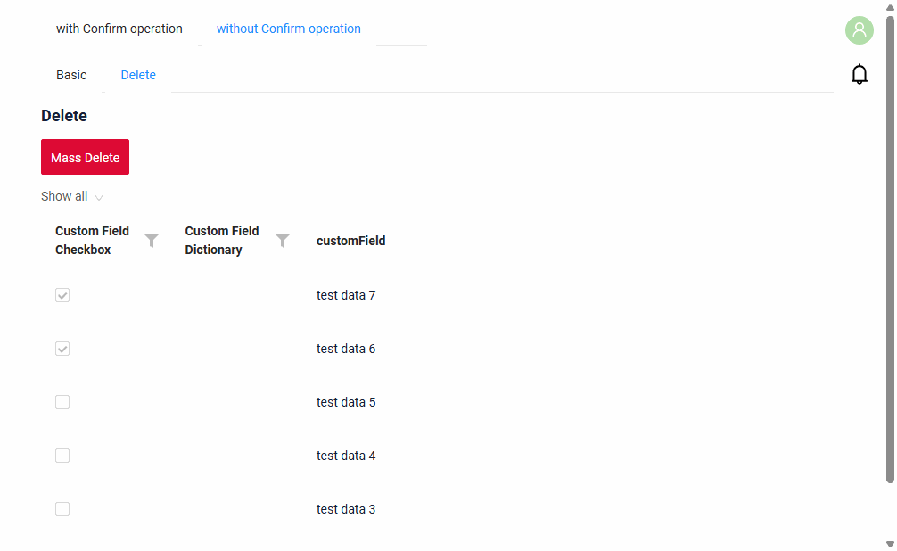
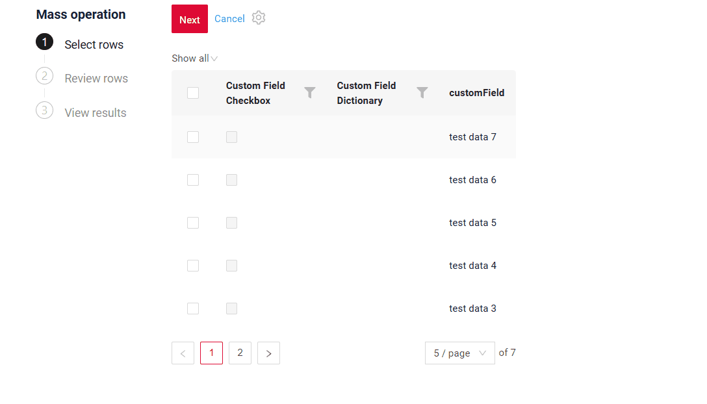

# Mass Specific Case<
[:material-play-circle: Live Sample]({{ external_links.code_samples }}/ui/#/screen/myexample6101/view/myexample6101delete){:target="_blank"}
[:fontawesome-brands-github: GitHub]({{ external_links.github_ui }}/{{ external_links.github_branch }}/src/main/java/org/demo/documentation/feature/massoperations){:target="_blank"}

!!! Attention
    For small and medium data volumes. Use for synchronous processing within a single transaction when the data size is up to 10,000 rows.

=== "List"
    [:material-play-circle: Live Sample]({{ external_links.code_samples }}/ui/#/screen/myexample6101/view/myexample6101delete){:target="_blank"}
    [:fontawesome-brands-github: GitHub]({{ external_links.github_ui }}/{{ external_links.github_branch }}/src/main/java/org/demo/documentation/feature/massoperations){:target="_blank"}

    
=== "GroupingHierarchy"
    [:material-play-circle: Live Sample]({{ external_links.code_samples }}/ui/#/screen/myexample6101/view/myexample6101deletegh){:target="_blank"}
    [:fontawesome-brands-github: GitHub]({{ external_links.github_ui }}/{{ external_links.github_branch }}/src/main/java/org/demo/documentation/feature/massoperations/gh){:target="_blank"}

    

`Mass delete` is a [mass operation](/widget/type/property/massoperations/massoperations/) that removes all selected records in one run.

## Basic
It saves the user from deleting records one by one, for example:

* **Delete outdated or erroneous records** — find them with filters, select and delete in one run.
* **Delete records imported by mistake** — select them from a file on [Step 1](#selecting_rows) and delete.

Rows that cannot be deleted by business rules get the status **Fail**, the other rows are deleted.
Successfully deleted records no longer appear in the results step.

The user sees the result for each row and can repeat the operation for the rows that failed, see [Retry for failed rows](#retry).

After clicking on a mass operation, the user enters the mass-operation mode, which consists of several steps:

1. [Select rows](#selecting_rows)
2. [Review rows](#reviewing)
3. [View results](#result)

### How does it look?
[:material-play-circle: Live Sample]({{ external_links.code_samples }}/ui/#/screen/myexample6101/view/myexample6101delete){:target="_blank"}
[:fontawesome-brands-github: GitHub]({{ external_links.github_ui }}/{{ external_links.github_branch }}/src/main/java/org/demo/documentation/feature/massoperations){:target="_blank"}

 

!!! Specifics
    * Mass operations become available only if there is at least one row in the table.
    * All requests are executed using the ID of the first selected row!
    * The operation runs in a single transaction: if an error occurs, the changes are rolled back for all selected rows, nothing is deleted.
    * Successfully deleted records are not shown on the results step, only the failed rows remain there.
    * To ask the user before deleting, add a confirmation step, as in [Mass operations with confirmation](/widget/type/property/massoperations/withconfirm/#confirming).
    * In GroupingHierarchy only rows with records can be selected: a group row without its own record (an empty group, a row of totals) has a disabled checkbox. From Step 2 the table shows only the groups with selected rows.
    * Rows are only viewed during a mass operation, the file preview too: its arrows go through the rows, a row does not become active, the record form is not shown.

### How to add?

??? Example
    - **Step1**  Add actionGroups **massDelete**(Custom name) to corresponding **.widget.json**.

        ```json
            "actionGroups": {
              "include": [
                "massDelete"
              ]
        }
        ```

        === "List"
            ```json
            --8<--
            {{ external_links.github_raw_doc }}/feature/massoperations/myexample6101Delete.widget.json
            --8<--
            ```
        === "GroupingHierarchy"
            ```json
            --8<--
            {{ external_links.github_raw_doc }}/feature/massoperations/gh/myexample6102DeleteGH.widget.json
            --8<--
            ```
    - **Step2** Create action massDelete to corresponding **AwareResponseService**.      

        === "With plugin(recommended)"
            **Step 1** Download plugin
            [download Intellij Plugin](https://doc.cxbox.org/plugin/plugininstalling)
    
            **Step 2** Add a mass action to the corresponding service
    
            
    
        === "Example of writing code"
            === "List"
                ```java
                --8<--
                {{ external_links.github_raw_doc }}/feature/massoperations/MyExample6101Service.java:massDelete
                --8<--
                ```
            === "GroupingHierarchy"
                ```java
                --8<--
                {{ external_links.github_raw_doc }}/feature/massoperations/gh/MyExample6102Service.java:massDelete
                --8<--
                ```

        Property:

        -  `.action("massDelete", "Mass Delete")`
            
            * `"massDelete"` — the action name used internally by the backend and frontend.
            * `"Mass Delete"` —  title displayed in the UI.

        - `.scope(ActionScope.MASS)`
                
            Specifies that this is a **mass action**, applied to all selected rows in the grid.
                
        - `.massInvoker((bc, data, ids) -> { ... })`
            
            The main handler for the mass operation.
            
            Parameters:
            
            * **`bc`** — business component context.
            * **`data`** — data of the *first selected row*.
            * **`ids`** — the set of IDs of all selected records.
            
            Inside the handler:
             The method deletes each record and returns:
            
            * `MassDTO.success(id)` - the record is deleted
            * `MassDTO.fail(id, "message")` - the record is not deleted, for example, by a business rule (in the sample, a record with the value `Error`)
                
        - `return new MassActionResultDTO<>(massResult)...`
                
            The mass action result includes:
            
            * success/failure information for each record,
            * a UI post-action.
            
            - `.setAction(PostAction.showMessage(...))`

                Displays a message in the UI when the user clicks **Close** on [Step 3](#result), not when the action is executed.

## <a id="selecting_rows">Step 1. Select rows</a>
### How does it look?


1. Checkboxes for selecting rows are displayed in the first column of the table (true = the row is selected).
2. Filtering and sorting remain available.
3. Rows become non-editable while in mass-operation mode.
4. All selected rows are displayed above the table as chips.

    * If the number of chips exceeds **N**, only the first **N** are shown; the rest are collapsed and replaced with the label **“+N values”**. Hovering over **“+N values”** displays a tooltip: *“Move on to Step 2 to see all the chosen rows.”*
    * A **“Clear”** button is displayed next to the chips. Clicking **Clear** deselects all checkboxes and removes all chips.
    * A gear icon is available for chip-related actions, containing the option **“Select from file”** (importing rows from a file exported on [Step 3](#result)).
      Rows are matched only by ID: the exported Excel file keeps it in a hidden column.

        

5. **Available actions**:

    * **Cancel** — exits mass-operation mode.
    * **Next** — proceeds to Step 2, where only the selected rows are displayed.

## <a id="reviewing">Step 2. Review rows</a>
### How does it look?


1. Selected rows from [Step 1. Select rows](#selecting_rows) are displayed in read-only mode.
2. Checkboxes are disabled, and rows cannot be edited.
3. Filtering and sorting of the selected rows remain available.
4. **Available actions**:

    * **Apply** — immediately deletes the selected rows and navigates to the [View results](#result) step.
    * **Back** — returns the user to Step 1 (row selection).
      When returning to Step 1, the table resets to the first page and all filters are cleared.
    * **Cancel** — exits mass-operation mode without deleting anything.

## <a id="result">Step 3. View results</a>
### How does it look?


After performing a mass operation, the status for each row in the table is displayed:

1. **Success** – the record is deleted. Deleted records are not shown in the table.
2. **Fail** – the record is not deleted

The widget header displays the number of processed rows (including the number of successful/failed rows).

Filtering/sorting of selected rows is available for any column, including status.

**Available actions:**

1. **Close** – Exit the mass operation mode. The user returns to the normal table view without the deleted records.
   The postAction of the mass action (for example, a message) runs at this moment, not when the action is executed.
2. **Export** – Export rows to a file.

    * Ability to filter/sort the table before export.
    * File format fully compatible with uploading on Step 1 (**Select from file**).
    * Tooltip on hover: “Export of selected rows. You can use this file on Step 1 via ‘Select from File.’”
    * After export, display a notification: “File exported successfully”

3. **Retry**, menu item **Export failed** – Export all rows with the status “Fail”.

    * The table is automatically filtered by failed rows.
    * File format fully compatible with uploading on Step 1 (**Select from file**).
    * Tooltip on hover: “A file with failed rows will be downloaded. To retry the operation for these rows, upload this file on Step 1 via ‘Select from File.’”

### <a id="retry">Retry for failed rows</a>
The deletion is repeated for the failed rows in four steps:

1. **Export** — on Step 3 click **Retry** → **Export failed**. An Excel file with the failed rows is downloaded.
2. **Fix the cause** — remove the reason why the record cannot be deleted (in the sample, change the value `Error`).
3. **Upload** — start the mass delete again and on [Step 1](#selecting_rows) select **Select from file** in the gear menu. The rows from the file become selected.
   Rows are matched only by ID: the exported file keeps it in a hidden column, so the file does not need to be edited.
4. **Run again** — go through the steps of the mass operation as usual.
