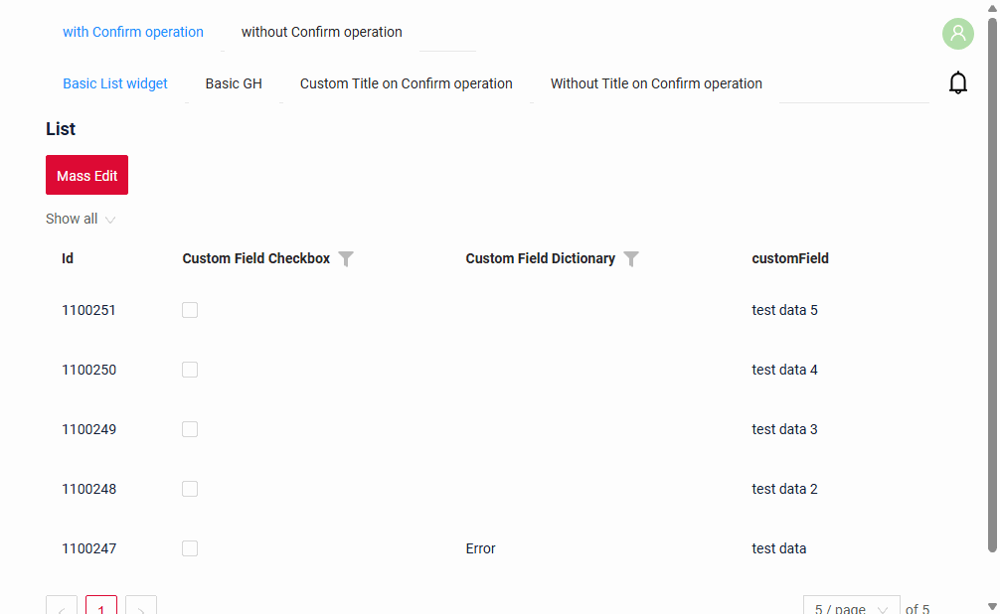
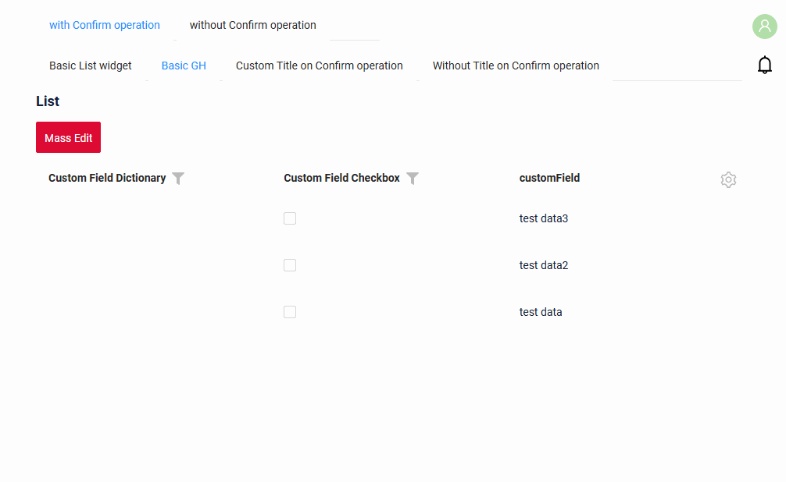

# Mass operations
[:material-play-circle: Live Sample]({{ external_links.code_samples }}/ui/#/screen/myexample6101){:target="_blank"}
[:fontawesome-brands-github: GitHub]({{ external_links.github_ui }}/{{ external_links.github_branch }}/src/main/java/org/demo/documentation/feature/massoperations){:target="_blank"}

!!! Attention
    For small and medium data volumes. Use for synchronous processing within a single transaction when the data size is up to 10,000 rows.

=== "List"
    [:material-play-circle: Live Sample]({{ external_links.code_samples }}/ui/#/screen/myexample6101/view/myexample6101list){:target="_blank"}
    [:fontawesome-brands-github: GitHub]({{ external_links.github_ui }}/{{ external_links.github_branch }}/src/main/java/org/demo/documentation/feature/massoperations){:target="_blank"}

    
=== "GroupingHierarchy"
    [:material-play-circle: Live Sample]({{ external_links.code_samples }}/ui/#/screen/myexample6101/view/myexample6101gh){:target="_blank"}
    [:fontawesome-brands-github: GitHub]({{ external_links.github_ui }}/{{ external_links.github_branch }}/src/main/java/org/demo/documentation/feature/massoperations/gh){:target="_blank"}

    

`Mass operations` are a mechanism that allows the user to perform a single action on a large number of table rows at once. Instead of processing each row individually, the user can select a set of data and apply a common operation to it—such as updating, deleting, changing statuses, recalculating values, and other typical scenarios.

## Basic
Mass operations save the user from repeating the same action row by row. They are used when the same change must be applied to many records at once, for example:

The user sees the result for each row and can repeat the operation for the rows that failed.

This function is available for widgets:

 * [List](/widget/type/list/list) 
 * [GroupingHierarchy](/widget/type/groupinghierarchy/groupinghierarchy)

## Which mass operation do you need?
All mass operations go through the same steps: select rows, review rows, (confirm operation), view results.
They differ in what the user does after the rows are selected. Choose the article by the task.

### <a id="withoutconfirm">Mass operations without confirmation</a>
**When to use:** the user only presses a button — the new values are known in advance or calculated on the server, the user does not enter anything.

* Change status of all selected rows, for example, close all processed requests.
* Set a flag, for example, mark all selected rows as checked.
* Recalculate values of the selected rows by business rules.
* After the operation, run a post-action, for example, show a message.

Steps: Select rows → Review rows → **Apply** → View results.

:material-arrow-right: [Mass operations without confirmation](/widget/type/property/massoperations/withoutconfirm/)

### <a id="withconfirm">Mass operations with confirmation</a>
**When to use:** the user must choose the values that are written to all selected rows — the confirmation form is filled in once for all of them.

* Assign a priority or a responsible employee to all selected requests.
* Set a new status together with a comment or a date chosen by the user.
* In the same operation, besides writing the values from the form, the server can process the rows further (change other fields, recalculate) and run a post-action, as in the operation without confirmation.

Steps: Select rows → Review rows → **Confirm operation** (form with values) → View results.

:material-arrow-right: [Mass operations with confirmation](/widget/type/property/massoperations/withconfirm/)

### <a id="crypto">Mass signing and encrypting</a>
**When to use:** the files of the selected rows must be signed or encrypted with CryptoPro in one run, the certificates are selected once.

:material-arrow-right: [Mass signing and encrypting](/widget/type/property/massoperations/sign/)

### <a id="delete">Mass delete</a>
**When to use:** the user must remove many records at once.

* Delete outdated or erroneous records selected by filter.
* Delete records that were imported by mistake: select them from a file and delete in one run.
* Rows that cannot be deleted by business rules get the status **Fail**, the other rows are deleted.

Steps: Select rows → Review rows → **Apply** → View results.

:material-arrow-right: [Mass delete](/widget/type/property/massoperations/delete/)
