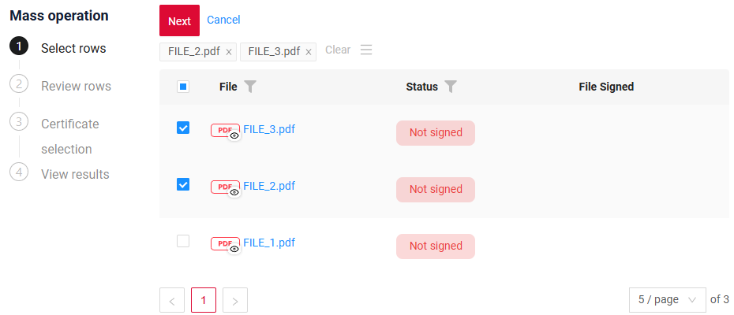
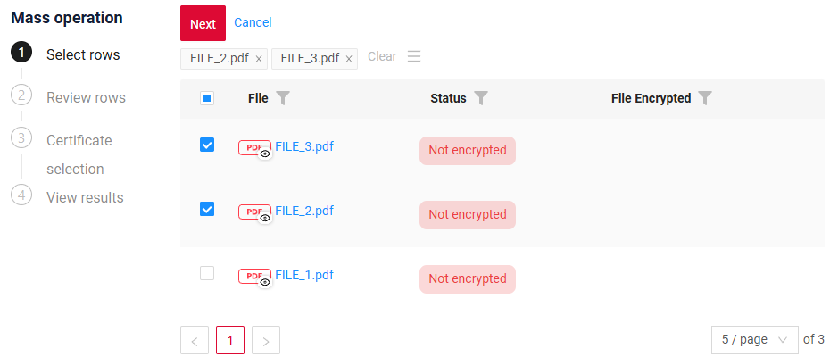
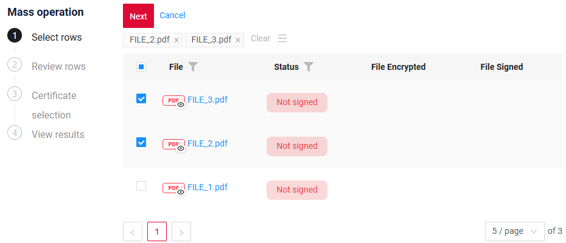
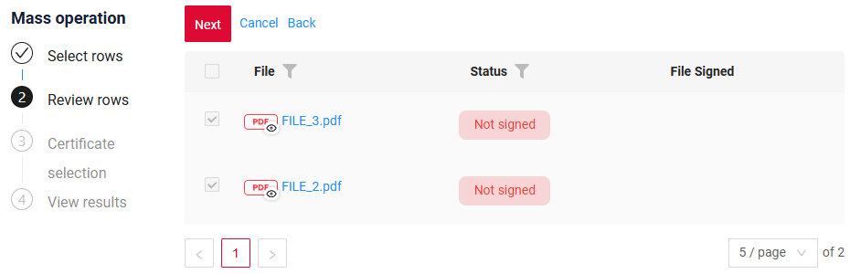
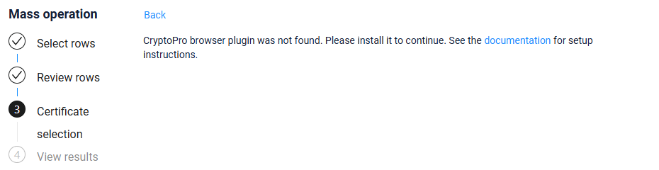

# Mass signing and encrypting
[:material-play-circle: Live Sample]({{ external_links.code_samples }}/ui/#/screen/myexample3711/view/myexample3711masssignlist){:target="_blank"}
[:fontawesome-brands-github: GitHub]({{ external_links.github_ui }}/{{ external_links.github_branch }}/src/main/java/org/demo/documentation/feature/encryptsign){:target="_blank"}

`Mass signing and encrypting` is a [mass operation](/widget/type/property/massoperations/massoperations/) that signs and encrypts the files of the selected rows with CryptoPro.
All operation types of [Signing and encrypting](/features/sign/sign/) are available: signing, encrypting, signing and encrypting, encrypting and signing.

To use this functionality, the user must have the required [software CryptoPro](http://testca2012.cryptopro.ru/ui/) installed.

### How does it look?
=== "Signing"
    === "List"
        [:material-play-circle: Live Sample]({{ external_links.code_samples }}/ui/#/screen/myexample3711/view/myexample3711masssignlist){:target="_blank"}
        [:fontawesome-brands-github: GitHub]({{ external_links.github_ui }}/{{ external_links.github_branch }}/src/main/java/org/demo/documentation/feature/encryptsign/sign/mass){:target="_blank"}
        <video controls width="800">
        <source src="/widget/type/property/massoperations/sign/01_sign_list_3711.mp4" type="video/mp4">
        </video>
    === "GroupingHierarchy"
        [:material-play-circle: Live Sample]({{ external_links.code_samples }}/ui/#/screen/myexample3711/view/myexample3711masssigngh){:target="_blank"}
        [:fontawesome-brands-github: GitHub]({{ external_links.github_ui }}/{{ external_links.github_branch }}/src/main/java/org/demo/documentation/feature/encryptsign/sign/mass){:target="_blank"}
        <video controls width="800">
        <source src="/widget/type/property/massoperations/sign/02_sign_gh_3711.mp4" type="video/mp4">
        </video> 
=== "Encrypting"
    === "List"
        [:material-play-circle: Live Sample]({{ external_links.code_samples }}/ui/#/screen/myexample3713/view/myexample3713massencryptlist){:target="_blank"}
        [:fontawesome-brands-github: GitHub]({{ external_links.github_ui }}/{{ external_links.github_branch }}/src/main/java/org/demo/documentation/feature/encryptsign/encrypt/mass){:target="_blank"}
        <video controls width="800">
        <source src="/widget/type/property/massoperations/sign/03_encrypt_list_3713.mp4" type="video/mp4">
        </video>
=== "GroupingHierarchy"
        [:material-play-circle: Live Sample]({{ external_links.code_samples }}/ui/#/screen/myexample3713/view/myexample3713massencryptgh){:target="_blank"}
        [:fontawesome-brands-github: GitHub]({{ external_links.github_ui }}/{{ external_links.github_branch }}/src/main/java/org/demo/documentation/feature/encryptsign/encrypt/mass){:target="_blank"}
        <video controls width="800">
        <source src="/widget/type/property/massoperations/sign/04_encrypt_gh_3713.mp4" type="video/mp4">
        </video>  
=== "Signing and encrypting"
    === "List"
        [:material-play-circle: Live Sample]({{ external_links.code_samples }}/ui/#/screen/myexample3714/view/myexample3714masssignencryptlist){:target="_blank"}
        [:fontawesome-brands-github: GitHub]({{ external_links.github_ui }}/{{ external_links.github_branch }}/src/main/java/org/demo/documentation/feature/encryptsign/signencrypt/mass){:target="_blank"}
        <video controls width="800">
        <source src="/widget/type/property/massoperations/sign/05_sign_encrypt_list_3714.mp4" type="video/mp4">
        </video>
=== "GroupingHierarchy"
        [:material-play-circle: Live Sample]({{ external_links.code_samples }}/ui/#/screen/myexample3714/view/myexample3714masssignencryptgh){:target="_blank"}
        [:fontawesome-brands-github: GitHub]({{ external_links.github_ui }}/{{ external_links.github_branch }}/src/main/java/org/demo/documentation/feature/encryptsign/signencrypt/mass){:target="_blank"}
        <video controls width="800">
        <source src="/widget/type/property/massoperations/sign/06_sign_encrypt_gh_3714.mp4" type="video/mp4">
        </video> 
=== "Encrypting and signing"
    === "List"
        [:material-play-circle: Live Sample]({{ external_links.code_samples }}/ui/#/screen/myexample3712/view/myexample3712massencryptsignlist){:target="_blank"}
        [:fontawesome-brands-github: GitHub]({{ external_links.github_ui }}/{{ external_links.github_branch }}/src/main/java/org/demo/documentation/feature/encryptsign/encryptsign/mass){:target="_blank"}
        <video controls width="800">
        <source src="/widget/type/property/massoperations/sign/07_encrypt_sign_list_3712.mp4" type="video/mp4">
        </video> 
    === "GroupingHierarchy"
        [:material-play-circle: Live Sample]({{ external_links.code_samples }}/ui/#/screen/myexample3712/view/myexample3712massencryptsigngh){:target="_blank"}
        [:fontawesome-brands-github: GitHub]({{ external_links.github_ui }}/{{ external_links.github_branch }}/src/main/java/org/demo/documentation/feature/encryptsign/encryptsign/mass){:target="_blank"}
        <video controls width="800">
        <source src="/widget/type/property/massoperations/sign/08_encrypt_sign_gh_3712.mp4" type="video/mp4">
        </video> 

## Basic
It saves the user from signing or encrypting documents one by one: the certificates are selected once, and the files of all selected rows are processed in one run. For example:

* **Sign** — sign a batch of contracts, acts or invoices with an electronic signature.
* **Encrypt** — encrypt the documents of the selected rows before sending them to a counterparty.
* **Sign and encrypt / Encrypt and sign** — prepare a batch of documents for sending in one action, in the required order of operations.

The user sees the result for each row and can repeat the operation for the rows that failed, see [Retry for failed rows](#retry).

This function is available for widgets:

* [List](/widget/type/list/list)
* [GroupingHierarchy](/widget/type/groupinghierarchy/groupinghierarchy)

After clicking on the mass action, the user goes through the steps:

1. [Select rows](#selecting_rows)
2. [Review rows](#reviewing)
3. [Certificate selection](#certificates)
4. [Confirm operation](#confirming) (this step is optional)
5. [View results](#result)

!!! Specifics
    * The mass action has the same settings as the action for one document: an item in `options.cryptoGenerator` with the name of the mass action.
    * The user selects the certificates once for all rows.
    * The files are processed row by row: the file of a row is signed or encrypted, and the new files are saved to the file storage. When all rows are processed, the action is sent once for all of them.
    * A row that cannot be processed is skipped, the other rows are processed: a row without a file, a CryptoPro error, a file that was not saved.
    * In GroupingHierarchy only rows with records can be selected: a group row without its own record has a disabled checkbox. In the samples the rows are grouped by status.
    * The file preview works on all steps. Its arrows go through the rows, the active row does not change.
    * The postAction of the mass action runs when the user clicks **Close** on [Step 5](#result).
    * The general rules of [mass operations](/widget/type/property/massoperations/massoperations/) apply: the action is executed using the ID of the first selected row, and on the server it runs in a single transaction — if an error occurs, the changes are rolled back for all rows.

### How to add?

??? Example
    **Step 1** Add a mass action to the corresponding **Service**.

    * `data.getMassIds_()` gives only the rows processed on the frontend.
      The files of a row are in its options: `mass.getOption(MassOptionType.SIGNATURE_FILE_ID)` and other keys of `MassOptionType`.
    * The rows that failed on the frontend get their errors in the result automatically.
      If the handler returns its own result for such a row, its own result is shown.

    **Step 2** Add an item with the name of the mass action to `options.cryptoGenerator` and the action to `actionGroups` in the `.widget` configuration options.
    The settings are the same for [List](/widget/type/list/list) and [GroupingHierarchy](/widget/type/groupinghierarchy/groupinghierarchy); GroupingHierarchy also needs `options.groupingHierarchy.fields`.

    === "Signing"
        List: [:material-play-circle: Live Sample]({{ external_links.code_samples }}/ui/#/screen/myexample3711/view/myexample3711masssignlist){:target="_blank"}

        GroupingHierarchy: [:material-play-circle: Live Sample]({{ external_links.code_samples }}/ui/#/screen/myexample3711/view/myexample3711masssigngh){:target="_blank"}

        [:fontawesome-brands-github: GitHub]({{ external_links.github_ui }}/{{ external_links.github_branch }}/src/main/java/org/demo/documentation/feature/encryptsign/sign){:target="_blank"}

        ```java
        --8<--
        {{ external_links.github_raw_doc }}/feature/encryptsign/sign/Myexample3711MassService.java:getActions
        --8<--
        ```

        === "List"
            ```json
            --8<--
            {{ external_links.github_raw_doc }}/feature/encryptsign/sign/mass/MyExample3711MassList.widget.json
            --8<--
            ```
        === "GroupingHierarchy"
            ```json
            --8<--
            {{ external_links.github_raw_doc }}/feature/encryptsign/sign/mass/MyExample3711MassGH.widget.json
            --8<--
            ```
    === "Encrypting"
        List: [:material-play-circle: Live Sample]({{ external_links.code_samples }}/ui/#/screen/myexample3713/view/myexample3713massencryptlist){:target="_blank"}

        GroupingHierarchy: [:material-play-circle: Live Sample]({{ external_links.code_samples }}/ui/#/screen/myexample3713/view/myexample3713massencryptgh){:target="_blank"}

        [:fontawesome-brands-github: GitHub]({{ external_links.github_ui }}/{{ external_links.github_branch }}/src/main/java/org/demo/documentation/feature/encryptsign/encrypt){:target="_blank"}

        ```java
        --8<--
        {{ external_links.github_raw_doc }}/feature/encryptsign/encrypt/Myexample3713MassService.java:getActions
        --8<--
        ```

        === "List"
            ```json
            --8<--
            {{ external_links.github_raw_doc }}/feature/encryptsign/encrypt/mass/MyExample3713MassList.widget.json
            --8<--
            ```
        === "GroupingHierarchy"
            ```json
            --8<--
            {{ external_links.github_raw_doc }}/feature/encryptsign/encrypt/mass/MyExample3713MassGH.widget.json
            --8<--
            ```
    === "Signing and encrypting"
        List: [:material-play-circle: Live Sample]({{ external_links.code_samples }}/ui/#/screen/myexample3714/view/myexample3714masssignencryptlist){:target="_blank"}

        GroupingHierarchy: [:material-play-circle: Live Sample]({{ external_links.code_samples }}/ui/#/screen/myexample3714/view/myexample3714masssignencryptgh){:target="_blank"}

        [:fontawesome-brands-github: GitHub]({{ external_links.github_ui }}/{{ external_links.github_branch }}/src/main/java/org/demo/documentation/feature/encryptsign/signencrypt){:target="_blank"}

        ```java
        --8<--
        {{ external_links.github_raw_doc }}/feature/encryptsign/signencrypt/Myexample3714MassService.java:getActions
        --8<--
        ```

        === "List"
            ```json
            --8<--
            {{ external_links.github_raw_doc }}/feature/encryptsign/signencrypt/mass/MyExample3714MassList.widget.json
            --8<--
            ```
        === "GroupingHierarchy"
            ```json
            --8<--
            {{ external_links.github_raw_doc }}/feature/encryptsign/signencrypt/mass/MyExample3714MassGH.widget.json
            --8<--
            ```
    === "Encrypting and signing"
        List: [:material-play-circle: Live Sample]({{ external_links.code_samples }}/ui/#/screen/myexample3712/view/myexample3712massencryptsignlist){:target="_blank"}

        GroupingHierarchy: [:material-play-circle: Live Sample]({{ external_links.code_samples }}/ui/#/screen/myexample3712/view/myexample3712massencryptsigngh){:target="_blank"}

        [:fontawesome-brands-github: GitHub]({{ external_links.github_ui }}/{{ external_links.github_branch }}/src/main/java/org/demo/documentation/feature/encryptsign/encryptsign){:target="_blank"}

        ```java
        --8<--
        {{ external_links.github_raw_doc }}/feature/encryptsign/encryptsign/Myexample3712MassService.java:getActions
        --8<--
        ```

        === "List"
            ```json
            --8<--
            {{ external_links.github_raw_doc }}/feature/encryptsign/encryptsign/mass/MyExample3712MassList.widget.json
            --8<--
            ```
        === "GroupingHierarchy"
            ```json
            --8<--
            {{ external_links.github_raw_doc }}/feature/encryptsign/encryptsign/mass/MyExample3712MassGH.widget.json
            --8<--
            ```

    To react to the rows that failed on the frontend, read `data.getMassErrors_()`:

    ```java
    --8<--
    {{ external_links.github_raw_doc }}/feature/encryptsign/sign/Myexample3711MassService.java:massErrors
    --8<--
    ```

## <a id="selecting_rows">Step 1. Select rows</a>
### How does it look?
=== "Signing"
    List:
    [:material-play-circle: Live Sample]({{ external_links.code_samples }}/ui/#/screen/myexample3711/view/myexample3711masssignlist){:target="_blank"}
    [:fontawesome-brands-github: GitHub]({{ external_links.github_ui }}/{{ external_links.github_branch }}/src/main/java/org/demo/documentation/feature/encryptsign/sign/mass){:target="_blank"}

    GroupingHierarchy:
    [:material-play-circle: Live Sample]({{ external_links.code_samples }}/ui/#/screen/myexample3711/view/myexample3711masssigngh){:target="_blank"}
    [:fontawesome-brands-github: GitHub]({{ external_links.github_ui }}/{{ external_links.github_branch }}/src/main/java/org/demo/documentation/feature/encryptsign/sign/mass){:target="_blank"}

    
=== "Encrypting"
    List:
    [:material-play-circle: Live Sample]({{ external_links.code_samples }}/ui/#/screen/myexample3713/view/myexample3713massencryptlist){:target="_blank"}
    [:fontawesome-brands-github: GitHub]({{ external_links.github_ui }}/{{ external_links.github_branch }}/src/main/java/org/demo/documentation/feature/encryptsign/encrypt/mass){:target="_blank"}

    GroupingHierarchy:
    [:material-play-circle: Live Sample]({{ external_links.code_samples }}/ui/#/screen/myexample3713/view/myexample3713massencryptgh){:target="_blank"}
    [:fontawesome-brands-github: GitHub]({{ external_links.github_ui }}/{{ external_links.github_branch }}/src/main/java/org/demo/documentation/feature/encryptsign/encrypt/mass){:target="_blank"}

    
=== "Signing and encrypting"
    List:
    [:material-play-circle: Live Sample]({{ external_links.code_samples }}/ui/#/screen/myexample3714/view/myexample3714masssignencryptlist){:target="_blank"}
    [:fontawesome-brands-github: GitHub]({{ external_links.github_ui }}/{{ external_links.github_branch }}/src/main/java/org/demo/documentation/feature/encryptsign/signencrypt/mass){:target="_blank"}

    GroupingHierarchy:
    [:material-play-circle: Live Sample]({{ external_links.code_samples }}/ui/#/screen/myexample3714/view/myexample3714masssignencryptgh){:target="_blank"}
    [:fontawesome-brands-github: GitHub]({{ external_links.github_ui }}/{{ external_links.github_branch }}/src/main/java/org/demo/documentation/feature/encryptsign/signencrypt/mass){:target="_blank"}

    
=== "Encrypting and signing"
    List:
    [:material-play-circle: Live Sample]({{ external_links.code_samples }}/ui/#/screen/myexample3712/view/myexample3712massencryptsignlist){:target="_blank"}
    [:fontawesome-brands-github: GitHub]({{ external_links.github_ui }}/{{ external_links.github_branch }}/src/main/java/org/demo/documentation/feature/encryptsign/encryptsign/mass){:target="_blank"}

    GroupingHierarchy:
    [:material-play-circle: Live Sample]({{ external_links.code_samples }}/ui/#/screen/myexample3712/view/myexample3712massencryptsigngh){:target="_blank"}
    [:fontawesome-brands-github: GitHub]({{ external_links.github_ui }}/{{ external_links.github_branch }}/src/main/java/org/demo/documentation/feature/encryptsign/encryptsign/mass){:target="_blank"}

    

The step works as [Select rows](/widget/type/property/massoperations/withconfirm/#selecting_rows) of mass operations: checkboxes in the first column, chips of the selected rows, **Clear** and **Select from file**.

**Available actions**:

* **Next** — moves the user to [Step 2](#reviewing).
* **Cancel** — exits mass-operation mode.

## <a id="reviewing">Step 2. Review rows</a>
### How does it look?


The step works as [Review rows](/widget/type/property/massoperations/withconfirm/#reviewing) of mass operations: only the selected rows are shown, read-only.

**Available actions**:

* **Next** — moves the user to [Step 3](#certificates).
* **Back** — returns the user to [Step 1](#selecting_rows).
* **Cancel** — exits mass-operation mode.

## <a id="certificates">Step 3. Certificate selection</a>
### How does it look?
If the CryptoPro browser plugin is not installed, the step shows a message with a link to the setup instructions, and only **Back** is available.



1. The user selects the certificates, as in the popup for one document: for signing, for encryption or both, by the operation type.
2. **Available actions**:

    * **Execute** - processes the files of the rows and sends the action. The button is shown when the action has no confirmation.
    * **Next** - moves the user to [Step 4](#confirming). The button is shown when the action has a confirmation. The files are not processed yet.
    * **Back** - returns the user to [Step 2](#reviewing).

3. While the files are processed, the step shows a progress bar and **Processed N of M**. **Back** is not available.

    * **Stop and send processed** - stops the processing at once. The processed rows are sent, the current row and the rows after it get the error "Interrupted".
      If no row is processed yet, nothing is sent and the step is shown again.

4. If the action fails on the server, the user can go back and run the step again.
   A row that is already processed with the same certificates and the same file is not processed again until the mass operation is closed.

## <a id="confirming">Step 4. Confirm operation</a>
The step is shown only when the mass action has a confirmation, as in [Mass operations with confirmation](/widget/type/property/massoperations/withconfirm/#confirming).

1. The confirmation is shown with its own buttons.
2. After the yes button, the files are processed on this step, as on [Step 3](#certificates): a progress bar, **Processed N of M**, **Stop and send processed**. Then the action is sent.
3. The no button closes the mass operation. Nothing is signed or encrypted.
4. **Back** returns the user to [Step 3](#certificates).

The title and the text of the yes and no buttons are customized as in [Mass operations with confirmation](/widget/type/property/massoperations/withconfirm/#confirming).
The values entered in the confirmation form are applied to all selected rows; an empty field means "clear".

## <a id="result">Step 5. View results</a>
The step works as [View results](/widget/type/property/massoperations/withconfirm/#result) of mass operations.

A row that was not processed has the status **Fail** and the error:

* "There is no file in this row" - the row has no file;
* the text of the CryptoPro error;
* "Interrupted" - the processing was stopped with **Stop and send processed** before this row.

The widget header displays the number of processed rows, successful and failed. **Export** and **Retry** → **Export failed** work as in [mass operations](/widget/type/property/massoperations/withconfirm/#result).

The postAction of the mass action runs when the user clicks **Close**.

### <a id="retry">Retry for failed rows</a>
The operation is repeated for the failed rows as in [mass operations](/widget/type/property/massoperations/withconfirm/#retry):

1. **Export** — on Step 5 click **Retry** → **Export failed**. An Excel file with the failed rows is downloaded.
2. **Fix the cause** — add a file to the rows with "There is no file in this row", or fix the CryptoPro error (for example, select another certificate). Rows with "Interrupted" need no fix.
3. **Upload** — start the mass operation again and on [Step 1](#selecting_rows) select **Select from file** in the gear menu.
   Rows are matched only by ID: the exported file keeps it in a hidden column, so the file does not need to be edited.
4. **Run again** — select the certificates and go through the steps as usual.
