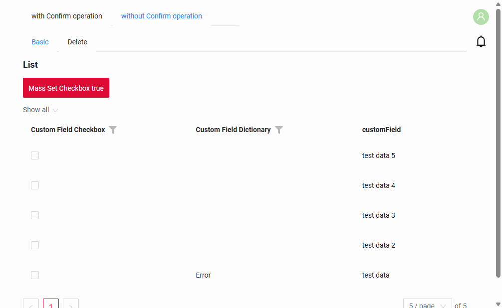
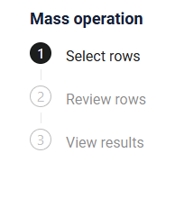

# Mass operations without confirmation
[:material-play-circle: Live Sample]({{ external_links.code_samples }}/ui/#/screen/myexample6101/view/myexample6101checkboxtruelist){:target="_blank"}
[:fontawesome-brands-github: GitHub]({{ external_links.github_ui }}/{{ external_links.github_branch }}/src/main/java/org/demo/documentation/feature/massoperations){:target="_blank"}

!!! Attention
    For small and medium data volumes. Use for synchronous processing within a single transaction when the data size is up to 10,000 rows.

=== "List"
    [:material-play-circle: Live Sample]({{ external_links.code_samples }}/ui/#/screen/myexample6101/view/myexample6101checkboxtruelist){:target="_blank"}
    [:fontawesome-brands-github: GitHub]({{ external_links.github_ui }}/{{ external_links.github_branch }}/src/main/java/org/demo/documentation/feature/massoperations){:target="_blank"}

    
=== "GroupingHierarchy"
    [:material-play-circle: Live Sample]({{ external_links.code_samples }}/ui/#/screen/myexample6101/view/myexample6101checkboxtruegh){:target="_blank"}
    [:fontawesome-brands-github: GitHub]({{ external_links.github_ui }}/{{ external_links.github_branch }}/src/main/java/org/demo/documentation/feature/massoperations/gh){:target="_blank"}

    

`Mass operation without confirmation` is a [mass operation](/widget/type/property/massoperations/massoperations/) that is executed right after the rows are selected: the user clicks **Apply**, and the action is applied to all selected rows. The user does not enter any values.

## Basic
It is used when the new values are known in advance or are calculated on the server, so the user only has to select the rows and press a button, for example:

* **Change status** — move all selected records to another status (for example, close all processed requests).
* **Set a flag** — set the same value in all selected rows (in the sample, the checkbox is set to `true`).
* **Recalculate** — recalculate the values of the selected rows by business rules without opening each record.

After the operation, the action can run a post-action, for example, show a message. It runs when the user clicks **Close** on [Step 3](#result).

If the user must choose the values that are written to the rows, use [Mass operations with confirmation](/widget/type/property/massoperations/withconfirm/).
To remove records, use [Mass delete](/widget/type/property/massoperations/delete/).

The user sees the result for each row and can repeat the operation for the rows that failed, see [Retry for failed rows](#retry).

This function is available for widgets:

 * [List](/widget/type/list/list) 
 * [GroupingHierarchy](/widget/type/groupinghierarchy/groupinghierarchy)

After clicking on a mass operation, the user enters the mass-operation mode, which consists of several steps:

1. [Select rows](#selecting_rows)
2. [Review rows](#reviewing)
3. [View results](#result)

### How does it look?
[:material-play-circle: Live Sample]({{ external_links.code_samples }}/ui/#/screen/myexample6101/view/myexample6101checkboxtruelist){:target="_blank"}
[:fontawesome-brands-github: GitHub]({{ external_links.github_ui }}/{{ external_links.github_branch }}/src/main/java/org/demo/documentation/feature/massoperations){:target="_blank"}



!!! Specifics
    * Mass operations become available only if there is at least one row in the table.
    * All requests are executed using the ID of the first selected row!
    * The operation runs in a single transaction: if an error occurs, the changes are rolled back for all selected rows.
    * In GroupingHierarchy only rows with records can be selected: a group row without its own record (an empty group, a row of totals) has a disabled checkbox. From Step 2 the table shows only the groups with selected rows.
    * Rows are only viewed during a mass operation, the file preview too: its arrows go through the rows, a row does not become active, the record form is not shown.

#### How to add?

??? Example
    - **Step1**  Add actionGroups **massCheckboxTrue**(Custom name) to corresponding **.widget.json**.

        ```json
            "actionGroups": {
              "include": [
                "massCheckboxTrue"
              ]
        }
        ```

        === "List"
            ```json
            --8<--
            {{ external_links.github_raw_doc }}/feature/massoperations/myexample6101CheckboxTrueList.widget.json
            --8<--
            ```
        === "GroupingHierarchy"
            ```json
            --8<--
            {{ external_links.github_raw_doc }}/feature/massoperations/gh/myexample6102CheckboxTrueGH.widget.json
            --8<--
            ```
    - **Step2** Create action massCheckboxTrue to corresponding **AwareResponseService**.

        === "With plugin(recommended)"
            **Step 1** Download plugin
            [download Intellij Plugin](https://doc.cxbox.org/plugin/plugininstalling)
    
            **Step 2** Add a mass action to the corresponding service
    
            
    
        === "Example of writing code"
            === "List"
                ```java
                --8<--
                {{ external_links.github_raw_doc }}/feature/massoperations/MyExample6101Service.java:massCheckboxTrue
                --8<--
                ```
            === "GroupingHierarchy"
                ```java
                --8<--
                {{ external_links.github_raw_doc }}/feature/massoperations/gh/MyExample6102Service.java:massCheckboxTrue
                --8<--
                ```

        Property:

        -  `.action("massCheckboxTrue", "Mass Set Checkbox true")`
            
            * `"massCheckboxTrue"` — the action name used internally by the backend and frontend.
            * `"Mass Set Checkbox true"` —  title displayed in the UI.

        - `.scope(ActionScope.MASS)`
                
            Specifies that this is a **mass action**, applied to all selected rows in the grid.
            There is no `.withPreAction(...)`, so the confirmation step is not shown: the **Apply** button on [Step 2](#reviewing) executes the action.
                
        - `.massInvoker((bc, data, ids) -> { ... })`
            
            The main handler for the mass operation.
            
            Parameters:
            
            * **`bc`** — business component context.
            * **`data`** — data of the *first selected row*.
            * **`ids`** — the set of IDs of all selected records.
            
            Inside the handler:
             The method processes each record and returns:
            
            * `MassDTO.success(id)` - result success 
            * `MassDTO.fail(id, "message")` - result error 
                
        - `return new MassActionResultDTO<>(massResult)...`
                
            The mass action result includes:
            
            * success/failure information for each record,
            * a UI post-action.
            
            - `.setAction(PostAction.showMessage(...))`

                Displays a message in the UI when the user clicks **Close** on [Step 3](#result), not when the action is executed.

                Parameters:

                * `MessageType.INFO` — message type.
                * `"The fields mass operation was completed!"` — message text.

## <a id="selecting_rows">Step 1. Select rows</a>
### How does it look?


1. Checkboxes for selecting rows are displayed in the first column of the table (true = the row is selected).
2. Filtering and sorting remain available.
3. Rows become non-editable while in mass-operation mode.
4. All selected rows are displayed above the table as chips.

    * If the number of chips exceeds **N**, only the first **N** are shown; the rest are collapsed and replaced with the label **“+N values”**. Hovering over **“+N values”** displays a tooltip: *“Move on to Step 2 to see all the chosen rows.”*
    * A **“Clear”** button is displayed next to the chips. Clicking **Clear** deselects all checkboxes and removes all chips.
    * A gear icon is available for chip-related actions, containing the option **“Select from file”** (importing rows from a file exported on [Step 3](#result)).
      Rows are matched only by ID: the exported Excel file keeps it in a hidden column.

        

5. **Available actions**:

    * **Cancel** — exits mass-operation mode.
    * **Next** — proceeds to Step 2, where only the selected rows are displayed.

## <a id="reviewing">Step 2. Review rows</a>
### How does it look?


1. Selected rows from [Step 1. Select rows](#selecting_rows) are displayed in read-only mode.
2. Checkboxes are disabled, and rows cannot be edited.
3. Filtering and sorting of the selected rows remain available.
4. **Available actions**:

    * **Apply** — immediately executes the mass action and navigates to the [View results](#result) step.
    * **Back** — returns the user to Step 1 (row selection).
      When returning to Step 1, the table resets to the first page and all filters are cleared.
    * **Cancel** — exits mass-operation mode without applying any changes.

## <a id="result">Step 3. View results</a>
### How does it look?


After performing a mass operation, the status for each row in the table is displayed:

1. **Success** – the operation was completed successfully
2. **Fail** – the operation was not completed

The widget header displays the number of processed rows (including the number of successful/failed rows).

Filtering/sorting of selected rows is available for any column, including status.

**Available actions:**

1. **Close** – Exit the mass operation mode. The user returns to the normal table view, taking into account all changes made by the operation.
   The postAction of the mass action (for example, a message) runs at this moment, not when the action is executed.
2. **Export** – Export rows to a file.

    * Ability to filter/sort the table before export.
    * File format fully compatible with uploading on Step 1 (**Select from file**).
    * Tooltip on hover: “Export of selected rows. You can use this file on Step 1 via ‘Select from File.’”
    * After export, display a notification: “File exported successfully”

3. **Retry**, menu item **Export failed** – Export all rows with the status “Fail”.

    * The table is automatically filtered by failed rows.
    * File format fully compatible with uploading on Step 1 (**Select from file**).
    * Tooltip on hover: “A file with failed rows will be downloaded. To retry the operation for these rows, upload this file on Step 1 via ‘Select from File.’”

### <a id="retry">Retry for failed rows</a>
The operation is repeated for the failed rows in three steps:

1. **Export** — on Step 3 click **Retry** → **Export failed**. An Excel file with the failed rows is downloaded.
2. **Upload** — start the mass operation again and on [Step 1](#selecting_rows) select **Select from file** in the gear menu. The rows from the file become selected.
   Rows are matched only by ID: the exported file keeps it in a hidden column, so the file does not need to be edited.
3. **Run again** — go through the steps of the mass operation as usual.
