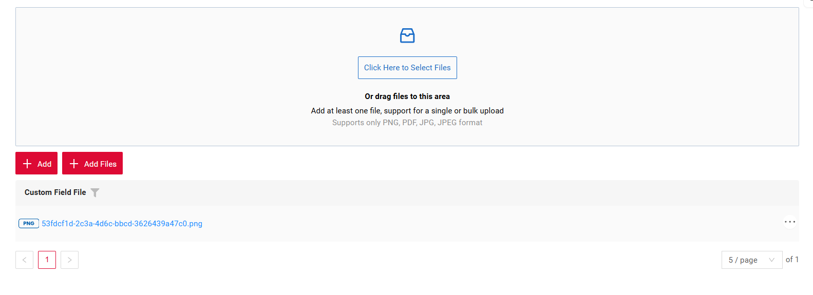
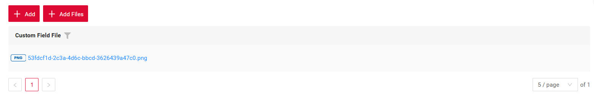
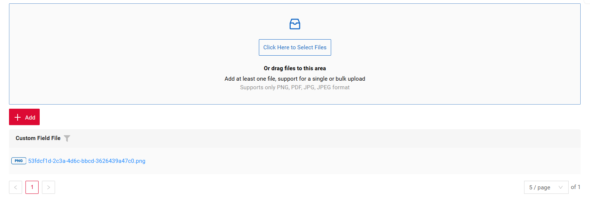
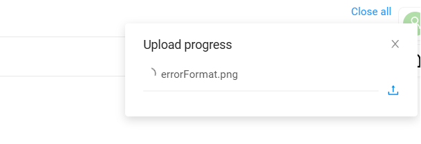
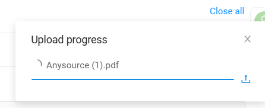
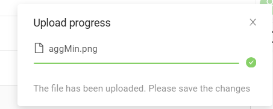
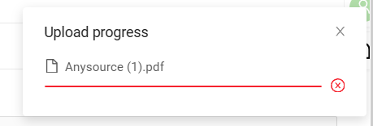
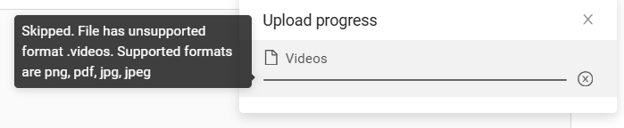
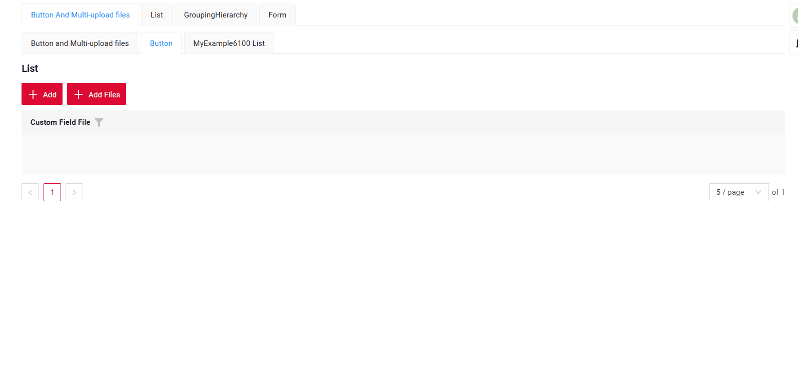

# Множественная загрузка файлов { #multi-upload-files }

[:material-play-circle: Живой пример]({{ external_links.code_samples }}/ui/#/screen/myexample6100){:target="_blank"}
[:fontawesome-brands-github: GitHub]({{ external_links.github_ui }}/{{ external_links.github_branch }}/src/main/java/org/demo/documentation/feature/file){:target="_blank"}

Реализована множественная загрузка файлов. Для выбора файлов можно использовать специальную зону drag-and-drop или стандартную кнопку.

Эта возможность поддерживает следующие типы:

* [Виджет List](/ru/widget/type/list/list)
* [Виджет GroupingHierarchy](/ru/widget/type/groupinghierarchy/groupinghierarchy)
* [виджета Tree](/ru/widget/type/tree/tree)
* [виджет CardCarouselList](/ru/widget/type/cardcarousellist/cardcarousellist)
* [виджета CardList](/ru/widget/type/cardlist/cardlist)

Эта возможность поддерживает только поле [fileUpload](/ru/widget/fields/field/fileUpload/fileUpload)

Интерфейс поддерживает три режима отображения массовой загрузки файлов, что позволяет гибко настраивать пользовательский опыт:

1. Комбинированный режим (кнопка + multi-upload)
[:material-play-circle: Живой пример]({{ external_links.code_samples }}/ui/#/screen/myexample6100){:target="_blank"}
[:fontawesome-brands-github: GitHub]({{ external_links.github_ui }}/{{ external_links.github_branch }}/src/main/java/org/demo/documentation/feature/file){:target="_blank"}

В этом режиме отображаются и кнопка вызова диалога загрузки, и виджет drag-and-drop, что даёт пользователю максимальный выбор способа загрузки.

2. Режим только кнопки (Button)
[:material-play-circle: Живой пример]({{ external_links.code_samples }}/ui/#/screen/myexample6100){:target="_blank"}
[:fontawesome-brands-github: GitHub]({{ external_links.github_ui }}/{{ external_links.github_branch }}/src/main/java/org/demo/documentation/feature/file){:target="_blank"}

В этом режиме отображается только кнопка. Нажатие на неё открывает стандартный диалог выбора файлов операционной системы для массовой загрузки.

3. Режим только виджета (Multi-upload files)
В этом режиме отображается только интерактивный виджет загрузки drag-and-drop, без отдельной кнопки.

[:material-play-circle: Живой пример]({{ external_links.code_samples }}/ui/#/screen/myexample6100){:target="_blank"}
[:fontawesome-brands-github: GitHub]({{ external_links.github_ui }}/{{ external_links.github_branch }}/src/main/java/org/demo/documentation/feature/file){:target="_blank"}

##### Как это выглядит? { #how-does-it-look }
=== "Комбинированный режим (кнопка + multi-upload)"
    
=== "Режим только кнопки (Button)"
    
=== "Режим только виджета (Multi-upload files)"
    
=== "CardList"
    

Для индикатора прогресса и иконки используются пять основных цветов:

* светло-серый — пустой индикатор прогресса
* синий — идёт загрузка
* зелёный — загрузка успешно завершена
* красный — произошла ошибка
* тёмно-серый — файл пропущен и не будет загружен (причину можно посмотреть, наведя курсор на строку прогресса)

=== "светло-серый"
    
=== "синий"
    
=== "зелёный"
    
=== "красный"
    
=== "тёмно-серый"
    

Загружено:

* Если все файлы загружены успешно, уведомление о прогрессе автоматически исчезает через 2 секунды.
* Если некоторые файлы пропущены, уведомление остаётся видимым, пока его не закроют вручную или пользователь не перейдёт на другой экран. Информация об успешно загруженных файлах по-прежнему исчезает через 2 секунды.
* При наведении на уведомление оно не исчезнет, пока курсор не будет убран (успешные уведомления в этом случае тоже остаются видимыми)
* Ограничение: при переходе на другой экран уведомление скрывается, а загрузка отменяется

!!! Button "Кнопка"
    Файл можно добавить не только через стандартный диалог выбора, но и перетащив его на кнопку загрузки.



!!! info
    Для полей типа fileUpload есть возможность отменить загрузку: если новый файл добавлен, пока предыдущий ещё загружается, предыдущая загрузка отменяется.

##### Как добавить? { #how-to-add }

??? Example "Пример"
    === "Кнопка и Multi-upload files"
        `Шаг 1`  Добавьте actionKey **associate** в соответствующий **.widget.json**.

        ```json
              {
                "actionKey": "associate",
                "fieldKey": "customFieldFile",
                "mode": "default-and-file-upload-dnd"
              }
        ```
        
        ```json
        --8<--
        {{ external_links.github_raw_doc }}/feature/file/MyExample6100AllList.widget.json
        --8<--
        ``` 
    === "Multi-upload files"
        `Шаг 1`  Добавьте actionKey **associate** в соответствующий **.widget.json**.
    
        ```json
              {
                "actionKey": "associate",
                "fieldKey": "customFieldFile",
                "mode": "file-upload-dnd"
              }
        ```
        
        ```json
        --8<--
        {{ external_links.github_raw_doc }}/feature/file/MyExample6100FileList.widget.json
        --8<--
        ``` 
    === "Кнопка"
        `Шаг 1`  Добавьте actionKey **associate** в соответствующий **.widget.json**.
    
        ```json
              {
                "actionKey": "associate",
                "fieldKey": "customFieldFile",
                "mode": "default"
              }
        ```
        
        ```json
        --8<--
        {{ external_links.github_raw_doc }}/feature/file/MyExample6100DefaultList.widget.json
        --8<--
        ``` 
    === "CardList"
        `Шаг 1`  Добавьте actionKey **associate** в соответствующий **.widget.json**.

        ```json
        --8<--
        {{ external_links.github_raw_doc }}/feature/file/MyExample6100CardList.widget.json
        --8<--
        ``` 

        [:material-play-circle: Живой пример]({{ external_links.code_samples }}/ui/#/screen/myexample6100/view/myexample6100cardlist){:target="_blank"} ·
        [:fontawesome-brands-github: GitHub]({{ external_links.github_ui }}/{{ external_links.github_branch }}/src/main/java/org/demo/documentation/feature/file){:target="_blank"}

    `Шаг 2`  Добавьте **setFileAccept** в соответствующий **FieldMetaBuilder**.
    ```java
        fields.setFileAccept(MyExampleDTO_.customFieldFile, List.of(".png",".pdf",".jpg",".jpeg"));
    ```
    
    ```java
    --8<--
    {{ external_links.github_raw_doc }}/feature/file/MyExample6100Meta.java:buildIndependentMeta
    --8<--
    ```

    `Шаг 3`  Добавьте **associate** в соответствующий **ResponseService**.
    
    ```java
        .associate(ast -> ast
        .withCustomParameter(Map.of("subtype", "multiFileUpload"))
        .text("Add Files"))
    ```
    
    ```java
    --8<--
    {{ external_links.github_raw_doc }}/feature/file/MyExample6100Service.java:getActions
    --8<--
    ```
    `Шаг 3.1`  Добавьте **doAssociate** в соответствующий **ResponseService**.
    В этом сервисе нужно описать, что происходит с файлами при множественной загрузке, а также как и с какими свойствами они сохраняются.

    ```java
    --8<--
    {{ external_links.github_raw_doc }}/feature/file/MyExample6100Service.java:doAssociate
    --8<--
    ```
    `Шаг 3.2`  Добавьте функцию **fileUpload** в соответствующий **ResponseService**.
    
    ```java
    --8<--
    {{ external_links.github_raw_doc }}/feature/file/MyExample6100Service.java:fileUpload
    --8<--
    ```