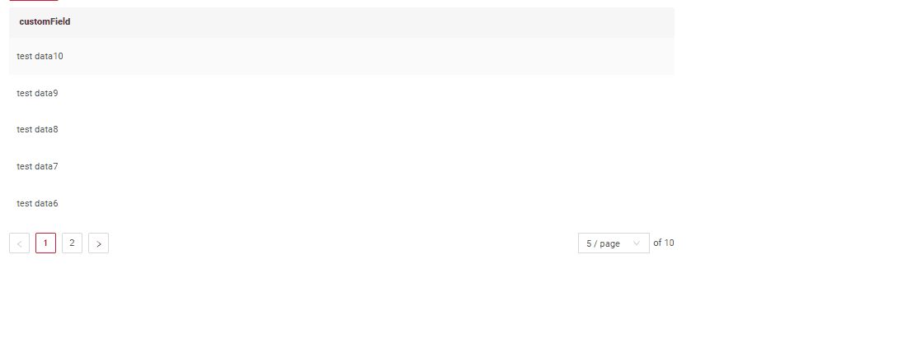
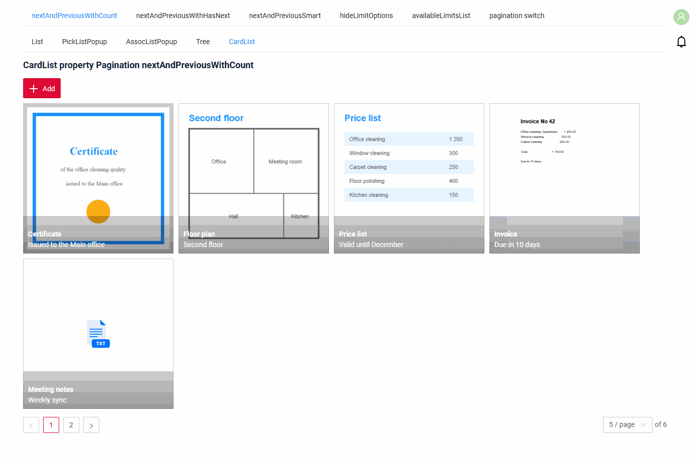
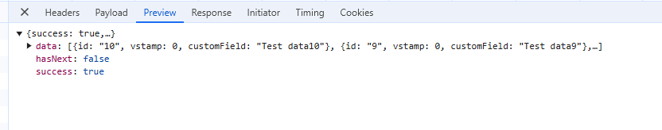
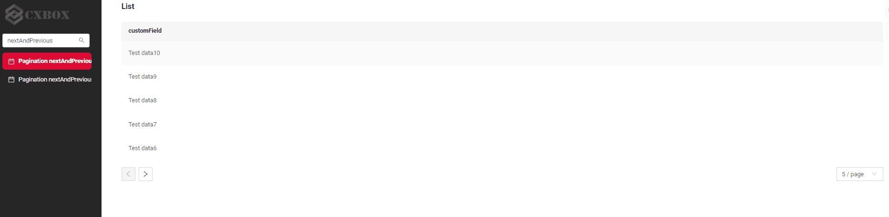
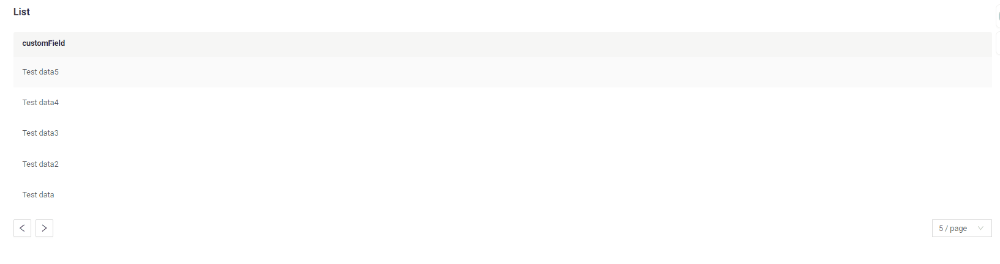
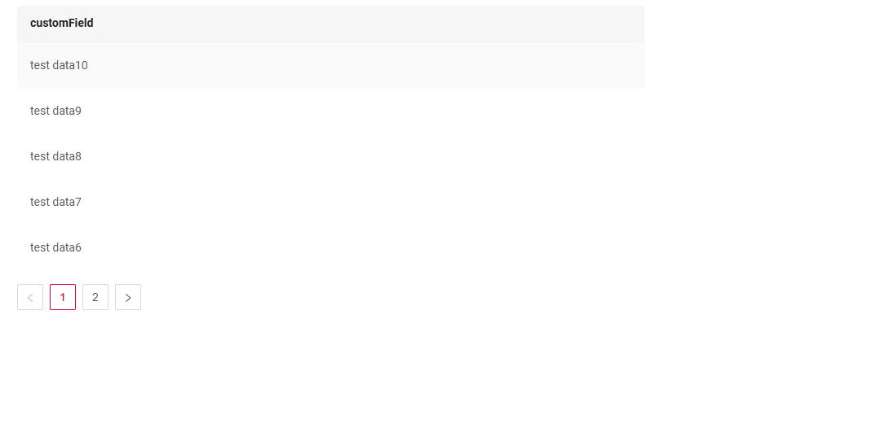
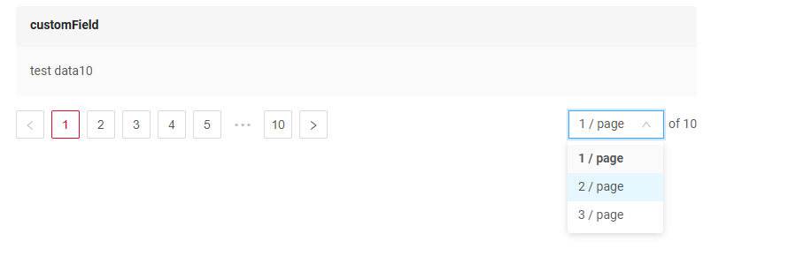
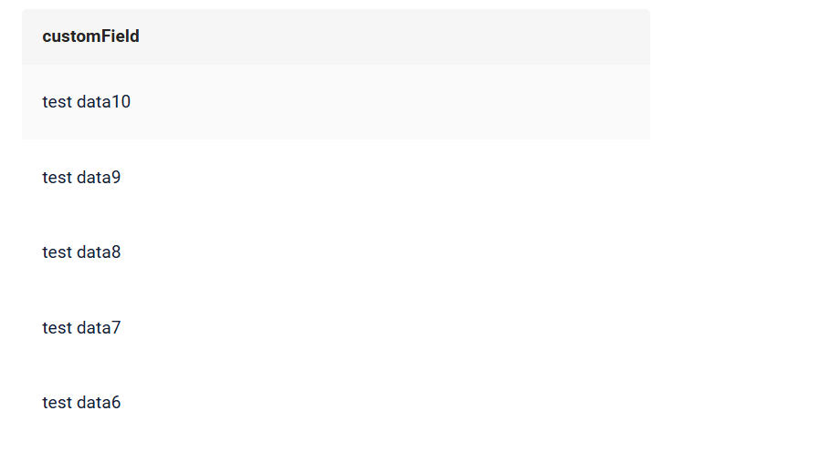
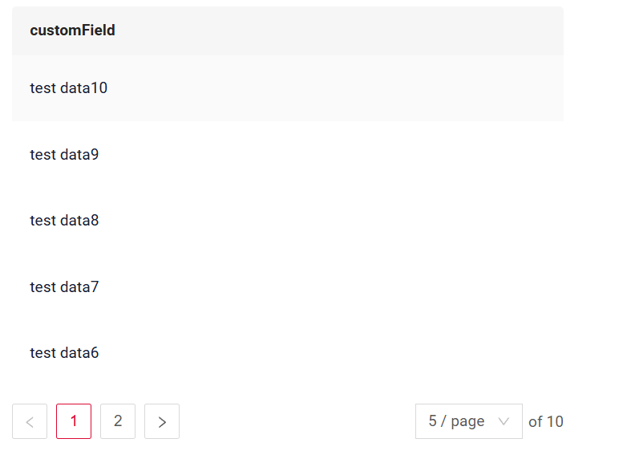

# Pagination

Pagination is the process of dividing content into separate, discrete pages, making it easier to navigate and consume large amounts of information.

The navigation arrows and limit settings block are removed if the number of records is less than the limit.

**This feature is available and recommended for use**:

* [List widget](/widget/type/list/list)
* [AssocListPopup widget](/widget/type/assoclistpopup/assoclistpopup)
* [PickListPopup widget](/widget/type/picklistpopup/picklistpopup)
* [Tree widget](/widget/type/tree/tree)
* [AssocTreePopup widget](/widget/type/assoctreepopup/assoctreepopup)
* [PickTreePopup widget](/widget/type/picktreepopup/picktreepopup)
* [CardList widget](/widget/type/cardlist/cardlist)

##**Pagination modes**:

* Default (nextAndPreviousWithCount)
* nextAndPreviousWithHasNext
* nextAndPreviousSmart

**By default**, all widget types use the following navigation mode: `nextAndPreviousSmart`

However, for certain `exception widgets,` the default navigation mode is: `nextAndPreviousWithCount`

`Exception Type Widgets`: 

* [List widget](/widget/type/list/list)
* [AssocListPopup widget](/widget/type/assoclistpopup/assoclistpopup)
* [PickListPopup widget](/widget/type/picklistpopup/picklistpopup)
* [GroupingHierarchy widget](/widget/type/groupinghierarchy/groupinghierarchy) 
* [CardList widget](/widget/type/cardlist/cardlist)
* DashboardList
* Pie1D
* [Column2D widget](/widget/type/column2d/column2d)
* Line2D
* DualAxes2D

The /count request is executed only if there is at least one widget with the `nextAndPreviousWithCount` mode on the view.
If such a widget is present (as specified in the view’s metadata), the /count request will be triggered.
 
| API Calls (Frontend to Backend) | nextAndPreviousWithCount  | nextAndPreviousWithHasNext | nextAndPreviousSmart |
|---------------------------------|---------------------------|----------------------------|----------------------|
| /meta                           | +                         | +                          | +                    |
| /count                          | +                         | -                          | -                    | 
| /data                           | +                         | +                          | +                    | 


!!! info
    Pagination won't function until the page is refreshed after adding records.

**Use Cases** :

* **`nextAndPreviousWithCount`**: Ideal for backends that leverage database sources.
* **`nextAndPreviousWithHasNext`**: Designed for microservice-based backends where the presence of the next page can be determined, allowing the `hasNext` flag to be populated.
* **`nextAndPreviousSmart`**: Suitable for microservice-based backends where it is not possible to determine if there is a next page, and the `hasNext` flag cannot be populated.  

### <a id="nextAndPreviousWithCount">Pagination with Total Count (default)</a>
[:material-play-circle: Live Sample]({{ external_links.code_samples }}/ui/#/screen/myexample3861/view/myexample3862list){:target="_blank"} ·
[:fontawesome-brands-github: GitHub]({{ external_links.github_ui }}/{{ external_links.github_branch }}/src/main/java/org/demo/documentation/widgets/property/pagination/nextandpreviouswithcount){:target="_blank"}
 
Frontend Behavior:

* All three responses are utilized, including the `/count` result.
* This mode is best suited for backends that rely on database sources.

#### How does it look?
=== "List"
    
=== "CardList"
    

#### How to add?
??? Example
    Option 1. By default 

    Option 2. Add in **options** parameter **pagination** to corresponding **.widget.json**.

    ```
      "pagination": {
      "type": "nextAndPreviousWithCount"
      }
    ```
    === "List"
        ```json
        --8<--
        {{ external_links.github_raw_doc }}/widgets/property/pagination/nextandpreviouswithcount/myexample3862list.widget.json
        --8<--
        ```

        [:material-play-circle: Live Sample]({{ external_links.code_samples }}/ui/#/screen/myexample3861/view/myexample3862list){:target="_blank"} ·
        [:fontawesome-brands-github: GitHub]({{ external_links.github_ui }}/{{ external_links.github_branch }}/src/main/java/org/demo/documentation/widgets/property/pagination/nextandpreviouswithcount){:target="_blank"}

    === "CardList"
        ```json
        --8<--
        {{ external_links.github_raw_doc }}/widgets/property/pagination/nextandpreviouswithcount/forcardlist/myexample3862cardlist.widget.json
        --8<--
        ```

        [:material-play-circle: Live Sample]({{ external_links.code_samples }}/ui/#/screen/myexample3861/view/myexample3862cardlist){:target="_blank"} ·
        [:fontawesome-brands-github: GitHub]({{ external_links.github_ui }}/{{ external_links.github_branch }}/src/main/java/org/demo/documentation/widgets/property/pagination/nextandpreviouswithcount/forcardlist){:target="_blank"}


### <a id="nextAndPreviousWithHasNext">Pagination is based `/data` and hasNext</a>
[:material-play-circle: Live Sample]({{ external_links.code_samples }}/ui/#/screen/myexample3861/view/myexample3860list){:target="_blank"} ·
[:fontawesome-brands-github: GitHub]({{ external_links.github_ui }}/{{ external_links.github_branch }}/src/main/java/org/demo/documentation/widgets/property/pagination/nextandpreviouswihhasnext){:target="_blank"}

Frontend Behavior:

* The `/count` endpoint is called, but its result is not used.
* Instead, pagination is based `/data` that indicates whether there is a next or previous page (hasNext/hasPrevious).



Next button availability logic:

* If hasNext (from /data) is true, Next button is available.
* If hasNext (from /data) is false, Next button is disabled.

#### How does it look?


#### How to add?
??? Example

    Add in **options** parameter **pagination** to corresponding **.widget.json**.

    ```
      "pagination": {
      "type": "nextAndPreviousWithHasNext"
      }
    ```
   
    ```json
    --8<--
    {{ external_links.github_raw_doc }}/widgets/property/pagination/nextandpreviouswihhasnext/myexample3860list.widget.json
    --8<--
    ```
    !!! info
          To deactivate the functionality `hasNext=true`add in application.yml `cxbox.api.any-source-has-next-enabled = false`


    [:material-play-circle: Live Sample]({{ external_links.code_samples }}/ui/#/screen/myexample3861/view/myexample3860list){:target="_blank"} ·
    [:fontawesome-brands-github: GitHub]({{ external_links.github_ui }}/{{ external_links.github_branch }}/src/main/java/org/demo/documentation/widgets/property/pagination/nextandpreviouswihhasnext){:target="_blank"}


### <a id="nextAndPreviousSmart">Pagination is based `/data` and _limit</a>
[:material-play-circle: Live Sample]({{ external_links.code_samples }}/ui/#/screen/myexample3861/view/myexample3861list){:target="_blank"} ·
[:fontawesome-brands-github: GitHub]({{ external_links.github_ui }}/{{ external_links.github_branch }}/src/main/java/org/demo/documentation/widgets/property/pagination/nextandprevioussmart){:target="_blank"}

Frontend Behavior:

* The `/count` endpoint is called, but its result is not used. 

Next button availability logic:
If the number of records received from `/data` is less than _limit, Next button is disabled.

Disadvantages of this mode:

* If the number of records is a multiple of _limit, a single jump to a page with no records will occur, since it is impossible to determine whether this is the last page.
* If the number of records is a multiple of _limit, a request for the next page will be sent even if it does not exist. If this request returns an error, it should be handled with a try {} catch {} block.
  (For instance, when retrieving data for the next page from a microservice.)

#### How does it look?


#### How to add?
??? Example

    Add in **options** parameter **pagination** to corresponding **.widget.json**.
    ```
    "pagination": {
    "type": "nextAndPreviousSmart"
    }
    ```
    ```json
      --8<--
        {{ external_links.github_raw_doc }}/widgets/property/pagination/nextandprevioussmart/myexample3861list.widget.json
      --8<--
    ```
    [:material-play-circle: Live Sample]({{ external_links.code_samples }}/ui/#/screen/myexample3861/view/myexample3861list){:target="_blank"} ·
    [:fontawesome-brands-github: GitHub]({{ external_links.github_ui }}/{{ external_links.github_branch }}/src/main/java/org/demo/documentation/widgets/property/pagination/nextandprevioussmart){:target="_blank"}

## Controls the visibility of the records-per-page  

[:material-play-circle: Live Sample]({{ external_links.code_samples }}/ui/#/screen/myexample3861/view/myexample3865list){:target="_blank"} ·
[:fontawesome-brands-github: GitHub]({{ external_links.github_ui }}/{{ external_links.github_branch }}/src/main/java/org/demo/documentation/widgets/property/pagination/hidelimitoptions){:target="_blank"}

Controls the visibility of the records-per-page selection option.

This function is available:

* [List widget](/widget/type/list/list)
* [AssocListPopup widget](/widget/type/assoclistpopup/assoclistpopup)
* [PickListPopup widget](/widget/type/picklistpopup/picklistpopup)
* [Tree widget](/widget/type/tree/tree)
* [AssocTreePopup widget](/widget/type/assoctreepopup/assoctreepopup)
* [PickTreePopup widget](/widget/type/picktreepopup/picktreepopup)

**Values:**

* `true` – Hides the records-per-page selection option.
* `false` (default if not specified) – Shows the records-per-page selection option.

### How does it look?

### How to add?
??? Example

    Add in **options** parameter **pagination** to corresponding **.widget.json**.
    ```
    "pagination": {
      "hideLimitOptions" : true
    }
    ```

    ```json
      --8<--
        {{ external_links.github_raw_doc }}/widgets/property/pagination/hidelimitoptions/myexample3865list.widget.json
      --8<--
    ```
 
    [:material-play-circle: Live Sample]({{ external_links.code_samples }}/ui/#/screen/myexample3861/view/myexample3865list){:target="_blank"} ·
    [:fontawesome-brands-github: GitHub]({{ external_links.github_ui }}/{{ external_links.github_branch }}/src/main/java/org/demo/documentation/widgets/property/pagination/hidelimitoptions){:target="_blank"}


## Available Page Size Options

[:material-play-circle: Live Sample]({{ external_links.code_samples }}/ui/#/screen/myexample3861/view/myexample3867list){:target="_blank"} ·
[:fontawesome-brands-github: GitHub]({{ external_links.github_ui }}/{{ external_links.github_branch }}/src/main/java/org/demo/documentation/widgets/property/pagination/availablelimitselist){:target="_blank"}

Specifies the available options for the number of items displayed per page. Users will see these values in a dropdown.

This function is available:

* [List widget](/widget/type/list/list)
* [AssocListPopup widget](/widget/type/assoclistpopup/assoclistpopup)
* [PickListPopup widget](/widget/type/picklistpopup/picklistpopup)
* [Tree widget](/widget/type/tree/tree)
* [AssocTreePopup widget](/widget/type/assoctreepopup/assoctreepopup)
* [PickTreePopup widget](/widget/type/picktreepopup/picktreepopup)

**Values:**

An array of integers.


**Behavior:**

If not provided, the component use default values [5, 10,15, 20].

The user will only be able to select from the specified values and the default page limit (see below).

### <a id="limitrules">Available options and default page limit</a>

Two different settings are used for the number of records per page:

* `availableLimitsList` in **.widget.json** (`options` -> `pagination` -> `availableLimitsList`) – the options the user can **choose** in the dropdown.
* `PAGE_LIMIT` of the business component in **BC_PROPERTIES.csv** – the **default** page limit: the number of records the user sees when the page is opened. See [Default page limit](/widget/type/property/defaultlimitpage/defaultlimitpage).

`availableLimitsList` does not set the default page limit: the first (or any other) value of the list is not used when the page is opened.

If `PAGE_LIMIT` is not set for the business component, the default page limit is taken from `cxbox.meta.bc-default-page-limit` in **application.yml** (5 if not specified).

The dropdown always contains the default page limit: if it is not in `availableLimitsList`, it is added to the options. The options are sorted in ascending order.

| `availableLimitsList`          | `PAGE_LIMIT` (BC_PROPERTIES.csv) | Records per page when the page is opened                 | Options in the dropdown |
|--------------------------------|----------------------------------|----------------------------------------------------------|-------------------------|
| `[10, 25, 50]`                 | `25` (in the list)               | 25                                                       | 10, 25, 50              |
| `[10, 25, 50]`                 | `7` (not in the list)            | 7                                                        | 7, 10, 25, 50           |
| `[10, 25, 50]`                 | not set                          | `bc-default-page-limit` (5 if not specified)             | 5, 10, 25, 50           |
| not set (`[5, 10, 15, 20]`)    | `12`                             | 12                                                       | 5, 10, 12, 15, 20       |
| not set (`[5, 10, 15, 20]`)    | not set                          | `bc-default-page-limit` (5 if not specified)             | 5, 10, 15, 20           |

!!! info
    The limit selected by the user is kept when the user switches to another screen and back, until the browser page is reloaded. After the reload, the default page limit (`PAGE_LIMIT`) is used again.

!!! tip
    To make the page open with a value from the dropdown, set `PAGE_LIMIT` to one of the values of `availableLimitsList`.

**Use Case:**

Restrict pagination options to specific values (e.g., 10, 25, 50, or 100 items per page).

### How does it look?


### How to add?
??? Example

    Add in **options** parameter **pagination** to corresponding **.widget.json**.
    ```
    "pagination": {
        "availableLimitsList": [ 1,2,3 ]
    }
    ```

    ```json
      --8<--
        {{ external_links.github_raw_doc }}/widgets/property/pagination/availablelimitselist/myexample3867list.widget.json
      --8<--
    ```
 
    [:material-play-circle: Live Sample]({{ external_links.code_samples }}/ui/#/screen/myexample3861/view/myexample3867list){:target="_blank"} ·
    [:fontawesome-brands-github: GitHub]({{ external_links.github_ui }}/{{ external_links.github_branch }}/src/main/java/org/demo/documentation/widgets/property/pagination/availablelimitselist){:target="_blank"}


## Pagination panel display 
Available since [v2.0.14](/new/version2014/)

[:material-play-circle: Live Sample]({{ external_links.code_samples }}/ui/#/screen/myexample3861/view/myexample3865listswitch){:target="_blank"} ·
[:fontawesome-brands-github: GitHub]({{ external_links.github_ui }}/{{ external_links.github_branch }}/src/main/java/org/demo/documentation/widgets/property/pagination/paginationswitch){:target="_blank"}

Pagination panel display  controlling the display of the pagination panel.

* the pagination panel and limit selector block **will not be displayed**, regardless of the number of records.
* the standard display logic applies, taking `defaultPageLimit` into account.

### How does it look?
=== "Pagination panel display  false"
    
=== "Pagination panel display  true"
    
 
### How to add?
??? Example

    Add in **options** parameter **enabled** to corresponding **.widget.json**.
    ```
    "pagination": {
        "enabled": false
    }
    ```
    ```json
      --8<--
        {{ external_links.github_raw_doc }}/widgets/property/pagination/paginationswitch/myexample3865paginationswitchfalselist.widget.json
      --8<--
    ```

    [:material-play-circle: Live Sample]({{ external_links.code_samples }}/ui/#/screen/myexample3861/view/myexample3865listswitch){:target="_blank"} ·
    [:fontawesome-brands-github: GitHub]({{ external_links.github_ui }}/{{ external_links.github_branch }}/src/main/java/org/demo/documentation/widgets/property/pagination/paginationswitch){:target="_blank"}
