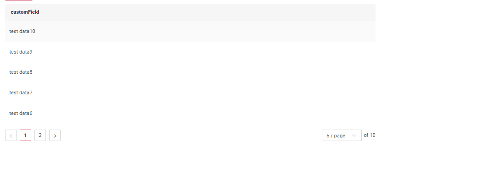
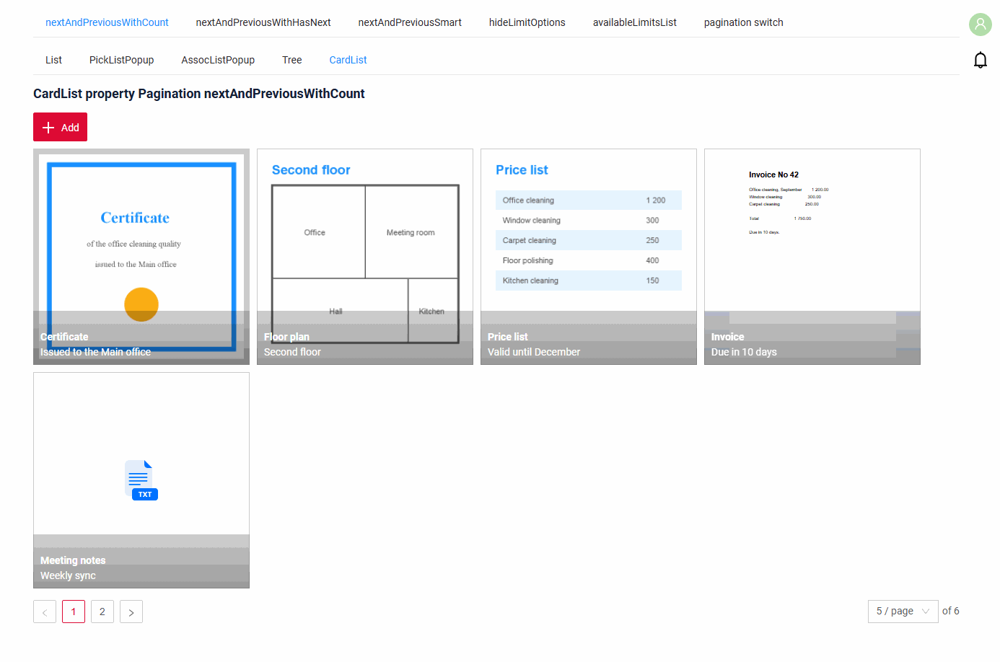
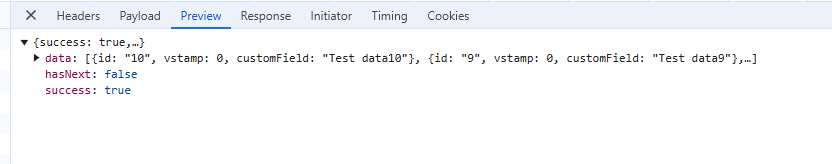
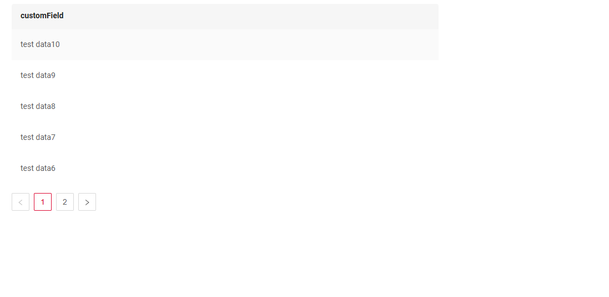
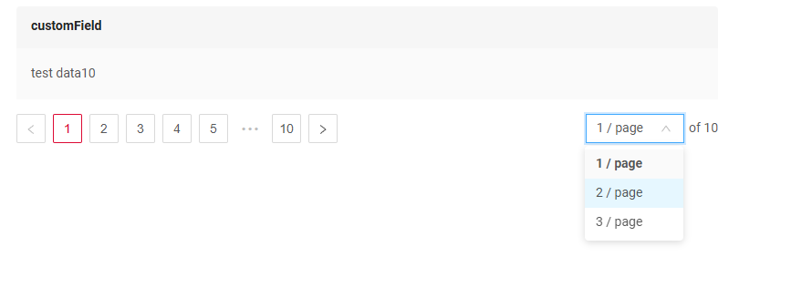
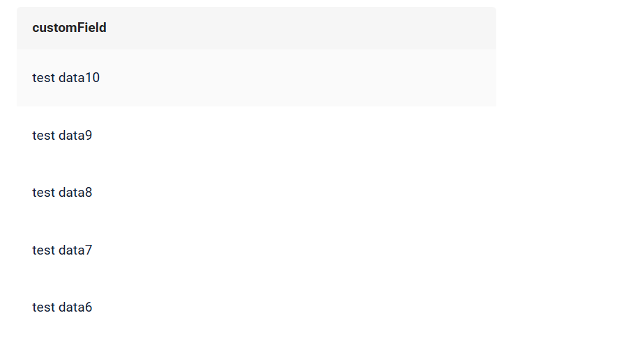
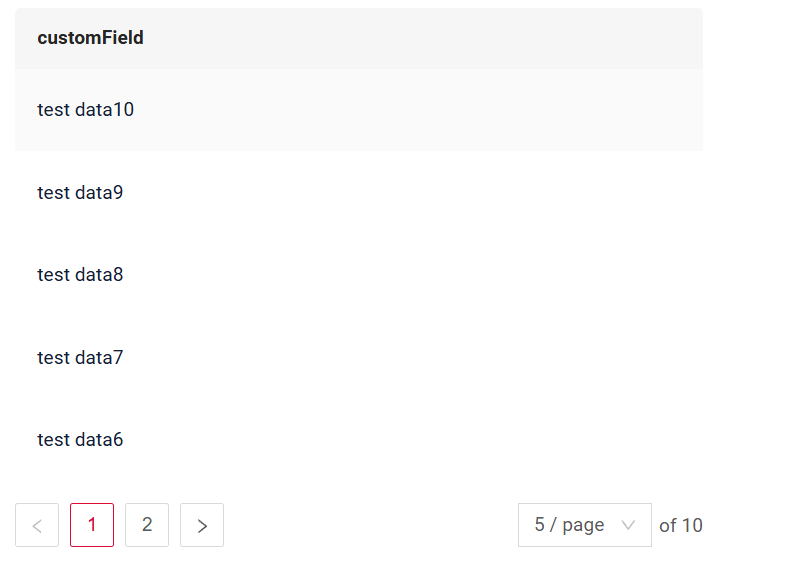

# Пагинация { #pagination }

Пагинация — разбиение содержимого на отдельные страницы, упрощающее навигацию и работу с большими объёмами информации.

Стрелки навигации и блок настройки лимита убираются, если количество записей меньше лимита.

**Эта возможность доступна и рекомендуется к использованию**:

* [Виджет List](/ru/widget/type/list/list)
* [Виджет AssocListPopup](/ru/widget/type/assoclistpopup/assoclistpopup)
* [Виджет PickListPopup](/ru/widget/type/picklistpopup/picklistpopup)
* [виджета Tree](/ru/widget/type/tree/tree)
* [виджета AssocTreePopup](/ru/widget/type/assoctreepopup/assoctreepopup)
* [виджета PickTreePopup](/ru/widget/type/picktreepopup/picktreepopup)
* [виджета CardList](/ru/widget/type/cardlist/cardlist)

## **Режимы пагинации**:

* По умолчанию (nextAndPreviousWithCount)
* nextAndPreviousWithHasNext
* nextAndPreviousSmart

**По умолчанию** все типы виджетов используют режим навигации `nextAndPreviousSmart`

Однако для некоторых `виджетов-исключений` режим навигации по умолчанию — `nextAndPreviousWithCount`

`Exception Type Widgets`: 

* [Виджет List](/ru/widget/type/list/list)
* [Виджет AssocListPopup](/ru/widget/type/assoclistpopup/assoclistpopup)
* [Виджет PickListPopup](/ru/widget/type/picklistpopup/picklistpopup)
* [Виджет GroupingHierarchy](/ru/widget/type/groupinghierarchy/groupinghierarchy)
* [виджета CardList](/ru/widget/type/cardlist/cardlist)
* DashboardList
* Pie1D
* [виджет Column2D](/ru/widget/type/column2d/column2d)
* Line2D
* DualAxes2D

Запрос /count выполняется, только если на view есть хотя бы один виджет с режимом `nextAndPreviousWithCount`.
Если такой виджет есть (согласно метаданным view), выполняется запрос /count.
 
| Вызовы API (фронтенд → бэкенд)  | nextAndPreviousWithCount  | nextAndPreviousWithHasNext | nextAndPreviousSmart |
|---------------------------------|---------------------------|----------------------------|----------------------|
| /meta                           | +                         | +                          | +                    |
| /count                          | +                         | -                          | -                    | 
| /data                           | +                         | +                          | +                    | 


!!! info
    Пагинация не сработает, пока страница не будет обновлена после добавления записей.

**Сценарии использования** :

* **`nextAndPreviousWithCount`**: идеально для бэкендов, работающих с базами данных.
* **`nextAndPreviousWithHasNext`**: для бэкендов на микросервисах, где можно определить наличие следующей страницы и заполнить флаг `hasNext`.
* **`nextAndPreviousSmart`**: для бэкендов на микросервисах, где невозможно определить наличие следующей страницы и нельзя заполнить флаг `hasNext`.

### <a id="nextAndPreviousWithCount">Пагинация с общим количеством (по умолчанию)</a>
[:material-play-circle: Живой пример]({{ external_links.code_samples }}/ui/#/screen/myexample3861/view/myexample3862list){:target="_blank"} ·
[:fontawesome-brands-github: GitHub]({{ external_links.github_ui }}/{{ external_links.github_branch }}/src/main/java/org/demo/documentation/widgets/property/pagination/nextandpreviouswithcount){:target="_blank"}
 
Поведение фронтенда:

* Используются все три ответа, включая результат `/count`.
* Этот режим лучше всего подходит для бэкендов, работающих с базами данных.

#### Как это выглядит? { #how-does-it-look }
=== "List"
    
=== "CardList"
    

#### Как добавить? { #how-to-add }
??? Example "Пример"
    Вариант 1. По умолчанию

    Вариант 2. Добавьте в **options** параметр **pagination** в соответствующий **.widget.json**.

    ```
      "pagination": {
      "type": "nextAndPreviousWithCount"
      }
    ```
    === "List"
        ```json
        --8<--
        {{ external_links.github_raw_doc }}/widgets/property/pagination/nextandpreviouswithcount/MyExample3862List.widget.json
        --8<--
        ```

        [:material-play-circle: Живой пример]({{ external_links.code_samples }}/ui/#/screen/myexample3861/view/myexample3862list){:target="_blank"} ·
        [:fontawesome-brands-github: GitHub]({{ external_links.github_ui }}/{{ external_links.github_branch }}/src/main/java/org/demo/documentation/widgets/property/pagination/nextandpreviouswithcount){:target="_blank"}

    === "CardList"
        ```json
        --8<--
        {{ external_links.github_raw_doc }}/widgets/property/pagination/nextandpreviouswithcount/forcardlist/MyExample3862CardList.widget.json
        --8<--
        ```

        [:material-play-circle: Живой пример]({{ external_links.code_samples }}/ui/#/screen/myexample3861/view/myexample3862cardlist){:target="_blank"} ·
        [:fontawesome-brands-github: GitHub]({{ external_links.github_ui }}/{{ external_links.github_branch }}/src/main/java/org/demo/documentation/widgets/property/pagination/nextandpreviouswithcount/forcardlist){:target="_blank"}


### <a id="nextAndPreviousWithHasNext">Пагинация на основе `/data` и hasNext</a>
[:material-play-circle: Живой пример]({{ external_links.code_samples }}/ui/#/screen/myexample3861/view/myexample3860list){:target="_blank"} ·
[:fontawesome-brands-github: GitHub]({{ external_links.github_ui }}/{{ external_links.github_branch }}/src/main/java/org/demo/documentation/widgets/property/pagination/nextandpreviouswihhasnext){:target="_blank"}

Поведение фронтенда:

* Эндпоинт `/count` вызывается, но его результат не используется.
* Вместо этого пагинация основана на `/data`, который указывает, есть ли следующая или предыдущая страница (hasNext/hasPrevious).



Логика доступности кнопки Next:

* Если hasNext (из /data) равен true, кнопка Next доступна.
* Если hasNext (из /data) равен false, кнопка Next неактивна.

#### Как это выглядит? { #how-does-it-look_1 }


#### Как добавить? { #how-to-add_1 }
??? Example "Пример"

    Добавьте в **options** параметр **pagination** в соответствующий **.widget.json**.

    ```
      "pagination": {
      "type": "nextAndPreviousWithHasNext"
      }
    ```
   
    ```json
    --8<--
    {{ external_links.github_raw_doc }}/widgets/property/pagination/nextandpreviouswihhasnext/MyExample3860List.widget.json
    --8<--
    ```
    !!! info
          Чтобы отключить функциональность `hasNext=true`, добавьте в application.yml `cxbox.api.any-source-has-next-enabled = false`


    [:material-play-circle: Живой пример]({{ external_links.code_samples }}/ui/#/screen/myexample3861/view/myexample3860list){:target="_blank"} ·
    [:fontawesome-brands-github: GitHub]({{ external_links.github_ui }}/{{ external_links.github_branch }}/src/main/java/org/demo/documentation/widgets/property/pagination/nextandpreviouswihhasnext){:target="_blank"}


### <a id="nextAndPreviousSmart">Пагинация на основе `/data` и _limit</a>
[:material-play-circle: Живой пример]({{ external_links.code_samples }}/ui/#/screen/myexample3861/view/myexample3861list){:target="_blank"} ·
[:fontawesome-brands-github: GitHub]({{ external_links.github_ui }}/{{ external_links.github_branch }}/src/main/java/org/demo/documentation/widgets/property/pagination/nextandprevioussmart){:target="_blank"}

Поведение фронтенда:

* Эндпоинт `/count` вызывается, но его результат не используется.

Логика доступности кнопки Next:
Если количество записей, полученных из `/data`, меньше _limit, кнопка Next неактивна.

Недостатки этого режима:

* Если количество записей кратно _limit, произойдёт один переход на страницу без записей, так как невозможно определить, последняя ли это страница.
* Если количество записей кратно _limit, запрос следующей страницы будет отправлен, даже если её не существует. Если этот запрос возвращает ошибку, её нужно обработать блоком try {} catch {}.
  (Например, при получении данных следующей страницы из микросервиса.)

#### Как это выглядит? { #how-does-it-look_2 }


#### Как добавить? { #how-to-add_2 }
??? Example "Пример"

    Добавьте в **options** параметр **pagination** в соответствующий **.widget.json**.
    ```
    "pagination": {
    "type": "nextAndPreviousSmart"
    }
    ```
    ```json
      --8<--
        {{ external_links.github_raw_doc }}/widgets/property/pagination/nextandprevioussmart/MyExample3861List.widget.json
      --8<--
    ```
    [:material-play-circle: Живой пример]({{ external_links.code_samples }}/ui/#/screen/myexample3861/view/myexample3861list){:target="_blank"} ·
    [:fontawesome-brands-github: GitHub]({{ external_links.github_ui }}/{{ external_links.github_branch }}/src/main/java/org/demo/documentation/widgets/property/pagination/nextandprevioussmart){:target="_blank"}

## Видимость выбора количества записей на странице { #controls-the-visibility-of-the-records-per-page }

[:material-play-circle: Живой пример]({{ external_links.code_samples }}/ui/#/screen/myexample3861/view/myexample3865list){:target="_blank"} ·
[:fontawesome-brands-github: GitHub]({{ external_links.github_ui }}/{{ external_links.github_branch }}/src/main/java/org/demo/documentation/widgets/property/pagination/hidelimitoptions){:target="_blank"}

Управляет видимостью выбора количества записей на странице.

Эта функция доступна:

* [Виджет List](/ru/widget/type/list/list)
* [Виджет AssocListPopup](/ru/widget/type/assoclistpopup/assoclistpopup)
* [Виджет PickListPopup](/ru/widget/type/picklistpopup/picklistpopup)
* [виджета Tree](/ru/widget/type/tree/tree)
* [виджета AssocTreePopup](/ru/widget/type/assoctreepopup/assoctreepopup)
* [виджета PickTreePopup](/ru/widget/type/picktreepopup/picktreepopup)

**Значения:**

* `true` — скрывает выбор количества записей на странице.
* `false` (по умолчанию, если не задано) — показывает выбор количества записей на странице.

### Как это выглядит? { #how-does-it-look_3 }

### Как добавить? { #how-to-add_3 }
??? Example "Пример"

    Добавьте в **options** параметр **pagination** в соответствующий **.widget.json**.
    ```
    "pagination": {
      "hideLimitOptions" : true
    }
    ```

    ```json
      --8<--
        {{ external_links.github_raw_doc }}/widgets/property/pagination/hidelimitoptions/MyExample3865List.widget.json
      --8<--
    ```
 
    [:material-play-circle: Живой пример]({{ external_links.code_samples }}/ui/#/screen/myexample3861/view/myexample3865list){:target="_blank"} ·
    [:fontawesome-brands-github: GitHub]({{ external_links.github_ui }}/{{ external_links.github_branch }}/src/main/java/org/demo/documentation/widgets/property/pagination/hidelimitoptions){:target="_blank"}


## Доступные варианты размера страницы { #available-page-size-options }

[:material-play-circle: Живой пример]({{ external_links.code_samples }}/ui/#/screen/myexample3861/view/myexample3867list){:target="_blank"} ·
[:fontawesome-brands-github: GitHub]({{ external_links.github_ui }}/{{ external_links.github_branch }}/src/main/java/org/demo/documentation/widgets/property/pagination/availablelimitselist){:target="_blank"}

Задаёт доступные варианты количества элементов на странице. Пользователь увидит эти значения в выпадающем списке.

Эта функция доступна:

* [Виджет List](/ru/widget/type/list/list)
* [Виджет AssocListPopup](/ru/widget/type/assoclistpopup/assoclistpopup)
* [Виджет PickListPopup](/ru/widget/type/picklistpopup/picklistpopup)
* [виджета Tree](/ru/widget/type/tree/tree)
* [виджета AssocTreePopup](/ru/widget/type/assoctreepopup/assoctreepopup)
* [виджета PickTreePopup](/ru/widget/type/picktreepopup/picktreepopup)

**Значения:**

Массив целых чисел.


**Поведение:**

Если не задано, компонент использует значения по умолчанию [5, 10, 15, 20].

Пользователь сможет выбирать только из указанных значений.

**Сценарий использования:**

Ограничение вариантов пагинации определёнными значениями (например, 10, 25, 50 или 100 элементов на странице).

### Как это выглядит? { #how-does-it-look_4 }


### Как добавить? { #how-to-add_4 }
??? Example "Пример"

    Добавьте в **options** параметр **pagination** в соответствующий **.widget.json**.
    ```
    "pagination": {
        "availableLimitsList": [ 1,2,3 ]
    }
    ```

    ```json
      --8<--
        {{ external_links.github_raw_doc }}/widgets/property/pagination/availablelimitselist/MyExample3867List.widget.json
      --8<--
    ```
 
    [:material-play-circle: Живой пример]({{ external_links.code_samples }}/ui/#/screen/myexample3861/view/myexample3867list){:target="_blank"} ·
    [:fontawesome-brands-github: GitHub]({{ external_links.github_ui }}/{{ external_links.github_branch }}/src/main/java/org/demo/documentation/widgets/property/pagination/availablelimitselist){:target="_blank"}


## Отображение панели пагинации { #pagination-panel-display }
Доступно начиная с [v2.0.14](/ru/new/version2014/)

[:material-play-circle: Живой пример]({{ external_links.code_samples }}/ui/#/screen/myexample3861/view/myexample3865listswitch){:target="_blank"} ·
[:fontawesome-brands-github: GitHub]({{ external_links.github_ui }}/{{ external_links.github_branch }}/src/main/java/org/demo/documentation/widgets/property/pagination/paginationswitch){:target="_blank"}

Параметр отображения панели пагинации управляет отображением панели пагинации.

* панель пагинации и блок выбора лимита **не отображаются** независимо от количества записей.
* применяется стандартная логика отображения с учётом `defaultPageLimit`.

### Как это выглядит? { #how-does-it-look_5 }
=== "Отображение панели пагинации: false"
    
=== "Отображение панели пагинации: true"
    
 
### Как добавить? { #how-to-add_5 }
??? Example "Пример"

    Добавьте в **options** параметр **enabled** в соответствующий **.widget.json**.
    ```
    "pagination": {
        "enabled": false
    }
    ```
    ```json
      --8<--
        {{ external_links.github_raw_doc }}/widgets/property/pagination/paginationswitch/MyExample3865PaginationSwitchFalseList.widget.json
      --8<--
    ```

    [:material-play-circle: Живой пример]({{ external_links.code_samples }}/ui/#/screen/myexample3861/view/myexample3865listswitch){:target="_blank"} ·
    [:fontawesome-brands-github: GitHub]({{ external_links.github_ui }}/{{ external_links.github_branch }}/src/main/java/org/demo/documentation/widgets/property/pagination/paginationswitch){:target="_blank"}
