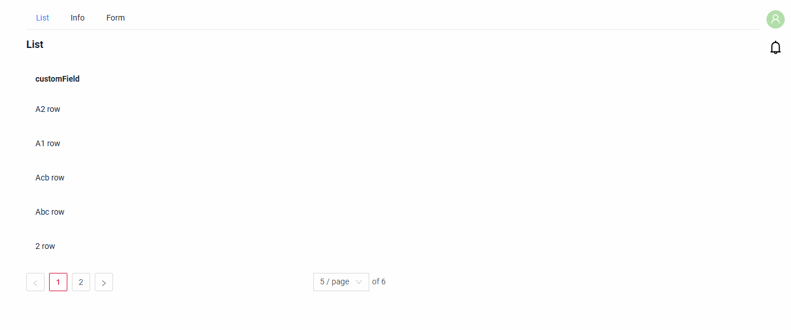
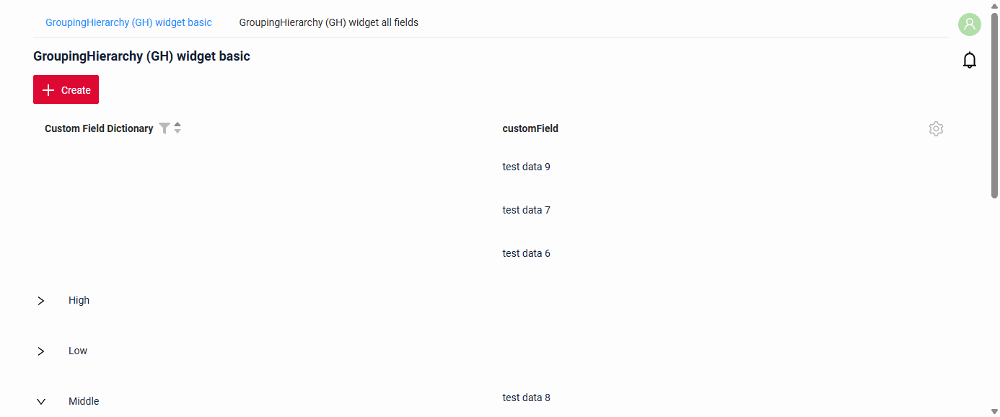
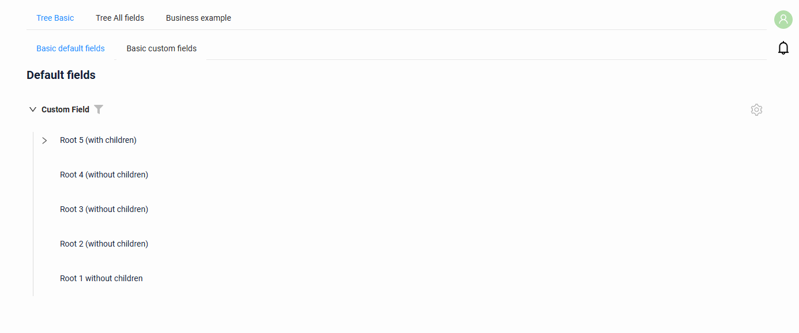
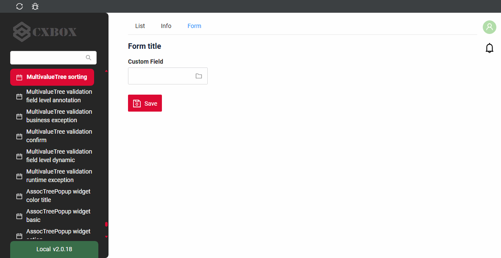
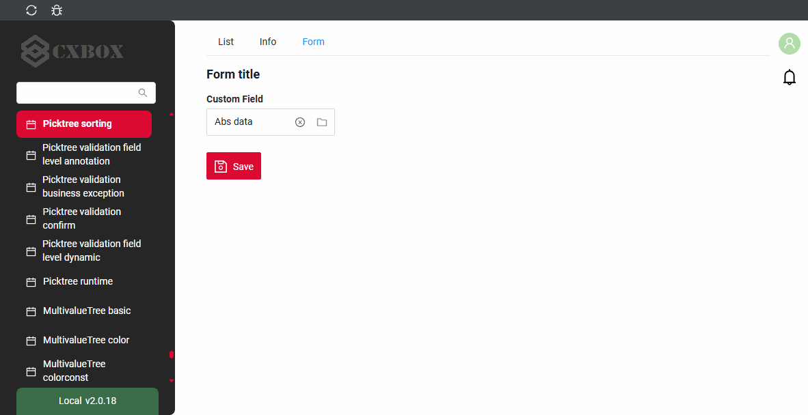
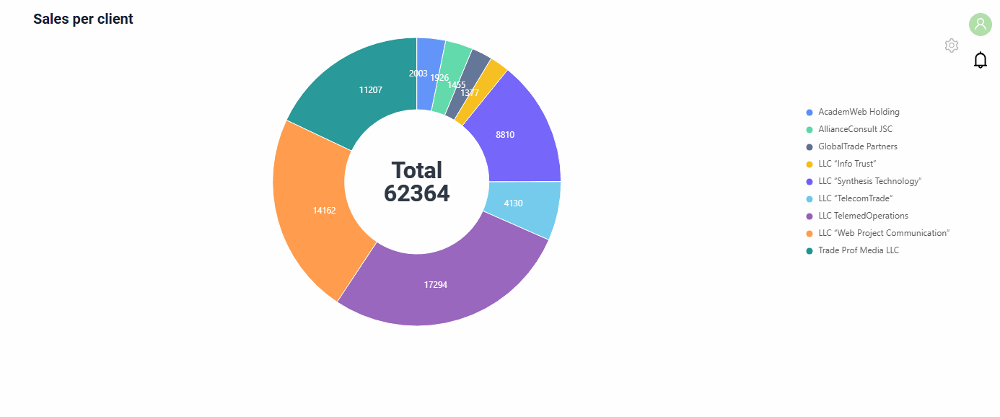
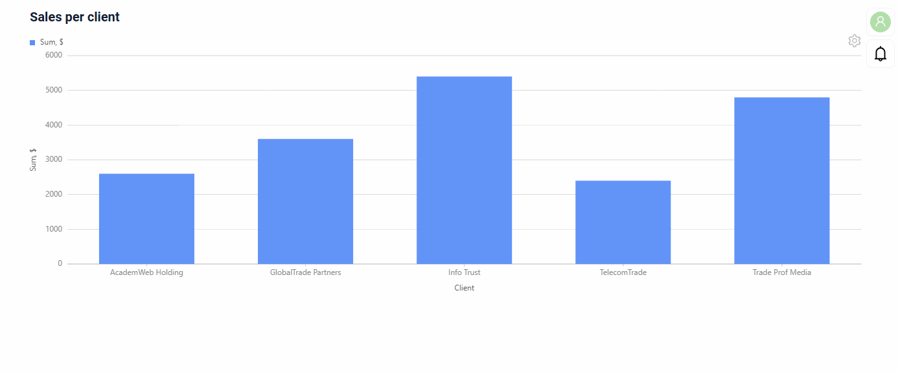

# Сортировка { #sorting }
`Sorting` позволяет сортировать данные по возрастанию или убыванию.

Эта функция доступна:

* для виджетов: [List](/ru/widget/type/list/list), [GroupingHierarchy](/ru/widget/type/groupinghierarchy/groupinghierarchy), [Tree](/ru/widget/type/tree/tree), [AssocTreePopup](/ru/widget/type/assoctreepopup/assoctreepopup), [PickTreePopup](/ru/widget/type/picktreepopup/picktreepopup), [Pie1D](/ru/widget/type/pie1d/pie1d), [Column2D](/ru/widget/type/column2d/column2d) (только в табличном режиме, см. [Диаграммы](#charts)).

* для полей: подробнее см. [типы полей](/ru/widget/fields/fieldtypes/)

!!! info
    Для древовидных виджетов сортировка работает **внутри узла**: записи сортируются среди дочерних элементов одного родителя, сама иерархия не меняется.
 
## Тип сортировки { #type-sorting }

`Sorting` можно включить двумя способами:

*  [На поле](#on_field) — сортировку нужно явно включить на уровне поля
* `Не рекомендуется.`  [На уровне приложения](#app-default-sort) — сортировка включена по умолчанию для всех полей приложения.

!!! info
    После добавления или обновления записей сортировка не сработает, пока страница не будет обновлена.

**Обратите внимание на поведение сортировки:**

* Если пользователь не задал сортировку, применяется сортировка по умолчанию, если она определена.
* Если пользователь применил сортировку, она сохраняется при переходах через drill-down или между экранами.

Как это выглядит?

=== "List"
    
=== "GroupingHierarchy"
    
=== "Tree"
    
=== "AssocTreePopup"
    
=== "PickTreePopup"
    
=== "Pie1D"
    
=== "Column2D"
    

### <a id="on_field">На поле</a>
[:material-play-circle: Живой пример]({{ external_links.code_samples }}/ui/#/screen/InputSort){:target="_blank"} ·
[:fontawesome-brands-github: GitHub]({{ external_links.github_ui }}/{{ external_links.github_branch }}/src/main/java/org/demo/documentation/fields/input/sorting){:target="_blank"}

#### Как добавить? { #how-to-add }
??? Example "Пример"

    **Шаг 1**  Добавьте `sort-enabled-default` = `false` в application.yml

    Если параметр не равен true, сортировку нужно явно включить на уровне поля.
    ```
        cxbox:
           widget:
               fields: 
                    sort-enabled-default: false
    ```

    **Шаг 2**  Добавьте **fields.enableSort** в соответствующий **FieldMetaBuilder**.
        ```java
        --8<--
        {{ external_links.github_raw_doc }}/fields/input/sorting/InputSortMeta.java:buildIndependentMeta
        --8<--
        ```

    Шаги одинаковы для всех виджетов.

    === "List"
        [:material-play-circle: Живой пример]({{ external_links.code_samples }}/ui/#/screen/InputSort){:target="_blank"} ·
        [:fontawesome-brands-github: GitHub]({{ external_links.github_ui }}/{{ external_links.github_branch }}/src/main/java/org/demo/documentation/fields/input/sorting){:target="_blank"}

    === "GroupingHierarchy"
        Сначала записи сортируются по колонкам группировки, затем по колонке, выбранной пользователем.

        [:material-play-circle: Живой пример]({{ external_links.code_samples }}/ui/#/screen/myexample3121/view/myexample3121gh){:target="_blank"} ·
        [:fontawesome-brands-github: GitHub]({{ external_links.github_ui }}/{{ external_links.github_branch }}/src/main/java/org/demo/documentation/widgets/groupinghierarhy/base){:target="_blank"}

    === "Tree"
        Записи сортируются внутри узла.

        [:material-play-circle: Живой пример]({{ external_links.code_samples }}/ui/#/screen/myexample3261/view/myexample3281tree){:target="_blank"} ·
        [:fontawesome-brands-github: GitHub]({{ external_links.github_ui }}/{{ external_links.github_branch }}/src/main/java/org/demo/documentation/widgets/tree/base/defaultfields){:target="_blank"}

    === "AssocTreePopup"
        Шаги выполняются для бизнес-компонента всплывающего окна. Записи сортируются внутри узла.

        [:material-play-circle: Живой пример]({{ external_links.code_samples }}/ui/#/screen/myexample3323/view/myexample3323form){:target="_blank"} ·
        [:fontawesome-brands-github: GitHub]({{ external_links.github_ui }}/{{ external_links.github_branch }}/src/main/java/org/demo/documentation/fields/multivaluetree/sorting){:target="_blank"}

    === "PickTreePopup"
        Шаги выполняются для бизнес-компонента всплывающего окна. Записи сортируются внутри узла.

        [:material-play-circle: Живой пример]({{ external_links.code_samples }}/ui/#/screen/myexample3290/view/myexample3290form){:target="_blank"} ·
        [:fontawesome-brands-github: GitHub]({{ external_links.github_ui }}/{{ external_links.github_branch }}/src/main/java/org/demo/documentation/fields/picktree/sorting){:target="_blank"}

    === "Pie1D"
        Работает только в [табличном режиме](/ru/widget/type/pie1d/pie1d/#tablemode) диаграммы, см. [Диаграммы](#charts).

    === "Column2D"
        Работает только в [табличном режиме](/ru/widget/type/column2d/column2d/#tablemode) диаграммы, см. [Диаграммы](#charts).

### <a id="app-default-sort">На уровне приложения</a>
`Not recommended.`

Если параметр равен true, сортировка включена по умолчанию для всех полей приложения.

#### Как добавить? { #how-to-add_1 }
 
??? Example "Пример"
    Добавьте `sort-enabled-default` в application.yml

      ```
        cxbox:
           widget:
               fields: 
                    sort-enabled-default: true
      ```


## <a id="default_sort">Сортировка по умолчанию</a>
Сортировка по умолчанию задаёт порядок записей при открытии виджета. Она задаётся для бизнес-компонента в таблице **BC_PROPERTIES**.
 
 
### Как добавить? { #how-to-add_2 }
??? Example "Пример"

     Добавьте бизнес-компонент в таблицу **BC_PROPERTIES**

      BC — имя бизнес-компонента
      PAGE_LIMIT — лимит страницы по умолчанию
      SORT — сортировка по умолчанию

      ```csv
      BC;PAGE_LIMIT;SORT;FILTER;ID
      dateSorting;1000;_sort.0.desc=customField;'""';
      ```

## <a id="charts">Диаграммы</a>
Диаграммы показывают сортировку только в табличном режиме. Когда данные диаграммы поступают из AnySource DAO, DAO сортирует записи сам.

### Как добавить? { #how-to-add_3 }
??? Example "Пример"
    === "Виджет Pie1D"
        Работает только в [табличном режиме](/ru/widget/type/pie1d/pie1d/#tablemode) диаграммы.
        После возврата в режим диаграммы записи отображаются в отсортированном порядке.

        **Шаг 1** Добавьте **fields.enableSort** в соответствующий **FieldMetaBuilder**.
        ```java
        --8<--
        {{ external_links.github_raw_doc }}/widgets/pie1d/sorting/MyExample4267Meta.java:buildIndependentMeta
        --8<--
        ```

        **Шаг 2** Отсортируйте записи в **getList** AnySource DAO.
        ```java
        --8<--
        {{ external_links.github_raw_doc }}/widgets/pie1d/sorting/MyExample4267Dao.java:getList
        --8<--
        ```

        [:material-play-circle: Живой пример]({{ external_links.code_samples }}/ui/#/screen/myexample4267){:target="_blank"} ·
        [:fontawesome-brands-github: GitHub]({{ external_links.github_ui }}/{{ external_links.github_branch }}/src/main/java/org/demo/documentation/widgets/pie1d/sorting){:target="_blank"}
    === "Виджет Column2D"
        Работает только в [табличном режиме](/ru/widget/type/column2d/column2d/#tablemode) диаграммы.
        После возврата в режим диаграммы записи отображаются в отсортированном порядке.

        **Шаг 1** Добавьте **fields.enableSort** в соответствующий **FieldMetaBuilder**.
        ```java
        --8<--
        {{ external_links.github_raw_doc }}/widgets/column2d/sorting/MyExample4271Meta.java:buildIndependentMeta
        --8<--
        ```

        **Шаг 2** Отсортируйте записи в **getList** AnySource DAO.
        ```java
        --8<--
        {{ external_links.github_raw_doc }}/widgets/column2d/sorting/MyExample4271Dao.java:getList
        --8<--
        ```

        [:material-play-circle: Живой пример]({{ external_links.code_samples }}/ui/#/screen/myexample4271){:target="_blank"} ·
        [:fontawesome-brands-github: GitHub]({{ external_links.github_ui }}/{{ external_links.github_branch }}/src/main/java/org/demo/documentation/widgets/column2d/sorting){:target="_blank"}
## <a id="charts">Диаграммы</a>
Диаграммы показывают сортировку только в табличном режиме. Когда данные диаграммы поступают из AnySource DAO, DAO сортирует записи сам.

### Как добавить? { #how-to-add_4 }
??? Example "Пример"
    === "Виджет Line2D"
        Работает только в [табличном режиме](/ru/widget/type/line2d/line2d/#tablemode) диаграммы.
        После возврата в режим диаграммы записи отображаются в отсортированном порядке.

        **Шаг 1** Добавьте **fields.enableSort** в соответствующий **FieldMetaBuilder**.
        ```java
        --8<--
        {{ external_links.github_raw_doc }}/widgets/line2d/sorting/MyExample4275Meta.java:buildIndependentMeta
        --8<--
        ```

        **Шаг 2** Отсортируйте записи в **getList** AnySource DAO.
        ```java
        --8<--
        {{ external_links.github_raw_doc }}/widgets/line2d/sorting/MyExample4275Dao.java:getList
        --8<--
        ```

        [:material-play-circle: Живой пример]({{ external_links.code_samples }}/ui/#/screen/myexample4275){:target="_blank"} ·
        [:fontawesome-brands-github: GitHub]({{ external_links.github_ui }}/{{ external_links.github_branch }}/src/main/java/org/demo/documentation/widgets/line2d/sorting){:target="_blank"}
