# RelationGraph

`RelationGraph` widget draws the records of a business component as a graph of relations: nodes connected by arrows (edges).
For example, a sales network: the main office, its branches and the clients of the branches. The user can switch the graph to a table.

## Basics
[:material-play-circle: Live Sample]({{ external_links.code_samples }}/ui/#/screen/myexample6151){:target="_blank"} ·
[:fontawesome-brands-github: GitHub]({{ external_links.github_ui }}/{{ external_links.github_branch }}/src/main/java/org/demo/documentation/widgets/relationGraph/base){:target="_blank"}

### How does it look?
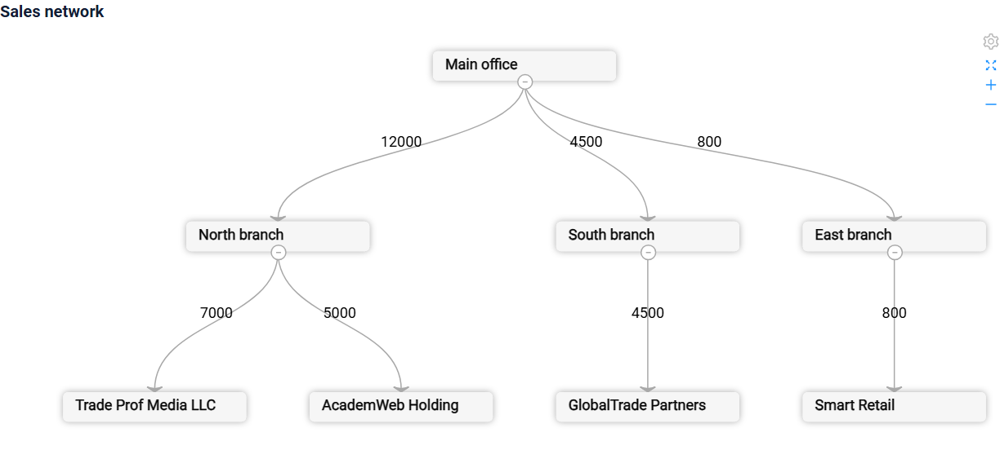

Every record of the business component is one **edge** "source node → target node":

* `sourceNodeId`: the id of the node the arrow starts from;
* `targetNodeId`: the id of the node the arrow points to.

A node is drawn from the records where it is the target: the title and the description of the node are taken from these records.
So the root node (a node without incoming edges) needs its own record with an empty `sourceNodeId`: this record declares the node and draws no edge.

The same pair "source → target" must not repeat, see [Incorrect data](#incorrectdata).

!!! warning
    Fill the field `targetNodeExpanded` with `true`: a node without it is drawn collapsed, and the graph shows only the root node.

The graph is drawn top-down by default. The user can move and zoom the graph with the mouse;
the toolbar in the corner has the buttons `Fullscreen`, `Zoom in`, `Zoom out`.
A node with children has a marker: a click on it collapses or expands the children.

Options of `options.relationGraph`:

| Option                       | Required | Description                                                                                                   |
|------------------------------|----------|---------------------------------------------------------------------------------------------------------------|
| `mode`                       | no       | Direction of the graph: `TB` (default, top-bottom), `BT`, `LR`, `RL`. See [Mode](#mode).                      |
| `dragNode`                   | no       | `true` allows the user to drag the nodes. See [Drag node](#dragnode).                                         |
| `nodes.fieldKeys`            | no       | Field keys of the source and the target node ids. Default `["sourceNodeId", "targetNodeId"]`. See [Field keys](#fieldkeys). |
| `nodes.descriptionFieldKeys` | no       | Field keys shown in the node: the first one is the title, the others are the lines under it. See [Nodes](#nodes). |
| `edges.labelFieldKeys`       | no       | Field keys shown at the edge, joined with a comma. See [Edges](#edges).                                       |
| `edges.type`                 | no       | Line of the edge: `polyline`, `line`, `arc`, `quadratic`. By default a curve. See [Edges](#edges).             |

Fields with fixed keys (they are not set in the options):

| Field                | Description                                                                                       |
|----------------------|---------------------------------------------------------------------------------------------------|
| `edgeValue`          | The color and the drilldown of the edges are taken from this field. See [Color](#color), [Drilldown](#drilldown). |
| `targetNodeType`     | `main` marks the main node. See [Main node and collapsed nodes](#expand).                         |
| `targetNodeExpanded` | `true` shows the children of the node. **Without `true` the node is collapsed**: fill it with `true` for every record. See [Main node and collapsed nodes](#expand). |

###  <a id="Howtoaddbacis">How to add?</a>
??? Example
    **Step1** Create **DataResponseDTO** with the fields of an edge: the source node id, the target node id, the fields of the target node and of the edge.
    ```java
    --8<--
    {{ external_links.github_raw_doc }}/widgets/relationGraph/base/MyExample6151DTO.java
    --8<--
    ```

    **Step2** Create **DAO** extends AbstractAnySourceBaseDAO<> implements AnySourceBaseDAO.
    The DAO returns one record per edge with a unique `id`, and one record without a source for the root node.
    In the sample the companies are stored with the id of the parent company, and an edge is "parent company → company".
    ```java
    --8<--
    {{ external_links.github_raw_doc }}/widgets/relationGraph/base/MyExample6151Dao.java:getEdges
    --8<--
    ```

    **Step3** Create **Meta** extends AnySourceFieldMetaBuilder.
    ```java
    --8<--
    {{ external_links.github_raw_doc }}/widgets/relationGraph/base/MyExample6151Meta.java
    --8<--
    ```

    **Step4** Create **Service** extends AnySourceVersionAwareResponseService.
    ```java
    --8<--
    {{ external_links.github_raw_doc }}/widgets/relationGraph/base/MyExample6151Service.java
    --8<--
    ```

    **Step5** Create file **_.widget.json_** with type = **"RelationGraph"**. Add the fields and **options.relationGraph**.
    ```json
    --8<--
    {{ external_links.github_raw_doc }}/widgets/relationGraph/base/myexample6151relationgraph.widget.json
    --8<--
    ```

    **Step6** Add widget to corresponding **_.view.json_**.
    ```json
    --8<--
    {{ external_links.github_raw_doc }}/widgets/relationGraph/base/myexample6151relationgraph.view.json
    --8<--
    ```

    **Step7** Set the page limit of the business component to the number of edges, for example 1000.
    The default limit is 5. When the business component has more records than the limit, the widget shows only the table.

    Add the business component to the **BC_PROPERTIES** table:
    ```csv
    BC;PAGE_LIMIT;MASS_PAGE_LIMIT;SORT;FILTER;ID
    myExampleBc6151;1000;NULL;NULL;'""';
    ```

## <a id="Title">Title</a>
[:material-play-circle: Live Sample]({{ external_links.code_samples }}/ui/#/screen/myexample6152){:target="_blank"} ·
[:fontawesome-brands-github: GitHub]({{ external_links.github_ui }}/{{ external_links.github_branch }}/src/main/java/org/demo/documentation/widgets/relationGraph/title){:target="_blank"}

### Title Basic
`Title` for widget (optional)

There are types of:

* `constant title`: shows constant text.
* `constant title empty`: if you want to visually connect widgets by them to be placed one under another

#### How does it look?
=== "Constant title"
    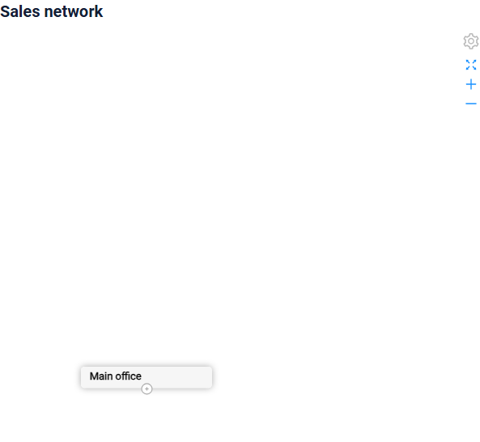
=== "Constant title empty"
    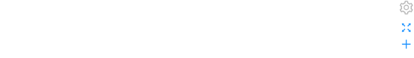

#### How to add?
??? Example
    === "Constant title"
        **Step1** Add name for **title** to **_.widget.json_**.
        ```json
        --8<--
        {{ external_links.github_raw_doc }}/widgets/relationGraph/title/myexample6152relationgraph.widget.json
        --8<--
        ```
    === "Constant title empty"
        **Step1** Add empty **title** to **_.widget.json_**.
        ```json
        --8<--
        {{ external_links.github_raw_doc }}/widgets/relationGraph/title/myexample6152relationgraphemptytitle.widget.json
        --8<--
        ```

### Title Color
_not applicable_

## <a id="bc">Business component</a>
This specifies the business component (BC) to which this widget belongs.
A business component represents a specific part of a system that handles a particular business logic or data.

In the samples the graph takes the data from an **AnySource** business component: the DAO builds the edges from the stored data.
A business component on an entity with the edge fields works too.

see more  [Business component](/environment/businesscomponent/businesscomponent/)

## <a id="Showcondition">Show condition</a>
[:material-play-circle: Live Sample]({{ external_links.code_samples }}/ui/#/screen/myexample6153){:target="_blank"} ·
[:fontawesome-brands-github: GitHub]({{ external_links.github_ui }}/{{ external_links.github_branch }}/src/main/java/org/demo/documentation/widgets/relationGraph/showcondition){:target="_blank"}

* `no show condition - recommended`: widget always visible
* `show condition by current entity`: the graph is shown when a field of the current record of another business component on the view has the given value

!!! tips
    It is recommended not to use `Show condition` when possible, because wide usage of this feature makes application hard to support.

#### <a id="howdoesitlook">How does it look?</a>
=== "no show condition"
    
=== "show condition by current entity"
    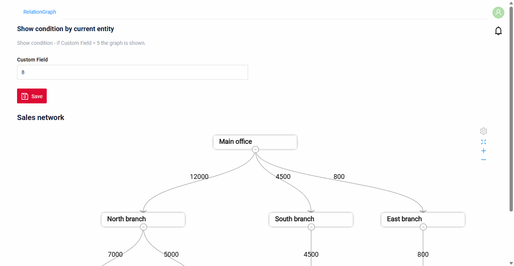

#### <a id="howtoadd">How to add?</a>
??? Example

    === "no show condition"
        see [Basic](#Howtoaddbacis)

    === "show condition by current entity"
        **Step1** Add **showCondition** to **_.widget.json_**. see more [showCondition](/widget/type/property/showcondition/showcondition)
        ```json
        --8<--
        {{ external_links.github_raw_doc }}/widgets/relationGraph/showcondition/myexample6153relationgraph.widget.json
        --8<--
        ```

## <a id="fields">Fields</a>
Fields Configuration. The graph uses the fields named in `options.relationGraph` and the fields with fixed keys (see [Basics](#basics));
all fields are shown in the [table mode](#tablemode).

```json
{
    "title": "Company id",
    "key": "targetNodeId",
    "type": "input"
}
```

* **"title"**

  Description: Field Title. Shown in the table mode.

  Type: String(optional).

* **"key"**

    Description: Name field to corresponding DataResponseDTO.

    Type: String(required).

* **"type"**

  Description: [Field types](/widget/fields/fieldtypes/)

  Type: String(required).

* **"width"**

  Description: For the target node field: the width of a node, px. Default 150. See [Nodes](#nodes).

  Type: Number(optional).

A field with type `hidden` is not shown in the table mode.

### How to add?
??? Example
    Add field to **_.widget.json_**.

      ```json
         --8<--
         {{ external_links.github_raw_doc }}/widgets/relationGraph/base/myexample6151relationgraph.widget.json
         --8<--
      ```

## <a id="Fieldslayout">Options layout</a>
**options.layout** - no use in this type.

## Actions
_not applicable_

### Additional properties

#### <a id="mode">Mode</a>
[:material-play-circle: Live Sample]({{ external_links.code_samples }}/ui/#/screen/myexample6154){:target="_blank"} ·
[:fontawesome-brands-github: GitHub]({{ external_links.github_ui }}/{{ external_links.github_branch }}/src/main/java/org/demo/documentation/widgets/relationGraph/mode){:target="_blank"}

`mode` sets the direction of the graph:

* `TB` (default): from top to bottom;
* `BT`: from bottom to top;
* `LR`: from left to right;
* `RL`: from right to left.

###### How does it look?
=== "TB"
    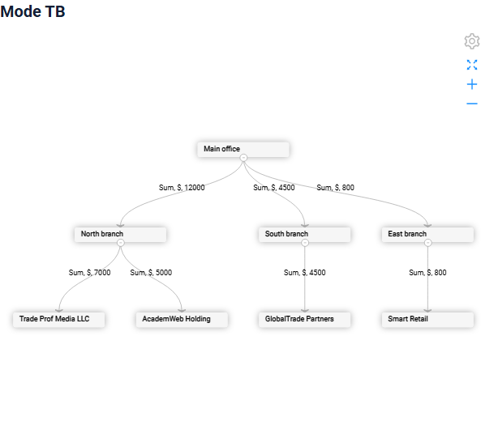
=== "BT"
    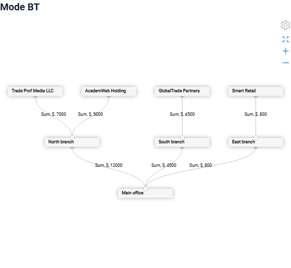
=== "LR"
    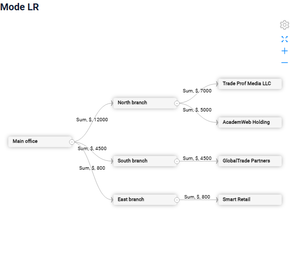
=== "RL"
    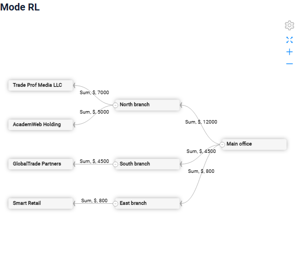

###### How to add?
??? Example
    **Step1** Add **mode** to **options.relationGraph** in **_.widget.json_**.
    ```json
    --8<--
    {{ external_links.github_raw_doc }}/widgets/relationGraph/mode/myexample6154relationgraphlr.widget.json
    --8<--
    ```

#### <a id="nodes">Nodes</a>
[:material-play-circle: Live Sample]({{ external_links.code_samples }}/ui/#/screen/myexample6155){:target="_blank"} ·
[:fontawesome-brands-github: GitHub]({{ external_links.github_ui }}/{{ external_links.github_branch }}/src/main/java/org/demo/documentation/widgets/relationGraph/nodes){:target="_blank"}

`nodes.descriptionFieldKeys` sets the text of a node:

* the first field is the title of the node;
* the other fields are the lines under the title. A long value is wrapped by the width of the node, up to 3 lines.

Without `descriptionFieldKeys` the title is the id of the node. The tooltip of a node shows its title.

`width` of the target node field sets the width of the nodes, px (default 150).

###### How does it look?
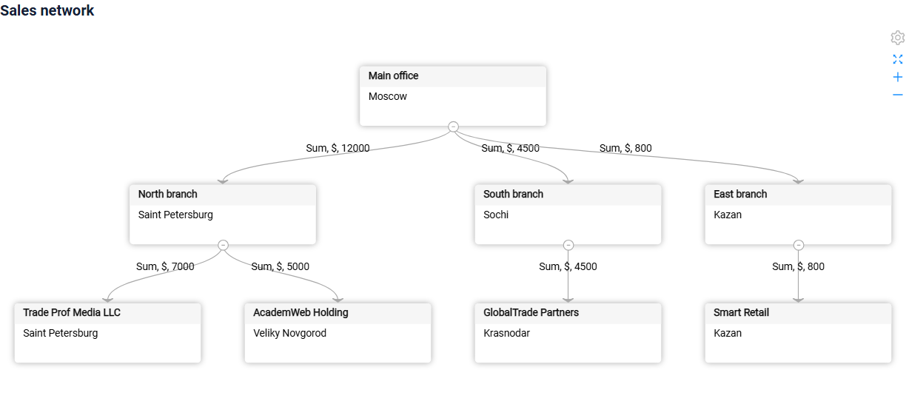

###### How to add?
??? Example
    **Step1** Fill the fields of the node in the DAO.
    ```java
    --8<--
    {{ external_links.github_raw_doc }}/widgets/relationGraph/nodes/MyExample6155Dao.java:getEdges
    --8<--
    ```
    **Step2** Add **nodes.descriptionFieldKeys** to **options.relationGraph** and **width** to the target node field in **_.widget.json_**.
    ```json
    --8<--
    {{ external_links.github_raw_doc }}/widgets/relationGraph/nodes/myexample6155relationgraph.widget.json
    --8<--
    ```

#### <a id="edges">Edges</a>
[:material-play-circle: Live Sample]({{ external_links.code_samples }}/ui/#/screen/myexample6156){:target="_blank"} ·
[:fontawesome-brands-github: GitHub]({{ external_links.github_ui }}/{{ external_links.github_branch }}/src/main/java/org/demo/documentation/widgets/relationGraph/edges){:target="_blank"}

`edges.labelFieldKeys` sets the label of an edge: the values of the listed fields of the record, joined with a comma. Empty values are skipped.

`edges.type` sets the line of the edges: `polyline`, `line`, `arc`, `quadratic`. By default the edges are curves.

###### How does it look?
=== "polyline"
    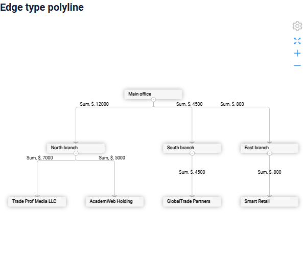
=== "line"
    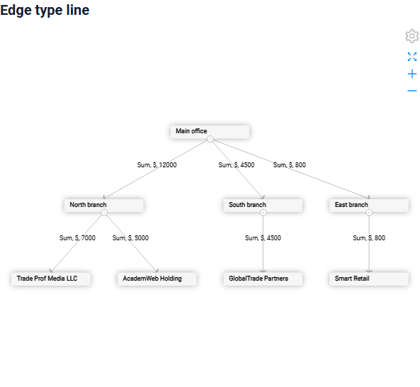
=== "arc"
    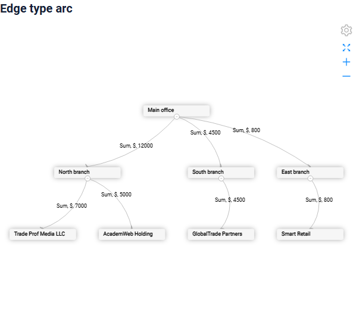
=== "quadratic"
    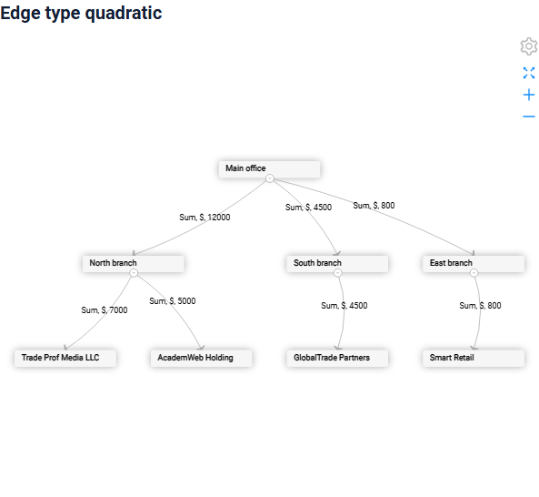

###### How to add?
??? Example
    **Step1** Add **edges.labelFieldKeys** and **edges.type** to **options.relationGraph** in **_.widget.json_**.
    ```json
    --8<--
    {{ external_links.github_raw_doc }}/widgets/relationGraph/edges/myexample6156relationgraphpolyline.widget.json
    --8<--
    ```

#### <a id="color">Color</a>
[:material-play-circle: Live Sample]({{ external_links.code_samples }}/ui/#/screen/myexample6157){:target="_blank"} ·
[:fontawesome-brands-github: GitHub]({{ external_links.github_ui }}/{{ external_links.github_branch }}/src/main/java/org/demo/documentation/widgets/relationGraph/color){:target="_blank"}

* The color of a node (the stripe at the left side of the node) is set on the target node field.
* The color of an edge (the line and the arrow) is set on the field `edgeValue`.

There are types of:

* `bgColorKey`: the key of the field with the color of the record. In the sample the companies with a sum over 5000 are red.
* `bgColor`: one constant color.

###### How does it look?
=== "Color from a field"
    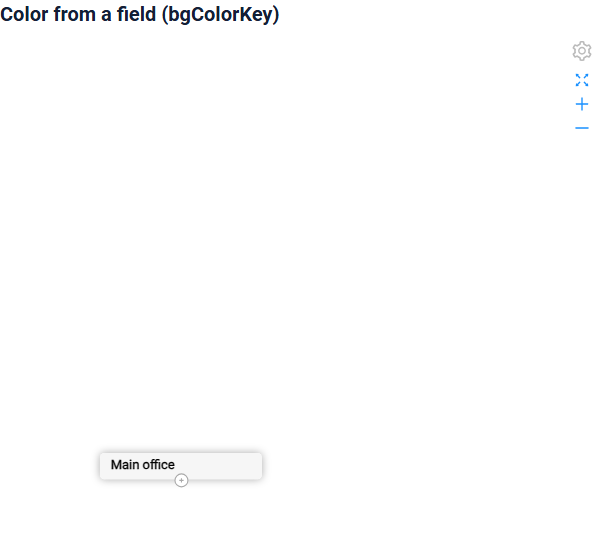
=== "Constant color"
    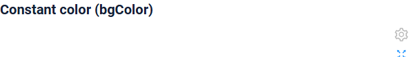

###### How to add?
??? Example
    === "Color from a field"
        **Step1** Add the color fields to **DataResponseDTO** and fill them in the DAO.
        ```java
        --8<--
        {{ external_links.github_raw_doc }}/widgets/relationGraph/color/MyExample6157Dao.java:getEdges
        --8<--
        ```
        **Step2** Add **bgColorKey** to the target node field and to the field `edgeValue` in **_.widget.json_**.
        ```json
        --8<--
        {{ external_links.github_raw_doc }}/widgets/relationGraph/color/myexample6157relationgraph.widget.json
        --8<--
        ```
    === "Constant color"
        **Step1** Add **bgColor** to the target node field and to the field `edgeValue` in **_.widget.json_**.
        ```json
        --8<--
        {{ external_links.github_raw_doc }}/widgets/relationGraph/color/myexample6157relationgraphcolor.widget.json
        --8<--
        ```

#### <a id="drilldown">Drilldown</a>
[:material-play-circle: Live Sample]({{ external_links.code_samples }}/ui/#/screen/myexample6158){:target="_blank"} ·
[:fontawesome-brands-github: GitHub]({{ external_links.github_ui }}/{{ external_links.github_branch }}/src/main/java/org/demo/documentation/widgets/relationGraph/drilldown){:target="_blank"}

* A click on a node opens the drilldown of the target node field of its incoming edge. The root node has no incoming edge and no drilldown.
* A click on an edge opens the drilldown of the field `edgeValue`. Edges with a drilldown are blue.

The drilldown is set by `drillDown: true` in the widget and the target view in the Meta of the record.

###### How does it look?
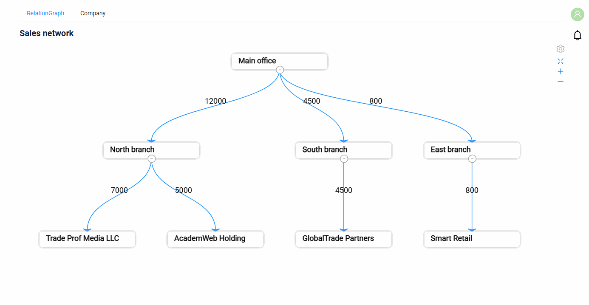

###### How to add?
??? Example
    **Step1** Add **drillDown** to the target node field and to the field `edgeValue` in **_.widget.json_**.
    ```json
    --8<--
    {{ external_links.github_raw_doc }}/widgets/relationGraph/drilldown/myexample6158relationgraph.widget.json
    --8<--
    ```
    **Step2** Set the target view in **buildRowDependentMeta** of the **Meta**.
    ```java
    --8<--
    {{ external_links.github_raw_doc }}/widgets/relationGraph/drilldown/MyExample6158Meta.java:buildRowDependentMeta
    --8<--
    ```

    see more [DrillDown](/advancedCustomization/element/drillDown/drillDown)

#### <a id="expand">Main node and collapsed nodes</a>
[:material-play-circle: Live Sample]({{ external_links.code_samples }}/ui/#/screen/myexample6159){:target="_blank"} ·
[:fontawesome-brands-github: GitHub]({{ external_links.github_ui }}/{{ external_links.github_branch }}/src/main/java/org/demo/documentation/widgets/relationGraph/expand){:target="_blank"}

The fields with fixed keys change the state of a node:

* `targetNodeType` = `main`: the node is the main one. Its title has a darker background, and the graph is moved to this node after it is drawn.
* `targetNodeExpanded` = `false` (or empty): the children of the node are collapsed when the graph is drawn. A click on the marker of the node expands them.
  The other nodes need `targetNodeExpanded` = `true`, see the [base sample](#Howtoaddbacis).

The values must be the same in all the records of the node (where it is the target).

###### How does it look?
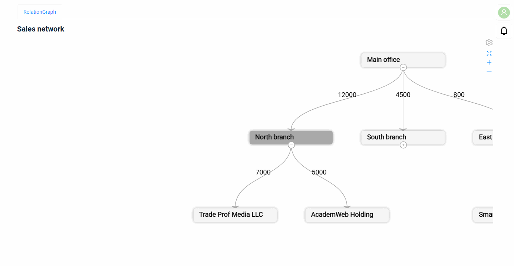

###### How to add?
??? Example
    **Step1** Add the fields **targetNodeType** and **targetNodeExpanded** to **DataResponseDTO** and fill them in the DAO.
    `targetNodeType` is an enum with the JSON value `main`.
    ```java
    --8<--
    {{ external_links.github_raw_doc }}/widgets/relationGraph/expand/MyExample6159Dao.java:getEdges
    --8<--
    ```
    **Step2** Add the fields to **_.widget.json_**.
    ```json
    --8<--
    {{ external_links.github_raw_doc }}/widgets/relationGraph/expand/myexample6159relationgraph.widget.json
    --8<--
    ```

#### <a id="dragnode">Drag node</a>
[:material-play-circle: Live Sample]({{ external_links.code_samples }}/ui/#/screen/myexample6162){:target="_blank"} ·
[:fontawesome-brands-github: GitHub]({{ external_links.github_ui }}/{{ external_links.github_branch }}/src/main/java/org/demo/documentation/widgets/relationGraph/dragnode){:target="_blank"}

`dragNode: true` allows the user to move a node with the mouse; the edges follow the node. Without it the user can only move the whole graph.

###### How does it look?


###### How to add?
??? Example
    **Step1** Add **dragNode** to **options.relationGraph** in **_.widget.json_**.
    ```json
    --8<--
    {{ external_links.github_raw_doc }}/widgets/relationGraph/dragnode/myexample6162relationgraph.widget.json
    --8<--
    ```

#### <a id="fieldkeys">Field keys</a>
[:material-play-circle: Live Sample]({{ external_links.code_samples }}/ui/#/screen/myexample6164){:target="_blank"} ·
[:fontawesome-brands-github: GitHub]({{ external_links.github_ui }}/{{ external_links.github_branch }}/src/main/java/org/demo/documentation/widgets/relationGraph/fieldkeys){:target="_blank"}

`nodes.fieldKeys` sets other fields for the ids of the nodes: the first one is the source node, the second one is the target node.
The fields `edgeValue`, `targetNodeType`, `targetNodeExpanded` keep their keys.

###### How does it look?
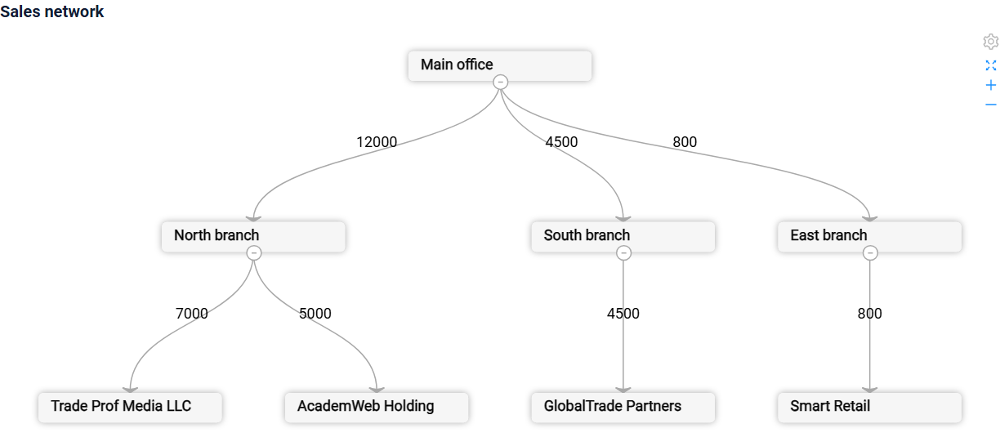

###### How to add?
??? Example
    **Step1** Add **nodes.fieldKeys** to **options.relationGraph** in **_.widget.json_**.
    ```json
    --8<--
    {{ external_links.github_raw_doc }}/widgets/relationGraph/fieldkeys/myexample6164relationgraph.widget.json
    --8<--
    ```

#### <a id="selectrecord">Parent-child</a>
[:material-play-circle: Live Sample]({{ external_links.code_samples }}/ui/#/screen/myexample6163){:target="_blank"} ·
[:fontawesome-brands-github: GitHub]({{ external_links.github_ui }}/{{ external_links.github_branch }}/src/main/java/org/demo/documentation/widgets/relationGraph/selectrecord){:target="_blank"}

A click on an edge or on a node without a drilldown selects the record: the edge or the incoming edge of the node.
The selected edge is drawn with a bold line. The other widgets of the business component and the child widgets show the selected record.

In the sample the `Info` widget shows the company of the selected node.

###### How does it look?
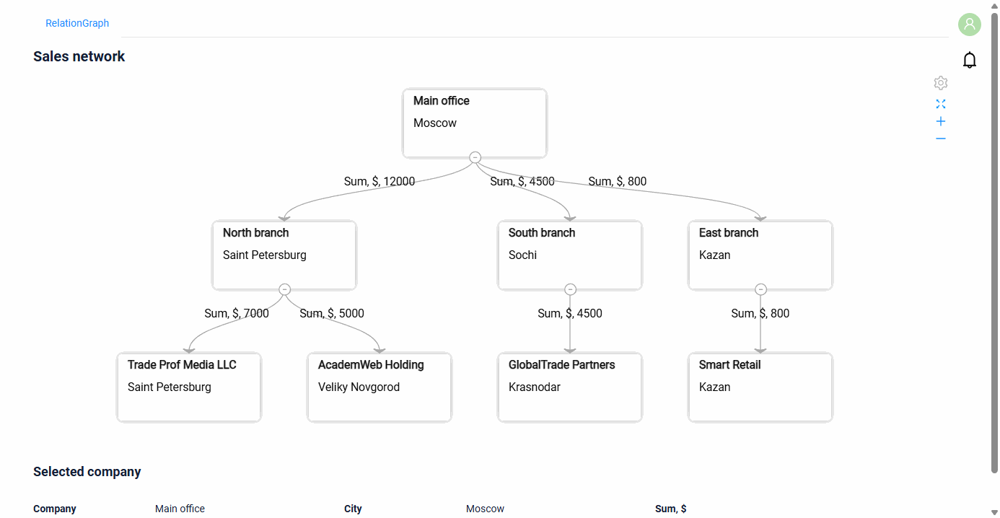

###### How to add?
??? Example
    **Step1** Add a widget of the same business component (or of a child one) to the view.
    ```json
    --8<--
    {{ external_links.github_raw_doc }}/widgets/relationGraph/selectrecord/myexample6163relationgraph.view.json
    --8<--
    ```

#### <a id="tablemode">Table mode</a>
[:material-play-circle: Live Sample]({{ external_links.code_samples }}/ui/#/screen/myexample6151){:target="_blank"} ·
[:fontawesome-brands-github: GitHub]({{ external_links.github_ui }}/{{ external_links.github_branch }}/src/main/java/org/demo/documentation/widgets/relationGraph/base){:target="_blank"}

The settings icon of the widget opens the `Mode` menu with `Chart` and `Table`. In the table mode the widget shows the records (the edges)
as a table with a column per field of the widget (fields with type `hidden` are not shown).

###### How does it look?
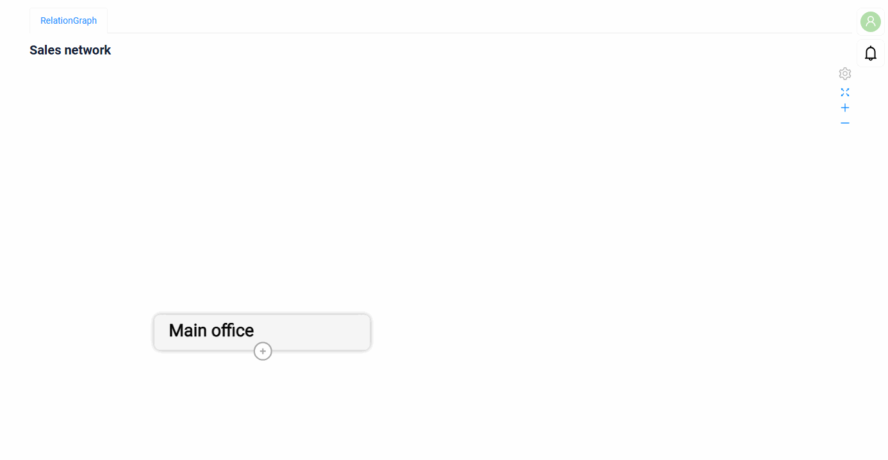

The table mode is always available, nothing to add.

#### <a id="incorrectdata">Incorrect data</a>
[:material-play-circle: Live Sample]({{ external_links.code_samples }}/ui/#/screen/myexample6160){:target="_blank"} ·
[:fontawesome-brands-github: GitHub]({{ external_links.github_ui }}/{{ external_links.github_branch }}/src/main/java/org/demo/documentation/widgets/relationGraph/incorrectdata){:target="_blank"}

When two records have the same pair "source node → target node", the graph is not drawn: the widget opens in the table mode,
the `Chart` mode is disabled and a warning icon shows `There is incorrect data, only table mode is available`.

###### How does it look?
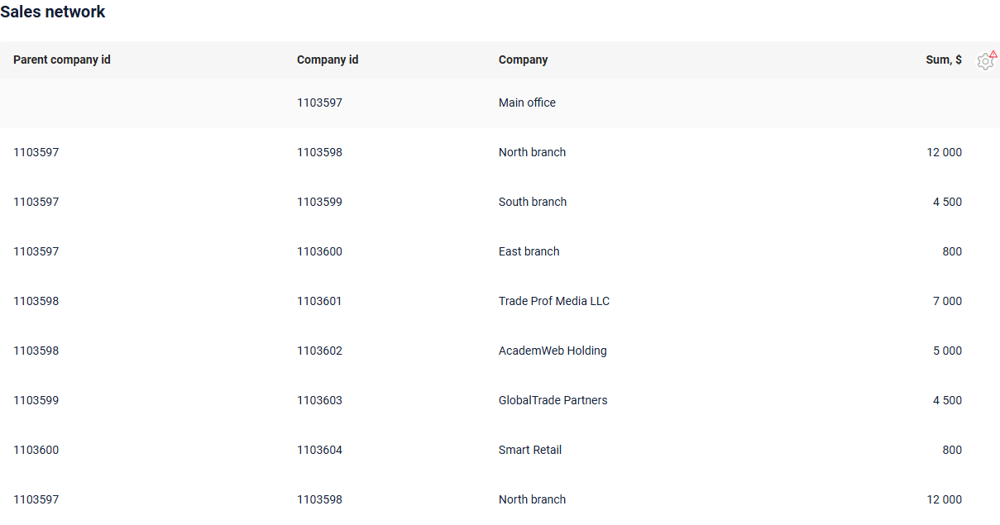

###### How to add?
??? Example
    In the sample the DAO adds a copy of an edge with another `id`.
    ```java
    --8<--
    {{ external_links.github_raw_doc }}/widgets/relationGraph/incorrectdata/MyExample6160Dao.java:getEdges
    --8<--
    ```

#### Customization of displayed columns
**not available** in this release.

#### Filtration
Works only in the [table mode](#tablemode): the column filters are shown for the fields with `enableFilter` in the Meta, as in a List widget.
The AnySource DAO applies the filter itself, see [Line2D filtration](/widget/type/line2d/line2d/#filtration).

#### Pagination
_not applicable_: the graph shows one page, see [Page limit](#pagelimit).

#### Export to Excel
**not available** in this release.

#### Multi-upload files
_not applicable_

#### <a id="pagelimit">Page limit</a>
The graph draws only the first page of the business component. When the business component has more records than the page limit,
the graph is not drawn: the widget opens in the table mode, the `Chart` mode is disabled and a warning icon explains why.

Set the page limit of the business component to the number of edges, see [Page limit](/widget/type/property/defaultlimitpage/defaultlimitpage).

#### <a id="nodata">No data</a>
[:material-play-circle: Live Sample]({{ external_links.code_samples }}/ui/#/screen/myexample6161){:target="_blank"} ·
[:fontawesome-brands-github: GitHub]({{ external_links.github_ui }}/{{ external_links.github_branch }}/src/main/java/org/demo/documentation/widgets/relationGraph/nodata){:target="_blank"}

When the business component returns no records, the widget shows `No Data` instead of the graph.

###### How does it look?

