# Блоки статистики { #statistics-blocks }
Виджет `Statistics blocks` предназначен для отображения агрегированных данных в наглядном виде. Данные могут поступать как из базы данных, так и из внешних источников.

Сейчас количество колонок в строке — 3.

## Основы { #basics }
[:material-play-circle: Живой пример]({{ external_links.code_samples }}/ui/#/screen/myexample4203){:target="_blank"}
[:fontawesome-brands-github: GitHub]({{ external_links.github_ui }}/{{ external_links.github_branch }}/src/main/java/org/demo/documentation/widgets/statsblock/base/defaultfields){:target="_blank"}

### Как это выглядит? { #how-does-it-look }

=== "С цветом"
    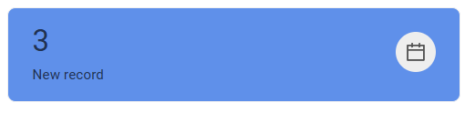
=== "Без цвета"
    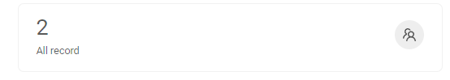

### Как добавить? { #how-to-add }
??? Example "Пример"
    === "Имена полей по умолчанию"
        Можно использовать имена полей по умолчанию для стандартных свойств, таких как цвет, иконка и т. д. В этом случае не нужно настраивать сопоставление этих полей со стандартными критериями

        **Шаг 1** Создайте **DataResponseDTO** с собственными полями.

        ```java
        --8<--
        {{ external_links.github_raw_doc }}/widgets/statsblock/base/defaultfields/MyExample4203DTO.java
        --8<--
        ```
        **Шаг 2**  Создайте **DAO**, наследующий AbstractAnySourceBaseDAO<> и реализующий AnySourceBaseDAO.

        [Заголовок](#Title). Необязательно

        `Value` — поле, задающее формулы агрегации данных

        [Иконка](#Icon). Необязательно

        [Цвет](#Color). Необязательно

        `Description` — комментарий к полю. Необязательно

        `Id` — рекомендуем назначать каждому блоку уникальный идентификатор. Это необходимо для корректной работы приложения и для drilldown.
          ```java
          --8<--
          {{ external_links.github_raw_doc }}/widgets/statsblock/base/defaultfields/MyExample4203Dao.java
          --8<--
          ```
          **Шаг 3** Создайте **Meta**, наследующий AnySourceFieldMetaBuilder.
          ```java
          --8<--
          {{ external_links.github_raw_doc }}/widgets/statsblock/base/defaultfields/MyExample4203Meta.java
          --8<--
          ```
          **Шаг 4** Создайте **Service**, наследующий AnySourceVersionAwareResponseService.
          ```java
          --8<--
          {{ external_links.github_raw_doc }}/widgets/statsblock/base/defaultfields/MyExample4203Service.java
          --8<--
          ```
 
          **Шаг 5** Создайте **Widget** с типом **StatsBlock**
          !!! tips "Совет"
              **fields**. Рекомендуем включать в этот блок все поля, используемые в виджете. Это поддерживает принцип согласованности приложения
      
          ```json
          --8<--
          {{ external_links.github_raw_doc }}/widgets/statsblock/base/defaultfields/MyExample4203List.widget.json
          --8<--
          ```

        !!! tips "Совет"
            Чтобы отображать блоки статистики на том же экране, где добавляются данные, нужно добавить свойство **RefreshBC**.

        [:material-play-circle: Живой пример]({{ external_links.code_samples }}/ui/#/screen/myexample4203){:target="_blank"}
        [:fontawesome-brands-github: GitHub]({{ external_links.github_ui }}/{{ external_links.github_branch }}/src/main/java/org/demo/documentation/widgets/statsblock/base/defaultfields){:target="_blank"}

    === "Собственные имена полей"
        Можно использовать собственные имена полей для стандартных свойств, таких как цвет, иконка и т. д. В этом случае нужно настроить сопоставление этих полей со стандартными критериями

        **Шаг 1** Создайте **DataResponseDTO** с собственными полями.
        ```java
        --8<--
        {{ external_links.github_raw_doc }}/widgets/statsblock/base/customfields/MyExample4200DTO.java
        --8<--
        ```    
        **Шаг 2**  Создайте **DAO**, наследующий AbstractAnySourceBaseDAO<> и реализующий AnySourceBaseDAO.

        [Заголовок](#Title). Необязательно

        Value — поле, задающее формулы агрегации данных

        [Иконка](#Icon). Необязательно

        [Цвет](#Color). Необязательно

        Description — комментарий к полю. Необязательно

        Id — рекомендуем назначать каждому блоку уникальный идентификатор. Это необходимо для корректной работы приложения и для drilldown.
        
        ```java
        --8<--
        {{ external_links.github_raw_doc }}/widgets/statsblock/base/customfields/MyExample4200Dao.java
        --8<--
        ```
        **Шаг 3** Создайте **Meta**, наследующий AnySourceFieldMetaBuilder.
        ```java
        --8<--
        {{ external_links.github_raw_doc }}/widgets/statsblock/base/customfields/MyExample4200Meta.java
        --8<--
        ``` 
        **Шаг 4** Создайте **Service**, наследующий AnySourceVersionAwareResponseService.
        ```java
        --8<--
        {{ external_links.github_raw_doc }}/widgets/statsblock/base/customfields/MyExample4200Service.java
        --8<--
        ```
        **Шаг 5** Создайте **Widget** с типом **StatsBlock**
        !!! tips "Совет"
            **fields**. Рекомендуем включать в этот блок все поля, используемые в виджете. Это поддерживает принцип согласованности приложения
            **options.stats** — задаёт сопоставление собственных полей со стандартными свойствами.

        ```json
        --8<--
        {{ external_links.github_raw_doc }}/widgets/statsblock/base/customfields/MyExample4200List.widget.json
        --8<--
        ```

        !!! tips "Совет"
            Чтобы отображать блоки статистики на том же экране, где добавляются данные, нужно добавить свойство **RefreshBC**.
 
        [:material-play-circle: Живой пример]({{ external_links.code_samples }}/ui/#/screen/myexample4200){:target="_blank"}
        [:fontawesome-brands-github: GitHub]({{ external_links.github_ui }}/{{ external_links.github_branch }}/src/main/java/org/demo/documentation/widgets/statsblock/base/customfields){:target="_blank"}


## Основные визуальные части { #main-visual-parts }
В этом виджете можно изменить следующие параметры:

* [Заголовок](#Title). Необязательно
* Value — поле, задающее формулы агрегации данных
* Description — комментарий к полю. Необязательно

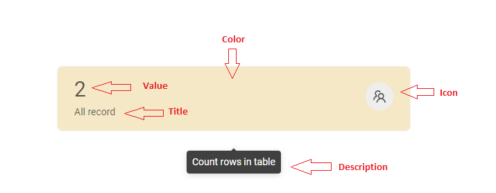  
 
## <a id="Title">Заголовок</a>
### Базовый заголовок { #title-basic }
Title — название, отображаемое в блоке. Необязательно.

[:material-play-circle: Живой пример]({{ external_links.code_samples }}/ui/#/screen/myexample4225/view/MyExample4226Stat){:target="_blank"} ·
[:fontawesome-brands-github: GitHub]({{ external_links.github_ui }}/{{ external_links.github_branch }}/src/main/java/org/demo/documentation/widgets/statsblock/title/withtitle){:target="_blank"}

Типы:

* `постоянный заголовок`: показывает постоянный текст.
* `constant title empty`.
 
#### Как это выглядит? { #how-does-it-look_1 }
=== "Постоянный заголовок"
    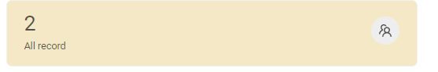
=== "Пустой постоянный заголовок"
    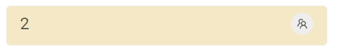

#### Как добавить? { #how-to-add_1 }
??? Example "Пример"
    === "Постоянный заголовок"
        **Шаг 1** Добавьте название в **title** в **_.widget.json_**.
        ```json
        --8<--
        {{ external_links.github_raw_doc }}/widgets/statsblock/title/withtitle/MyExample4226Stat.widget.json
        --8<--
        ```

        [:material-play-circle: Живой пример]({{ external_links.code_samples }}/ui/#/screen/myexample4225/view/MyExample4226Stat){:target="_blank"} ·
        [:fontawesome-brands-github: GitHub]({{ external_links.github_ui }}/{{ external_links.github_branch }}/src/main/java/org/demo/documentation/widgets/statsblock/title/withtitle){:target="_blank"}

    === "Пустой постоянный заголовок"
        **Шаг 1** Не используйте параметр **title** в **_.widget.json_**.
        ```json
        --8<--
        {{ external_links.github_raw_doc }}/widgets/statsblock/title/withouttitle/MyExample4225Stat.widget.json
        --8<--
        ```

        [:material-play-circle: Живой пример]({{ external_links.code_samples }}/ui/#/screen/myexample4225/view/MyExample4225Stat){:target="_blank"} ·
        [:fontawesome-brands-github: GitHub]({{ external_links.github_ui }}/{{ external_links.github_branch }}/src/main/java/org/demo/documentation/widgets/statsblock/title/withouttitle){:target="_blank"}

### Цвет заголовка { #title-color }
_неприменимо_

## <a id="bc">Бизнес-компонент</a>
Указывает бизнес-компонент (BC), к которому относится эта форма.
Бизнес-компонент представляет определённую часть системы, отвечающую за конкретную бизнес-логику или данные.

подробнее см. [Бизнес-компонент](/ru/environment/businesscomponent/businesscomponent/)

## <a id="Showcondition">Условие отображения</a>

* `без условия отображения — рекомендуется`: виджет виден всегда

  [:material-play-circle: Живой пример]({{ external_links.code_samples }}/ui/#/screen/myexample4203){:target="_blank"} ·
  [:fontawesome-brands-github: GitHub]({{ external_links.github_ui }}/{{ external_links.github_branch }}/src/main/java/org/demo/documentation/widgets/statsblock/base/defaultfields){:target="_blank"}

* `условие отображения по текущей сущности`: **не рекомендуется** для блоков статистики.

* `условие отображения по родительской сущности`: условие может содержать логическое выражение, зависящее от родительской сущности. Обновление полей родителя вызывает пересчёт условия только при сохранении или если поле force active и отображается на том же view

  [:material-play-circle: Живой пример]({{ external_links.code_samples }}/ui/#/screen/myexample4230){:target="_blank"} ·
  [:fontawesome-brands-github: GitHub]({{ external_links.github_ui }}/{{ external_links.github_branch }}/src/main/java/org/demo/documentation/widgets/statsblock/showcondition/byparententity){:target="_blank"}

!!! tips "Совет"
    По возможности рекомендуется не использовать `Show condition`, так как широкое применение этой возможности усложняет поддержку приложения.

#### <a id="howdoesitlook">Как это выглядит?</a>
=== "без условия отображения"
    
=== "условие отображения по текущей сущности"
    **Не рекомендуется** для блоков статистики.
=== "условие отображения по родительской сущности"
    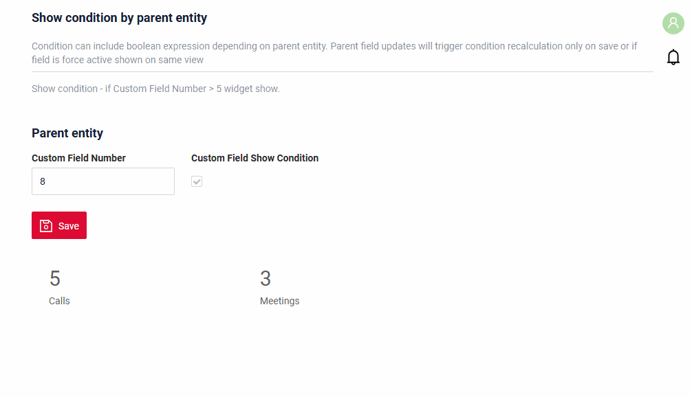

#### <a id="howtoadd">Как добавить?</a>
??? Example "Пример"

    === "без условия отображения"
        см. [Основы](#basics)

    === "условие отображения по текущей сущности"
        **Не рекомендуется** для блоков статистики.

    === "условие отображения по родительской сущности"
        **Шаг 1** Добавьте **showCondition** в **_.widget.json_**. Подробнее см. [showCondition](/ru/widget/type/property/showcondition/showcondition)
        ```json
        --8<--
        {{ external_links.github_raw_doc }}/widgets/statsblock/showcondition/byparententity/MyExample4233Child.widget.json
        --8<--
        ```
        [:material-play-circle: Живой пример]({{ external_links.code_samples }}/ui/#/screen/myexample4230){:target="_blank"} ·
        [:fontawesome-brands-github: GitHub]({{ external_links.github_ui }}/{{ external_links.github_branch }}/src/main/java/org/demo/documentation/widgets/statsblock/showcondition/byparententity){:target="_blank"}

## <a id="bc">Поля</a>

## <a id="Fieldslayout">Компоновка (options layout)</a>
**options.layout** — в этом типе не используется.

## Действия { #actions }
`Actions` отображают доступные действия в виде отдельных кнопок
см. [Действия](/ru/features/element/actions/actions)

 
## Дополнительные свойства { #additional-properties }

### <a id="Icon">Иконка</a>
[:material-play-circle: Живой пример]({{ external_links.code_samples }}/ui/#/screen/myexample4223/view/MyExample4223Stat){:target="_blank"} ·
[:fontawesome-brands-github: GitHub]({{ external_links.github_ui }}/{{ external_links.github_branch }}/src/main/java/org/demo/documentation/widgets/statsblock/icon/withicon){:target="_blank"}

Icon — изображение, обозначающее определённую функцию. Необязательно
<a id="standard_icons">Стандартные иконки</a>
Cxbox-ui уже включает эту библиотеку иконок.

[Иконки Ant Design](https://3x.ant.design/components/icon/)

Типы:

* `icon`.
* `icon empty`.

 

#### Как это выглядит? { #how-does-it-look_2 }
=== "Иконка"
    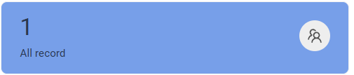
=== "Без иконки"
    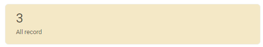

#### Как добавить? { #how-to-add_2 }
??? Example "Пример"
    === "Иконка"
        **Шаг 1** Добавьте поле **icon** в **_.widget.json_**.
        ```json
        --8<--
        {{ external_links.github_raw_doc }}/widgets/statsblock/icon/withicon/MyExample4223Stat.widget.json
        --8<--
        ```

        [:material-play-circle: Живой пример]({{ external_links.code_samples }}/ui/#/screen/myexample4223/view/MyExample4223Stat){:target="_blank"} ·
        [:fontawesome-brands-github: GitHub]({{ external_links.github_ui }}/{{ external_links.github_branch }}/src/main/java/org/demo/documentation/widgets/statsblock/icon/withicon){:target="_blank"}

    === "Без иконки"
        **Шаг 1** Не добавляйте поле **icon** в **_.widget.json_**.
        ```json
        --8<--
        {{ external_links.github_raw_doc }}/widgets/statsblock/icon/withouticon/MyExample4224Stat.widget.json
        --8<--
        ```

        [:material-play-circle: Живой пример]({{ external_links.code_samples }}/ui/#/screen/myexample4223/view/MyExample4224Stat){:target="_blank"} ·
        [:fontawesome-brands-github: GitHub]({{ external_links.github_ui }}/{{ external_links.github_branch }}/src/main/java/org/demo/documentation/widgets/statsblock/icon/withouticon){:target="_blank"}

### <a id="ColorField">Цвет</a>
`Color` позволяет задать цвет блока. Необязательно. Его можно вычислять на основе бизнес-логики приложения

**Вычисляемый цвет**

[:material-play-circle: Живой пример]({{ external_links.code_samples }}/ui/#/screen/myexample4206/view/myexample4206list){:target="_blank"} ·
[:fontawesome-brands-github: GitHub]({{ external_links.github_ui }}/{{ external_links.github_branch }}/src/main/java/org/demo/documentation/widgets/statsblock/color/color){:target="_blank"}

**Постоянный цвет**

[:material-play-circle: Живой пример]({{ external_links.code_samples }}/ui/#/screen/myexample4206/view/myexample4205list){:target="_blank"} ·
[:fontawesome-brands-github: GitHub]({{ external_links.github_ui }}/{{ external_links.github_branch }}/src/main/java/org/demo/documentation/widgets/statsblock/color/colorconst){:target="_blank"}

#### Как это выглядит? { #how-does-it-look_3 }
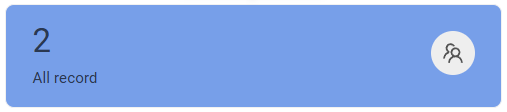


#### Как добавить? { #how-to-add_3 }
??? Example "Пример"
    === "Вычисляемый цвет"
        **Шаг 1**   Добавьте `собственное поле для цвета` в соответствующий **DataResponseDTO**. Поле может содержать цвет в формате HEX или быть null.

        ```java
        --8<--
        {{ external_links.github_raw_doc }}/widgets/statsblock/color/color/MyExample4206DTO.java
        --8<--
        ```
  
        **Шаг 2** Добавьте **"bgColorKey"** :  `собственное поле для цвета` в .widget.json.
        ```json
        --8<--
        {{ external_links.github_raw_doc }}/widgets/statsblock/color/color/MyExample4206List.widget.json
        --8<--
        ```
  

    === "Постоянный цвет"
 
        Добавьте **"bgColor"** :  `цвет HEX` в .widget.json.
        ```json
        --8<--
        {{ external_links.github_raw_doc }}/widgets/statsblock/color/colorconst/MyExample4205.widget.json
        --8<--
        ```

### <a id="Viewwidgetwidth">Размер виджета</a>
По умолчанию поле gridWidth во view используется для размещения виджетов в ряд, каждый занимает 1/3 заданного размера.
Например, если общая ширина ряда — 24 span, каждый виджет займёт 8 span.

[:material-play-circle: Живой пример]({{ external_links.code_samples }}/ui/#/screen/myexample4228){:target="_blank"} ·
[:fontawesome-brands-github: GitHub]({{ external_links.github_ui }}/{{ external_links.github_branch }}/src/main/java/org/demo/documentation/widgets/statsblock/fieldslayoute){:target="_blank"}
  
#### Как это выглядит? { #how-does-it-look_4 }
=== "gridWidth 24 во view — рекомендуется"
    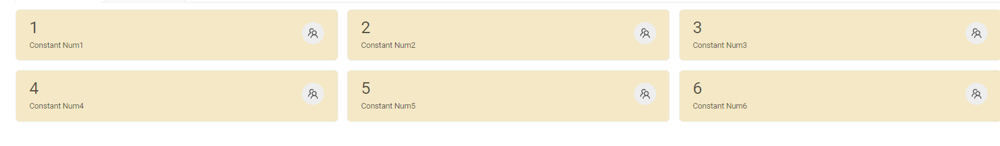
=== "gridWidth 12 во view"
    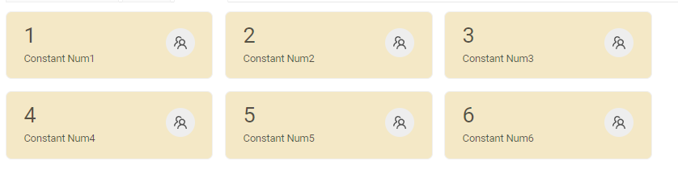
=== "gridWidth 6 во view"
    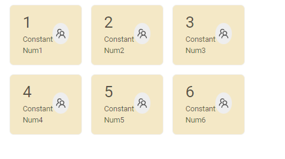
#### Как добавить? { #how-to-add_4 }
??? Example "Пример"
    === "gridWidth24 — рекомендуется"
        Измените **gridWidth** = 24 в соответствующем **view**
        ```json
        --8<--
        {{ external_links.github_raw_doc }}/widgets/statsblock/fieldslayoute/MyExample4228Stat.view.json
        --8<--
        ```

    === "gridWidth12"
        Измените **gridWidth** = 12 в соответствующем **view**
        ```json
        --8<--
        {{ external_links.github_raw_doc }}/widgets/statsblock/fieldslayoute/MyExample4228Stat12.view.json
        --8<--
        ``` 

    === "gridWidth6"
        Измените **gridWidth** = 6 в соответствующем **view**
        ```json
        --8<--
        {{ external_links.github_raw_doc }}/widgets/statsblock/fieldslayoute/MyExample4228Stat6.view.json
        --8<--
        ```
### Drilldown  
[:material-play-circle: Живой пример]({{ external_links.code_samples }}/ui/#/screen/myexample4210/view/myexample4210list){:target="_blank"} ·
[:fontawesome-brands-github: GitHub]({{ external_links.github_ui }}/{{ external_links.github_branch }}/src/main/java/org/demo/documentation/widgets/statsblock/drilldown/drilldown){:target="_blank"}

`DrillDown` позволяет перейти в другое представление простым нажатием. Целевое представление и другие части drill-down можно вычислять на основе бизнес-логики приложения

Также при необходимости можно отфильтровать данные целевого представления до его открытия, `подробнее см.` [DrillDown](/ru/features/element/drilldown/drilldown)

#### Как это выглядит? { #how-does-it-look_5 }
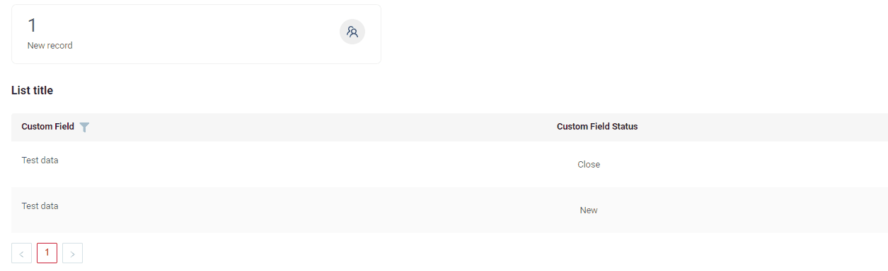

#### Как добавить? { #how-to-add_5 }
??? Example "Пример"
    **Вариант 1**
    `Шаг 1` Добавьте [fields.setDrilldown](/ru/features/element/drilldown/drilldown) в соответствующий **FieldMetaBuilder**.
    ```java
    --8<--
    {{ external_links.github_raw_doc }}/widgets/statsblock/drilldown/drilldown/MyExample4210Meta.java:buildRowDependentMeta
    --8<--
    ```

    `Шаг 2` Добавьте **"drillDown": "true"** в .widget.json.
    ```json
    --8<--
    {{ external_links.github_raw_doc }}/widgets/statsblock/drilldown/drilldown/MyExample4210List.widget.json
    --8<--
    ```

    **Вариант 2**
       Добавьте **"drillDownKey"** :  `собственное поле` в .widget.json. Подробнее см. [Drilldown](/ru/features/element/drilldown/drilldown)

    [:material-play-circle: Живой пример]({{ external_links.code_samples }}/ui/#/screen/myexample4210/view/myexample4210list){:target="_blank"} ·
    [:fontawesome-brands-github: GitHub]({{ external_links.github_ui }}/{{ external_links.github_branch }}/src/main/java/org/demo/documentation/widgets/statsblock/drilldown/drilldown){:target="_blank"}


### Функция выделения { #highlighting-functionality }
[:material-play-circle: Живой пример]({{ external_links.code_samples }}/ui/#/screen/myexample4210/view/myexample4216list){:target="_blank"} ·
[:fontawesome-brands-github: GitHub]({{ external_links.github_ui }}/{{ external_links.github_branch }}/src/main/java/org/demo/documentation/widgets/statsblock/drilldown/parentchild){:target="_blank"}

Функция выделения текущего элемента (плитки)

**Иерархия родитель-потомок**. Этот подход реализует зависимость виджетов родитель-потомок, что даёт следующие особенности поведения:

1.  **Инициализация и фокус курсора**
    *   При открытии экрана курсор автоматически устанавливается на первую запись в наборе данных, полученном родительским виджетом.

2.  **Обязательная запись «Все записи»**
    *   Для корректной работы фильтрации родительский виджет **должен** содержать статическую запись «Все записи» (или аналогичный элемент).
    *   **Назначение:** при выборе этого элемента дочерний табличный виджет должен показывать все доступные записи без применения фильтров по выбору в родительском виджете. Обычно эта запись должна быть первой в списке и выбранной по умолчанию при инициализации.

3.  **Ограничение для родительского виджета (StatsBlock)**
    *   Если родительский виджет — блок статистики (StatsBlock), в его конфигурации **нельзя** использовать drilldown, так как функцию навигации уже выполняет связь с дочерним виджетом.

4. Вкладки не используются
 
#### Как это выглядит? { #how-does-it-look_6 }
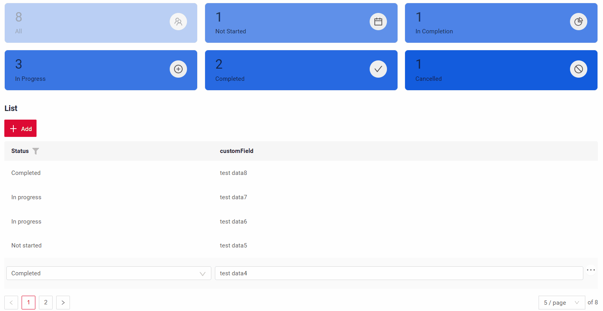

#### Как добавить? { #how-to-add_6 }
??? Example "Пример"
    !!! info
        Для работы зависимости родитель-потомок ID, назначаемые виджетам StatBlock, должны иметь тип **long**.

    `Шаг 1` Добавьте зависимость родитель/потомок в соответствующий **EnumBcIdentifier**.
    
    parent -> bc для StatsBlock

    ```java
    --8<--
    {{ external_links.github_raw_doc }}/widgets/statsblock/drilldown/parentchild/CxboxMyExample4216Controller.java:bc
    --8<--
    ```
 
    `Шаг 2` Добавьте **getParentSpecification** в соответствующий **ResponseService**.
     Добавьте фильтрацию по назначенным ID в соответствующий **Dao**.

    ```java
    --8<--
    {{ external_links.github_raw_doc }}/widgets/statsblock/drilldown/parentchild/data/MyExample4216Service.java:getParentSpecification
    --8<--
    ```
    `Шаг 3` Добавьте **bcCursor** в соответствующий **widget.json**.
    Добавлен новый параметр `bcCursor` для управления визуальным выделением выбранного элемента UI.

    *   **`bcCursor: show`**
    Когда параметр включён, выбранный элемент выделяется. Кроме того, для родительских элементов система автоматически отображает дочерние виджеты, связанные с выбранной плиткой.

    *   **`bcCursor: none`** (значение по умолчанию)
      Режим по умолчанию. Визуальное выделение активного элемента отключено. Поведение интерфейса соответствует предыдущей версии.

    ```json
    --8<--
    {{ external_links.github_raw_doc }}/widgets/statsblock/drilldown/parentchild/example4127Stats.widget.json
    --8<--
    ```
    [:material-play-circle: Живой пример]({{ external_links.code_samples }}/ui/#/screen/myexample4210/view/myexample4216list){:target="_blank"} ·
    [:fontawesome-brands-github: GitHub]({{ external_links.github_ui }}/{{ external_links.github_branch }}/src/main/java/org/demo/documentation/widgets/statsblock/drilldown/parentchild){:target="_blank"}


### Настройка прозрачности выбранного элемента { #configuring-selected-item-opacity }

Прозрачность визуального выделения выбранного элемента виджета задаётся константой `selectedItemOpacity`.

**Расположение:** ui/src/components/widgets/StatsBlock/constants.ts

**Текущее значение:** 0.5 (50% непрозрачности / 50% прозрачности)

### Настройка количества колонок { #configuring-number-of-columns }
При необходимости это можно изменить в настройках компонента фронтенда в StatsBlock.tsx с помощью свойства grid.

Пример: `gutter: 16, sm: 3, column: 6` — даёт 3 колонки.

**Расположение:** ui/src/components/widgets/StatsBlock/StatsBlock.tsx

**Текущее значение:**
`3` — даёт 3 колонки

[Расширенная настройка](/ru/features/element/drilldown/drilldown)