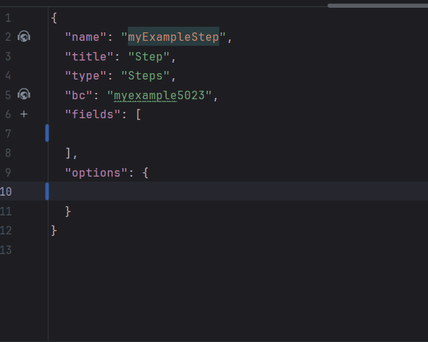

# Steps
 
Виджет `Steps` используется для определения последовательных действий или этапов бизнес-процесса в приложении и управления ими. Он позволяет разработчикам и пользователям разбивать сложное поведение на небольшие управляемые шаги, улучшая читаемость и сопровождаемость.

## Основы { #basics }
[:material-play-circle: Живой пример]({{ external_links.code_samples }}/ui/#/screen/myexample5023){:target="_blank"} ·
[:fontawesome-brands-github: GitHub]({{ external_links.github_ui }}/{{ external_links.github_branch }}/src/main/java/org/demo/documentation/widgets/steps/base){:target="_blank"}

### Как это выглядит? { #how-does-it-look }


###  <a id="Howtoaddbacis">Как добавить?</a>
??? Example "Пример"
    **Шаг 1** Создайте файл **_.widget.json_** с type = "Steps"
 
    ```json
    --8<--
    {{ external_links.github_raw_doc }}/widgets/steps/base/myExampleStep.widget.json
    --8<--
    ```
    **Шаг 2** Добавьте виджет в соответствующий **_.view.json_**.

    ```json
    --8<--
    {{ external_links.github_raw_doc }}/widgets/steps/base/myexample5023step1.view.json
    --8<--
    ```

    [:material-play-circle: Живой пример]({{ external_links.code_samples }}/ui/#/screen/myexample5023){:target="_blank"} ·
    [:fontawesome-brands-github: GitHub]({{ external_links.github_ui }}/{{ external_links.github_branch }}/src/main/java/org/demo/documentation/widgets/steps/base){:target="_blank"}
     
## Заголовок (Title) { #title }
Этот тип виджета не поддерживает Title

## <a id="bc">Бизнес-компонент</a>
Указывает бизнес-компонент (BC), к которому относится эта форма.
Бизнес-компонент представляет определённую часть системы, отвечающую за конкретную бизнес-логику или данные.

подробнее см. [Бизнес-компонент](/ru/environment/businesscomponent/businesscomponent/)
 
## <a id="Showcondition">Условие отображения</a>
Этот тип виджета не поддерживает Show condition

## <a id="bc">Поля</a>
Настройка полей. Массив fields определяет отдельные поля формы.

```json
{
    "label": "Custom Field",
    "key": "customField",
    "type": "input"
}
```

* **"label"**

Описание: заголовок поля.

Тип: String (необязательно).

* **"key"**

Описание: имя поля в соответствующем DataResponseDTO.

Тип: String (обязательно).

* **"type"**

Описание: [Типы полей](/ru/widget/fields/fieldtypes/)

Тип: String (обязательно).

### Как добавить? { #how-to-add }
??? Example "Пример"

    === "С плагином"
        **Шаг 1** Скачайте плагин
            [скачать плагин для IntelliJ](https://doc.cxbox.org/ru/plugin/plugininstalling)
    
        **Шаг 2** Добавьте существующее поле в существующий виджет формы
            

    === "Другое"
        Добавьте поле в **_.widget.json_**.

        ```json
           --8<--
           {{ external_links.github_raw_doc }}/widgets/steps/base/myExampleStep.widget.json
           --8<--
        ```


подробнее см. [Поля](/ru/widget/fields/fieldtypes/)

## Компоновка (options layout) { #options-layout }
Этот тип виджета не поддерживает Options layout
## Действия { #actions }
Этот тип виджета не поддерживает кнопки


 