# Tree

Доступно начиная с [v3.0.1](/ru/new/version3001/)

Виджет Tree представляет иерархические записи в виде раскрываемого дерева, позволяя просматривать родительские и дочерние строки в одной таблице.

!!! info
    В этом релизе для виджета `Tree` **недоступны** следующие возможности:

    * полностью или частично раскрытая начальная загрузка (дерево всегда открывается свёрнутым)


## Основы { #basics }
[:material-play-circle: Живой пример]({{ external_links.code_samples }}/ui/#/screen/myexample3261){:target="_blank"} ·
[:fontawesome-brands-github: GitHub]({{ external_links.github_ui }}/{{ external_links.github_branch }}/src/main/java/org/demo/documentation/widgets/tree/base){:target="_blank"}

Для корректной работы виджета должны выполняться следующие требования:

* **Между записями должна быть задана связь родитель-потомок**. Можно использовать как стандартные, так и собственные поля, при необходимости переопределив стандартную логику.
* **Должен быть флаг, определяющий, можно ли раскрыть дерево дальше**. Он указывает, является ли текущая запись листом или у неё есть дочерние записи.

Минимальный набор данных записи дерева:

* `id` — идентификатор записи.
* `parentId` — идентификатор родительской записи. Для корневой записи значение `null`.
  Бэкенд должен **всегда** возвращать это поле, и поле должно быть **фильтруемым**, так как дерево строится запросами `parentId.specified=false` (корневые записи) и `parentId.equals=<id>` (дочерние записи). Подробнее см. [Ленивая загрузка](#lazyload)
* поле названия (title) — значение, отображаемое в колонке дерева.
* `isLeaf` — вычисляемый логический флаг. Значение по умолчанию `false`. Значение `true` означает, что у записи нет дочерних записей, поэтому стрелка раскрытия для неё не отображается.

!!! info
    **Первое** поле массива `fields` отображается как колонка дерева: стрелка раскрытия. Все остальные поля отображаются как обычные колонки.

**options.tree**

Все настройки, специфичные для дерева, размещаются в **options**.**tree** файла **_.widget.json_**.

??? Example "Пример"

    | Свойство                 | Тип                                             | По умолчанию             | Описание                                                                                                          |
    |--------------------------|-------------------------------------------------|--------------------------|-------------------------------------------------------------------------------------------------------------------|
    | `parentIdFieldKey`       | String                                          | `parentId`               | Имя поля с идентификатором родительской записи.                                                                     |
    | `isLeafFieldKey`         | String                                          | `isLeaf`                 | Имя поля с флагом «у записи нет дочерних записей».                                                                   |
    | `searchModes`            | Массив из `collapse`, `hide`                    | `["collapse", "hide"]`   | Режимы отображения результата фильтрации. Первый элемент массива — активный. см. [Режимы поиска](#searchmodes) |
    | `onFilterApplyNestLevel` | Number                                          | `0`                      | Сколько уровней пути навигации показывается над найденной записью в режиме `collapse`. см. [Режимы поиска](#searchmodes) |
    | `insertPosition`         | `start`, `end`                                  | —                        | Куда внутри узла вставляется новая строка. см. [Действия](#actions)                                                 |

**Ленивая загрузка**

Дерево всегда загружается **лениво** и всегда открывается **свёрнутым**: при открытии виджета запрашиваются только корневые записи, а дочерние записи узла — когда пользователь его раскрывает.
!!! info
    Операция `specified` используется **только** для выбора записей с пустым родителем. Для всех остальных запросов используется операция `equals`.
    Поэтому поле с идентификатором родителя должно быть фильтруемым на бэкенде.

Каждый узел хранит **собственное состояние пагинации**, поэтому записи одного узла загружаются постранично независимо от соседних узлов. Подробнее см. [Пагинация](#pagination)

??? Example "Пример"
    * **Корневые записи** запрашиваются с фильтром по пустому родителю:

    ```
    ?parentId.specified=false&_page=1&_limit=5
    ```

    * **Дочерние записи** узла запрашиваются при раскрытии узла:

      ```
      ?parentId.equals=<id>&_page=1&_limit=5
      ```
  
### Как это выглядит? { #how-does-it-look }


### Как добавить? { #how-to-add }
??? Example "Пример"
    === "Имена полей по умолчанию"

        Можно использовать имена полей по умолчанию для стандартных свойств, таких как parentId, isLeaf. В этом случае не нужно настраивать сопоставление этих полей со стандартными критериями

        **Шаг 1** Создайте поля `parentId`, `isLeaf` в соответствующем **DataResponseDTO**.

        * `parentId` — идентифицирует родительскую запись текущей записи и задаёт связь родитель-потомок в дереве. Если запись — корневой узел, `parentId` должен быть пустым.
        * `isLeaf` — указывает, можно ли раскрыть запись. Значение `true` означает, что запись нельзя раскрыть, а `false` — что её можно раскрыть для отображения дочерних записей.

        ```java
        --8<--
        {{ external_links.github_raw_doc }}/widgets/tree/base/defaultfields/MyExample3281DTO.java
        --8<--
        ```
     
        **Шаг 2** Создайте файл **_.widget.json_** с type = **"Tree"**
    
        Добавьте существующее поле в виджет дерева. Подробнее см. [Поля](#fields)
    
        Для корректной работы дерева виджет должен содержать поля `parentId` и `isLeaf`. Эти поля нужно настроить как **hidden**.

        ```json
        --8<--
        {{ external_links.github_raw_doc }}/widgets/tree/base/defaultfields/widget/MyExample3281Tree.widget.json
        --8<--
        ```
        [:material-play-circle: Живой пример]({{ external_links.code_samples }}/ui/#/screen/myexample3261/view/myexample3281tree){:target="_blank"} ·
        [:fontawesome-brands-github: GitHub]({{ external_links.github_ui }}/{{ external_links.github_branch }}/src/main/java/org/demo/documentation/widgets/tree/base/defaultfields){:target="_blank"}

    === "Собственные имена полей"

        Можно использовать собственные имена полей для стандартных свойств. В этом случае нужно настроить сопоставление этих полей со стандартными критериями

        **Шаг 1** Создайте поля `customFieldParentId`, `customFieldIsLeaf` в соответствующем **DataResponseDTO**.

        * `customFieldParentId` — идентифицирует родительскую запись текущей записи и задаёт связь родитель-потомок в дереве. Если запись — корневой узел, `parentId` должен быть пустым.
        * `customFieldIsLeaf` — указывает, можно ли раскрыть запись. Значение `true` означает, что запись нельзя раскрыть, а `false` — что её можно раскрыть для отображения дочерних записей.

        ```java
        --8<--
        {{ external_links.github_raw_doc }}/widgets/tree/base/customfields/MyExample3278DTO.java
        --8<--
        ```
     
        **Шаг 2** Создайте файл **_.widget.json_** с type = **"Tree"**
    
        Добавьте существующее поле в виджет дерева. Подробнее см. [Поля](#fields)
    
        Для корректной работы дерева виджет должен содержать поля `customFieldParentId` и `customFieldIsLeaf`. Эти поля нужно настроить как **hidden**.

        ```json
        --8<--
        {{ external_links.github_raw_doc }}/widgets/tree/base/customfields/widget/MyExample3278Tree.widget.json
        --8<--
        ```
        [:material-play-circle: Живой пример]({{ external_links.code_samples }}/ui/#/screen/myexample3261/view/myexample3278tree){:target="_blank"} ·
        [:fontawesome-brands-github: GitHub]({{ external_links.github_ui }}/{{ external_links.github_branch }}/src/main/java/org/demo/documentation/widgets/tree/base/customfields){:target="_blank"}

## Заголовок (Title) { #title }
[:material-play-circle: Живой пример]({{ external_links.code_samples }}/ui/#/screen/myexample3271){:target="_blank"} ·
[:fontawesome-brands-github: GitHub]({{ external_links.github_ui }}/{{ external_links.github_branch }}/src/main/java/org/demo/documentation/widgets/tree/title){:target="_blank"}

### Базовый заголовок { #title-basic }
`Title` для виджета (необязательно)

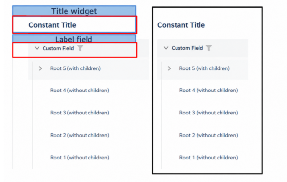    

Типы:

* `постоянный заголовок`: показывает постоянный текст.
* `пустой постоянный заголовок`: если нужно визуально связать виджеты, расположив их один под другим
 
#### Как это выглядит? { #how-does-it-look_1 }
=== "Постоянный заголовок"
    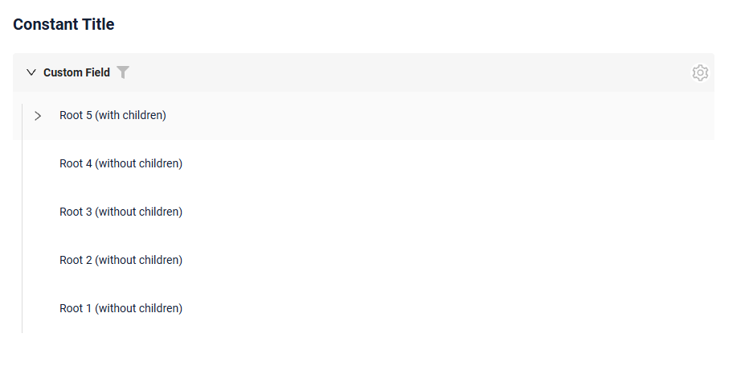
=== "Пустой постоянный заголовок"
    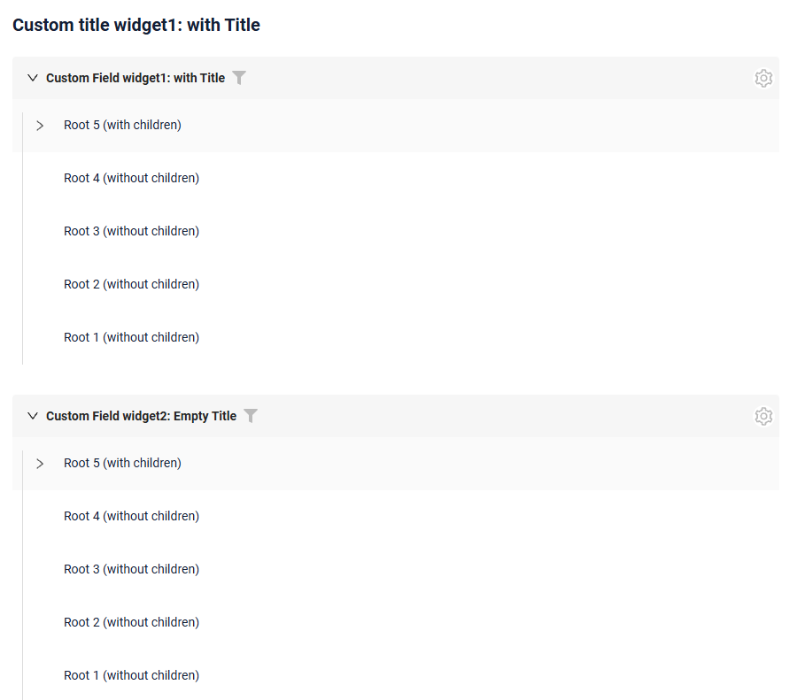
 
#### Как добавить? { #how-to-add_1 }
??? Example "Пример"
    === "Постоянный заголовок"
        **Шаг 1** Добавьте название в **title** в **_.widget.json_**.
        ```json
        --8<--
        {{ external_links.github_raw_doc }}/widgets/tree/title/widget/MyExample3271Tree.widget.json
        --8<--
        ```
        [:material-play-circle: Живой пример]({{ external_links.code_samples }}/ui/#/screen/myexample3271){:target="_blank"} ·
        [:fontawesome-brands-github: GitHub]({{ external_links.github_ui }}/{{ external_links.github_branch }}/src/main/java/org/demo/documentation/widgets/tree/title){:target="_blank"}


    === "Пустой постоянный заголовок"

        **Шаг 1** Удалите параметр **title** из **_.widget.json_**.
        ```json
        --8<--
        {{ external_links.github_raw_doc }}/widgets/tree/title/widget/MyExample3271EmptyTitle.widget.json
        --8<--
        ```

        [:material-play-circle: Живой пример]({{ external_links.code_samples }}/ui/#/screen/myexample3271/view/myexample3271emtytitle){:target="_blank"} ·
        [:fontawesome-brands-github: GitHub]({{ external_links.github_ui }}/{{ external_links.github_branch }}/src/main/java/org/demo/documentation/widgets/tree/title){:target="_blank"}


### Цвет заголовка { #title-color }
`Title Color` позволяет задать цвет заголовка. Он может быть постоянным или вычисляемым.

**Постоянный цвет**

[:material-play-circle: Живой пример]({{ external_links.code_samples }}/ui/#/screen/myexample3267/view/myexample3267listcolorconst){:target="_blank"} ·
[:fontawesome-brands-github: GitHub]({{ external_links.github_ui }}/{{ external_links.github_branch }}/src/main/java/org/demo/documentation/widgets/tree/colortitle){:target="_blank"}

*Постоянный цвет* — фиксированный цвет, который не меняется. Он остаётся одинаковым независимо от каких-либо факторов в приложении.

**Вычисляемый цвет**

[:material-play-circle: Живой пример]({{ external_links.code_samples }}/ui/#/screen/myexample3267/view/myexample3267tree){:target="_blank"} ·
[:fontawesome-brands-github: GitHub]({{ external_links.github_ui }}/{{ external_links.github_branch }}/src/main/java/org/demo/documentation/widgets/tree/colortitle){:target="_blank"}

*Вычисляемый цвет* можно использовать для динамического изменения цвета заголовка. Он меняется в зависимости от бизнес-логики или данных приложения.

!!! info
    Цветовое выделение заголовка **применимо** к следующим [полям](/ru/widget/fields/fieldtypes/): date, dateTime, dateTimeWithSeconds, number, money, percent, time, input, text, dictionary, radio, checkbox, pickList, inlinePickList, multivalue, multivalueHover.

##### Как это выглядит? { #how-does-it-look_2 }
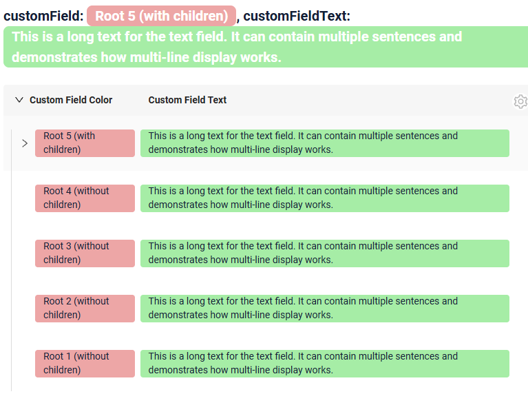

##### Как добавить? { #how-to-add_2 }
??? Example "Пример"
    === "Вычисляемый цвет"

        **Шаг 1**   Добавьте `собственное поле для цвета` в соответствующий **DataResponseDTO**. Поле может содержать цвет в формате HEX или быть null.
        ```java
        --8<--
        {{ external_links.github_raw_doc }}/widgets/tree/colortitle/MyExample3267DTO.java:colorDTO
        --8<--
        ```  
 
        **Шаг 2** Добавьте **"bgColorKey"** :  `собственное поле для цвета` в .widget.json.

        Добавьте в `title` поле с `${customField}`

        ```json
        --8<--
        {{ external_links.github_raw_doc }}/widgets/tree/colortitle/widget/MyExample3267.widget.json
        --8<--
        ``` 

        [:material-play-circle: Живой пример]({{ external_links.code_samples }}/ui/#/screen/myexample3267/view/myexample3267tree){:target="_blank"} ·
        [:fontawesome-brands-github: GitHub]({{ external_links.github_ui }}/{{ external_links.github_branch }}/src/main/java/org/demo/documentation/widgets/tree/colortitle){:target="_blank"}

    === "Постоянный цвет"
 
        Добавьте **"bgColor"** :  `цвет HEX` в .widget.json.

        Добавьте в `title` поле с `${customField}`

        ```json
        --8<--
        {{ external_links.github_raw_doc }}/widgets/tree/colortitle/widget/MyExample3267ColorConst.widget.json
        --8<--
        ```

        [:material-play-circle: Живой пример]({{ external_links.code_samples }}/ui/#/screen/myexample3267/view/myexample3267listcolorconst){:target="_blank"} ·
        [:fontawesome-brands-github: GitHub]({{ external_links.github_ui }}/{{ external_links.github_branch }}/src/main/java/org/demo/documentation/widgets/tree/colortitle){:target="_blank"}

## <a id="bc">Бизнес-компонент</a>
Указывает бизнес-компонент (BC), к которому относится эта форма.
Бизнес-компонент представляет определённую часть системы, отвечающую за конкретную бизнес-логику или данные.

подробнее см. [Бизнес-компонент](/ru/environment/businesscomponent/businesscomponent/)

## <a id="Showcondition">Условие отображения</a>

[:material-play-circle: Живой пример]({{ external_links.code_samples }}/ui/#/screen/myexample3261){:target="_blank"} ·
[:fontawesome-brands-github: GitHub]({{ external_links.github_ui }}/{{ external_links.github_branch }}/src/main/java/org/demo/documentation/widgets/tree/base){:target="_blank"}

* `без условия отображения — рекомендуется`: виджет виден всегда

  [:material-play-circle: Живой пример]({{ external_links.code_samples }}/ui/#/screen/myexample3269){:target="_blank"} ·
  [:fontawesome-brands-github: GitHub]({{ external_links.github_ui }}/{{ external_links.github_branch }}/src/main/java/org/demo/documentation/widgets/tree/showcondition/bycurrententity){:target="_blank"}

* `условие отображения по текущей сущности`: условие может содержать логическое выражение, зависящее от полей текущей сущности. Обновление полей вызывает пересчёт условия только при сохранении или если поле force active

<!--
  [:material-play-circle: Живой пример]({{ external_links.code_samples }}/ui/#/screen/myexample3269/view/myexample3276showcond){:target="_blank"} ·
  [:fontawesome-brands-github: GitHub]({{ external_links.github_ui }}/{{ external_links.github_branch }}/src/main/java/org/demo/documentation/widgets/tree/showcondition/byparententity){:target="_blank"}
 
* `условие отображения по родительской сущности`: условие может содержать логическое выражение, зависящее от родительской сущности. Обновление полей родителя вызывает пересчёт условия только при сохранении или если поле force active и отображается на том же view
-->
!!! tips "Совет"
    По возможности рекомендуется не использовать `Show condition`, так как широкое применение этой возможности усложняет поддержку приложения.

#### <a id="howdoesitlook">Как это выглядит?</a>
=== "без условия отображения"
    
=== "условие отображения по текущей сущности"
    <video controls width="800">
    <source src="/widget/type/tree/show_cond_current.mp4" type="video/mp4">
    </video>

<!--
=== "условие отображения по родительской сущности"
    
-->

#### <a id="howtoadd">Как добавить?</a>
??? Example "Пример"

    === "без условия отображения"
        см. [Основы](#Howtoaddbacis)

    === "условие отображения по текущей сущности"
        **Шаг 1** Добавьте **showCondition** в **_.widget.json_**. Подробнее см. [showCondition](/ru/widget/type/property/showcondition/showcondition)
        ```json
        --8<--
        {{ external_links.github_raw_doc }}/widgets/tree/showcondition/bycurrententity/MyExample32692.widget.json
        --8<--
        ```
<!--
    === "условие отображения по родительской сущности"
        **Шаг 1** Добавьте **showCondition** в **_.widget.json_**. Подробнее см. [showCondition](/ru/widget/type/property/showcondition/showcondition)
        ```json
        --8<--
        {{ external_links.github_raw_doc }}/widgets/tree/showcondition/byparententity/MyExample3277child.widget.json
        --8<--
        ```
-->

## <a id="fields">Поля</a>
Настройка полей. Массив fields определяет отдельные поля формы.

```json
{
    "title": "Custom Field",
    "key": "customField",
    "type": "input"
}
```

* **"title"**

  Описание: заголовок поля.
  
  Тип: String (необязательно).
  
* **"key"**
  
    Описание: имя поля в соответствующем DataResponseDTO.
  
    Тип: String (обязательно).
  
* **"type"**
  
  Описание: [Типы полей](/ru/widget/fields/fieldtypes/)
  
  Тип: String (обязательно).


### Как добавить? { #how-to-add_3 }
??? Example "Пример"

    === "С плагином (рекомендуется)"
        **Шаг 1** Скачайте плагин
            [скачать плагин для IntelliJ](https://doc.cxbox.org/ru/plugin/plugininstalling)
    
        **Шаг 2** Добавьте существующее поле в существующий виджет формы
            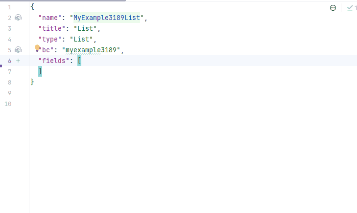
    === "Пример написания кода"
        Добавьте поле в **_.widget.json_**.

          ```json
             --8<--
             {{ external_links.github_raw_doc }}/widgets/tree/title/widget/MyExample3271Tree.widget.json
             --8<--
          ```

## <a id="Fieldslayout">Компоновка (options layout)</a>
**options.layout** — в этом типе не используется.


## Действия { #actions }
`Actions` отображают доступные действия в виде отдельных кнопок, подробнее см. [Действия](/ru/features/element/actions/actions).

Для виджета Tree есть несколько действий. Они настраиваются так же, как действия [виджета List](/ru/widget/type/list/list): те же действия `create`, `edit`, `save`, `cancel-create`, `delete` и те же три способа создания и редактирования записи — inline, inline-form и with view.

#### Создание { #create }
Кнопка `Create` позволяет создать новое значение нажатием кнопки `Add`. Это действие можно выполнить тремя разными способами — выбирайте любой в зависимости от логики приложения:

Есть три способа создать запись:

* [Inline](#createinline): строку можно добавить напрямую.

!!! info
    Пагинация не сработает, пока страница не будет обновлена после добавления записей.

* [Inline-form](#withwidget): данные можно добавить с помощью виджета формы, не покидая текущий view.

* [With view](#withview): запись можно создать, перейдя в отдельный view.

##### <a id="createinline">Inline</a>
[:material-play-circle: Живой пример]({{ external_links.code_samples }}/ui/#/screen/myexample3265/view/myexample3265tree){:target="_blank"} ·
[:fontawesome-brands-github: GitHub]({{ external_links.github_ui }}/{{ external_links.github_branch }}/src/main/java/org/demo/documentation/widgets/tree/actions/create/basic){:target="_blank"}

При `Line Addition` по нажатию кнопки "Add" вверху виджета дерева сразу добавляется новая пустая строка. Это быстрый способ добавлять строки без предварительного ввода данных.

Позицию новой строки внутри узла можно задать так:

* перед уже загруженными строками узла
* после них.

###### Как это выглядит? { #how-does-it-look_3 }
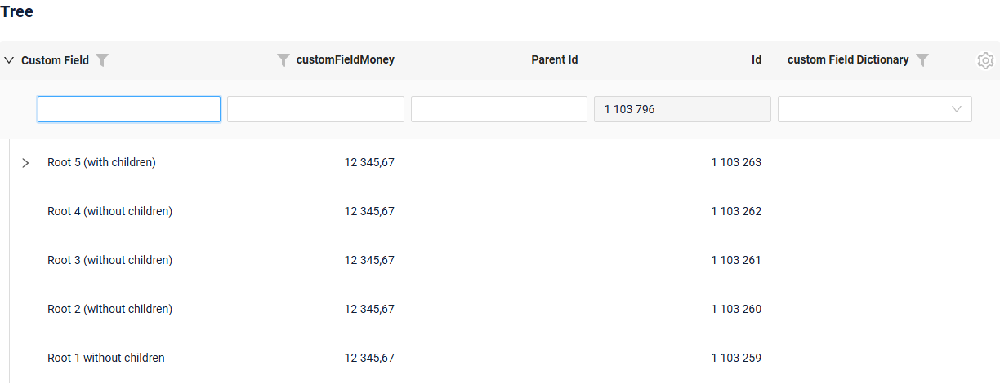

###### Как добавить? { #how-to-add_4 }
??? Example "Пример"
    
    **Шаг 1** Добавьте кнопку `create` в соответствующий **VersionAwareResponseService**.
    ```java
    --8<--
    {{ external_links.github_raw_doc }}/widgets/tree/actions/create/basic/MyExample3265Service.java:getActions
    --8<--
    ```
     **Шаг 2** Добавьте кнопку `create` в соответствующий **.widget.json**.

     Позиция новой строки внутри узла задаётся
 
    `options`.`tree`.`insertPosition`: start помещает её перед уже загруженными строками узла, end — после них

    ```json
    --8<--
    {{ external_links.github_raw_doc }}/widgets/tree/actions/create/basic/MyExample3265Tree.widget.json
    --8<--
    ```
     **Шаг 3** Добавьте **fields.setEnabled** в соответствующий **FieldMetaBuilder**.
    ```java
    --8<--
    {{ external_links.github_raw_doc }}/widgets/tree/actions/create/basic/MyExample3265Meta.java:buildRowDependentMeta
    --8<--
    ```
    [:material-play-circle: Живой пример]({{ external_links.code_samples }}/ui/#/screen/myexample3265/view/myexample3265tree){:target="_blank"} ·
    [:fontawesome-brands-github: GitHub]({{ external_links.github_ui }}/{{ external_links.github_branch }}/src/main/java/org/demo/documentation/widgets/tree/actions/create/basic){:target="_blank"}

##### <a id="withwidget">Inline-form</a> 
[:material-play-circle: Живой пример]({{ external_links.code_samples }}/ui/#/screen/myexample3265/view/myexample3279tree){:target="_blank"} ·
[:fontawesome-brands-github: GitHub]({{ external_links.github_ui }}/{{ external_links.github_branch }}/src/main/java/org/demo/documentation/widgets/tree/actions/create/withwidget){:target="_blank"}

`Create with widget` открывает дополнительный виджет при нажатии кнопки "Add". Форма появляется на том же экране, поэтому видны и дерево сущностей, и форма добавления новой строки.
После заполнения информации и нажатия "Save" новая строка добавляется в дерево.

Позиция новой строки внутри узла задаётся:

* перед уже загруженными строками узла
* после них.

###### Как это выглядит? { #how-does-it-look_4 }
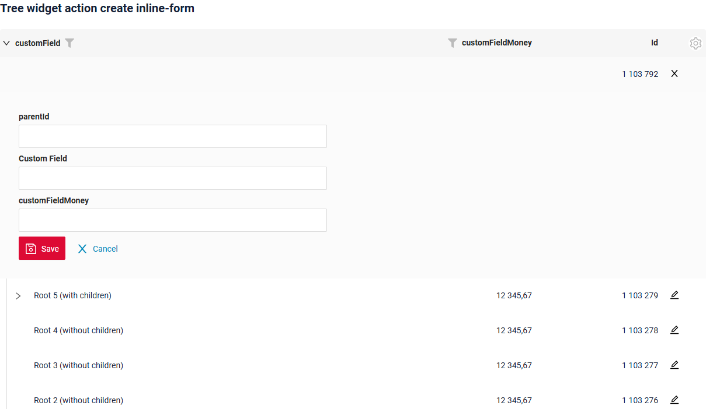

###### Как добавить? { #how-to-add_5 }
??? Example "Пример"

    **Шаг 1** Добавьте кнопку `create` в соответствующий **VersionAwareResponseService**.
    ```java
    --8<--
    {{ external_links.github_raw_doc }}/widgets/tree/actions/create/withwidget/MyExample3279Service.java:getActions
    --8<--
    ```
    **Шаг 2** Добавьте **fields.setEnabled** в соответствующий **FieldMetaBuilder**.
    ```java
    --8<--
    {{ external_links.github_raw_doc }}/widgets/tree/actions/create/withwidget/MyExample3279Meta.java:buildRowDependentMeta
    --8<--
    ```

     **Шаг 3** Создайте widget.json с типом `Form`, который появляется при нажатии кнопки
    ```json
    --8<--
    {{ external_links.github_raw_doc }}/widgets/tree/actions/create/withwidget/myEntity3279CreateForm.widget.json
    --8<--
    ```
 
     **Шаг 4** Добавьте widget.json с типом `Form` в соответствующий **.view.json**.
    ```json
    --8<--
    {{ external_links.github_raw_doc }}/widgets/tree/actions/create/withwidget/myexample3279tree.view.json
    --8<--
    ```

     **Шаг 5** Добавьте кнопку `create` и виджет с типом `Form` в соответствующий **.widget.json**.

    `options`.`create`: имя виджета, который появляется при нажатии кнопки
    
     Позиция новой строки внутри узла задаётся
 
    `options`.`tree`.`insertPosition`: start помещает её перед уже загруженными строками узла, end — после них

    ```json
    --8<--
    {{ external_links.github_raw_doc }}/widgets/tree/actions/create/withwidget/MyExample3279Tree.widget.json
    --8<--
    ```

    [:material-play-circle: Живой пример]({{ external_links.code_samples }}/ui/#/screen/myexample3265/view/myexample3279tree){:target="_blank"} ·
    [:fontawesome-brands-github: GitHub]({{ external_links.github_ui }}/{{ external_links.github_branch }}/src/main/java/org/demo/documentation/widgets/tree/actions/create/withwidget){:target="_blank"}

##### <a id="withview">With view</a>
[:material-play-circle: Живой пример]({{ external_links.code_samples }}/ui/#/screen/myexample3265/view/myexample3266tree){:target="_blank"} ·
[:fontawesome-brands-github: GitHub]({{ external_links.github_ui }}/{{ external_links.github_branch }}/src/main/java/org/demo/documentation/widgets/tree/actions/create/newview){:target="_blank"}

При `Create with view` нажатие кнопки "Add" открывает отдельный view, отображающий только форму ввода данных. После заполнения формы и сохранения система возвращается к дереву сущностей с добавленной новой строкой.
###### Как это выглядит? { #how-does-it-look_5 }
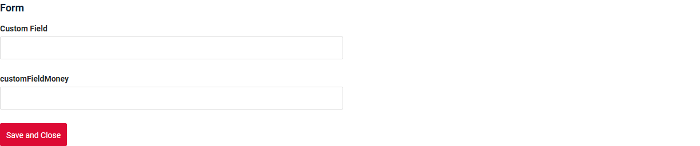

###### Как добавить? { #how-to-add_6 }
??? Example "Пример"

    **Шаг 1** Добавьте кнопку `create` в соответствующий **VersionAwareResponseService**.
    ```java
    --8<--
    {{ external_links.github_raw_doc }}/widgets/tree/actions/create/newview/MyExample3266Service.java:getActions
    --8<--
    ```
     **Шаг 2** Добавьте **PostAction.drillDown** в метод **doCreateEntity** соответствующего **VersionAwareResponseService**.
    ```java
    --8<--
    {{ external_links.github_raw_doc }}/widgets/tree/actions/create/newview/MyExample3266Service.java:doCreateEntity
    --8<--
    ```
    **Шаг 3** Добавьте кнопку `create` в соответствующий **.widget.json**.
  
    ```json
    --8<--
    {{ external_links.github_raw_doc }}/widgets/tree/actions/create/newview/MyExample3266Tree.widget.json
    --8<--
    ```

    [:material-play-circle: Живой пример]({{ external_links.code_samples }}/ui/#/screen/myexample3265/view/myexample3266tree){:target="_blank"} ·
    [:fontawesome-brands-github: GitHub]({{ external_links.github_ui }}/{{ external_links.github_branch }}/src/main/java/org/demo/documentation/widgets/tree/actions/create/newview){:target="_blank"}


#### Редактирование { #edit }
`Edit` позволяет изменить значение поля. Как и для кнопки `Create`, это действие можно реализовать тремя способами.

Есть три способа создать запись:

* [Inline edit](#editline): строку можно редактировать напрямую.

* [Inline-form](#editwithwidget): данные можно редактировать с помощью виджета формы, не покидая текущий view.

* [With view](#editwithview): запись можно отредактировать, перейдя в отдельный view.

##### <a id="editline">Inline-редактирование </a>
[:material-play-circle: Живой пример]({{ external_links.code_samples }}/ui/#/screen/myexample3265/view/myexample3273tree){:target="_blank"} ·
[:fontawesome-brands-github: GitHub]({{ external_links.github_ui }}/{{ external_links.github_branch }}/src/main/java/org/demo/documentation/widgets/tree/actions/edit/basic){:target="_blank"}


`Edit Inline` означает inline-редактирование. Дважды щёлкните по значению, которое нужно изменить.
###### Как это выглядит? { #how-does-it-look_6 }
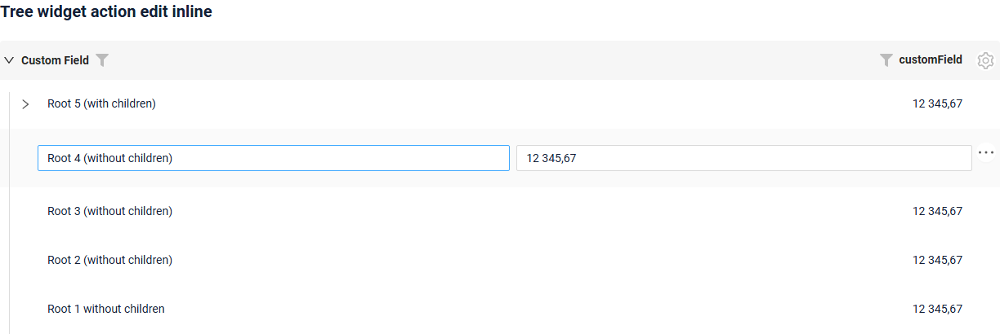

###### Как добавить? { #how-to-add_7 }
??? Example "Пример"

    **Шаг 1** Добавьте **fields.setEnabled** в соответствующий **FieldMetaBuilder**.
    ```java
    --8<--
    {{ external_links.github_raw_doc }}/widgets/tree/actions/edit/basic/MyExample3273Meta.java:buildRowDependentMeta
    --8<--
    ```
 
    [:material-play-circle: Живой пример]({{ external_links.code_samples }}/ui/#/screen/myexample3265/view/myexample3273tree){:target="_blank"} ·
    [:fontawesome-brands-github: GitHub]({{ external_links.github_ui }}/{{ external_links.github_branch }}/src/main/java/org/demo/documentation/widgets/tree/actions/edit/basic){:target="_blank"}

##### <a id="editwithwidger">Inline-form</a>
[:material-play-circle: Живой пример]({{ external_links.code_samples }}/ui/#/screen/myexample3265/view/myexample3275tree){:target="_blank"} ·
[:fontawesome-brands-github: GitHub]({{ external_links.github_ui }}/{{ external_links.github_branch }}/src/main/java/org/demo/documentation/widgets/tree/actions/edit/withwidget){:target="_blank"}

`Edit with widget` открывает дополнительный виджет при нажатии на иконку редактирования в строке.

###### Как это выглядит? { #how-does-it-look_7 }
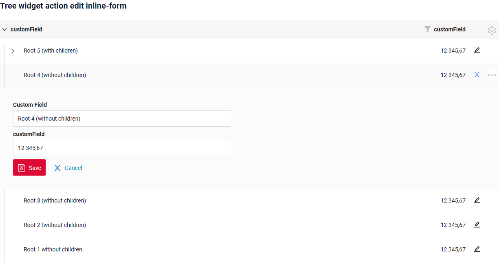

###### Как добавить? { #how-to-add_8 }
??? Example "Пример"

    **Шаг 1** Добавьте действие `save` в соответствующий **VersionAwareResponseService**: с его помощью форма сохраняет запись.
    ```java
    --8<--
    {{ external_links.github_raw_doc }}/widgets/tree/actions/edit/withwidget/MyExample3275Service.java:getActions
    --8<--
    ```

    **Шаг 2** Добавьте **fields.setEnabled** в соответствующий **FieldMetaBuilder**.
    ```java
    --8<--
    {{ external_links.github_raw_doc }}/widgets/tree/actions/edit/withwidget/MyExample3275Meta.java:buildRowDependentMeta
    --8<--
    ```
 
    **Шаг 3**  Создайте widget.json с типом `Form`, который появляется при нажатии кнопки
    ```json
    --8<--
    {{ external_links.github_raw_doc }}/widgets/tree/actions/edit/withwidget/myEntity3275EditForm.widget.json
    --8<--
    ```
 
     **Шаг 4** Добавьте widget.json с типом `Form` в соответствующий **.view.json**.
    ```json
    --8<--
    {{ external_links.github_raw_doc }}/widgets/tree/actions/edit/withwidget/myexample3275tree.view.json
    --8<--
    ```

     **Шаг 5** Добавьте виджет с типом `Form` в **options**.**edit**.**widget** соответствующего **.widget.json**: в каждой строке появится иконка редактирования.
       
    `options`.`edit`: имя виджета, который появляется при нажатии кнопки
        
    ```json
    --8<--
    {{ external_links.github_raw_doc }}/widgets/tree/actions/edit/withwidget/MyExample3275Tree.widget.json
    --8<--
    ```

    [:material-play-circle: Живой пример]({{ external_links.code_samples }}/ui/#/screen/myexample3265/view/myexample3275tree){:target="_blank"} ·
    [:fontawesome-brands-github: GitHub]({{ external_links.github_ui }}/{{ external_links.github_branch }}/src/main/java/org/demo/documentation/widgets/tree/actions/edit/withwidget){:target="_blank"}

##### <a id="editwithview">With view</a>
[:material-play-circle: Живой пример]({{ external_links.code_samples }}/ui/#/screen/myexample3265/view/myexample3274tree){:target="_blank"} ·
[:fontawesome-brands-github: GitHub]({{ external_links.github_ui }}/{{ external_links.github_branch }}/src/main/java/org/demo/documentation/widgets/tree/actions/edit/newview){:target="_blank"}

При `Edit with view` сущность можно редактировать в отдельном view, отображающем только форму ввода данных. Выберите пункт "Edit" в меню с тремя точками.

###### Как это выглядит? { #how-does-it-look_8 }
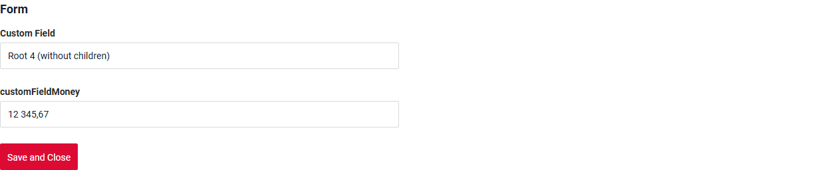

###### Как добавить? { #how-to-add_9 }
??? Example "Пример"

    **Шаг 1** Добавьте действие *edit* в соответствующий **VersionAwareResponseService**.
    
    Добавьте **PostAction.drillDown** в метод *edit*

    ```java
    --8<--
    {{ external_links.github_raw_doc }}/widgets/tree/actions/edit/newview/MyExample3274Service.java:getActions
    --8<--
    ```
    **Шаг 2** Добавьте кнопку или группу кнопок в соответствующий **.widget.json**.
   
    ```json
    --8<--
    {{ external_links.github_raw_doc }}/widgets/tree/actions/edit/newview/MyExample3274Tree.widget.json
    --8<--
    ```
    [:material-play-circle: Живой пример]({{ external_links.code_samples }}/ui/#/screen/myexample3265/view/myexample3274tree){:target="_blank"} ·
    [:fontawesome-brands-github: GitHub]({{ external_links.github_ui }}/{{ external_links.github_branch }}/src/main/java/org/demo/documentation/widgets/tree/actions/edit/newview){:target="_blank"}


### Дополнительные свойства { #additional-properties }
#### <a id="noderefresh">Обновление узла</a>
Отличие от [виджета List](/ru/widget/type/list/list) — **что обновляется после действия**. Виджет List обновляет всю страницу, а виджет Tree — только **узел**, к которому относится запись:

* строка обновляется из ответа действия или, если ответ её не содержит, перечитывается запросом `?id.equals=<id>`;
* row-meta строки запрашивается повторно;
* если запись больше не возвращается, строка удаляется из дерева;
* узел сворачивается, а его уже загруженные дочерние записи забываются, поэтому при следующем раскрытии они загружаются заново.
 

!!! info
    Соседние и родительские записи автоматически **не** обновляются.
    `PostAction.refreshBC` в этом релизе не поддерживается для виджета Tree: корневая страница загружается заново, но раскрытые узлы и их уже загруженные дочерние записи остаются как есть. Если действие меняет другие записи, перезагрузите view.


**Запросы**
Поскольку обновляется только узел, виджет Tree выполняет меньше запросов, чем виджет List.

| Действие      | Виджет List                                                   | Виджет Tree                       |
|---------------|---------------------------------------------------------------|-----------------------------------|
| Delete        | `DELETE /data` + `GET /data` + `GET /row-meta` + `GET /count` | `DELETE /data` + `GET /row-meta`  |
| Save          | `PUT /data` + `GET /data` + `GET /row-meta` + `GET /count`    | `PUT /data` + `GET /row-meta`     |
| Cancel-create | `DELETE /data` + `GET /data` + `GET /row-meta` + `GET /count` | `DELETE /data` + `GET /row-meta`  |

**Пример**: действие записи `custom Save` из примера ниже обновляет запись; дерево обновляет только её узел.
[:material-play-circle: Живой пример]({{ external_links.code_samples }}/ui/#/screen/myexample3265/view/myexample3265tree){:target="_blank"} ·
[:fontawesome-brands-github: GitHub]({{ external_links.github_ui }}/{{ external_links.github_branch }}/src/main/java/org/demo/documentation/widgets/tree/actions/create/basic){:target="_blank"}

 
??? Example "Пример"
    ```java
    --8<--
    {{ external_links.github_raw_doc }}/widgets/tree/actions/create/basic/MyExample3265Service.java:getActions
    --8<--
    ```
    [:material-play-circle: Живой пример]({{ external_links.code_samples }}/ui/#/screen/myexample3265/view/myexample3265tree){:target="_blank"} ·
    [:fontawesome-brands-github: GitHub]({{ external_links.github_ui }}/{{ external_links.github_branch }}/src/main/java/org/demo/documentation/widgets/tree/actions/create/basic){:target="_blank"}


#### Настройка отображаемых колонок { #customization-of-displayed-columns }
[:material-play-circle: Живой пример]({{ external_links.code_samples }}/ui/#/screen/myexample3268){:target="_blank"} ·
[:fontawesome-brands-github: GitHub]({{ external_links.github_ui }}/{{ external_links.github_branch }}/src/main/java/org/demo/documentation/widgets/tree/customizationcolumns){:target="_blank"}
 
Для настройки колонок, отображаемых в виджете дерева, доступны два основных действия:

* Скрыть колонки
* Поменять колонки местами
 
!!! info
    Сейчас данные настройки таблицы хранятся во внутренних таблицах, даже если используются микросервисы.

###### Основы { #basic }
При настройке колонок записи вставляются в таблицу ADDITIONAL_FIELDS.
Таблица *ADDITIONAL_FIELDS* для хранения пользовательских настроек:

 * `user_id`: ID пользователя, для которого настраиваются колонки.
 * `view`: имя view, в котором настраиваются колонки.
 * `widget`: имя виджета, в котором настраиваются колонки.
 * `order_fields`: при перестановке колонок последовательность полей обновляется и сохраняется новая последовательность полей через запятую.
 * `added_to_additional_fields`: поля, скрытые пользователем.
 * `removed_from_additional_fields`: список полей, которые изначально были скрыты для пользователя, но затем сделаны видимыми.
   Когда пользователь открывает виджет и выбирает отображение ранее скрытых полей, эти поля записываются в эту колонку.

###### Как это выглядит? { #how-does-it-look_9 }
=== "Скрыть колонки"
    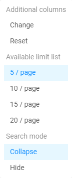
=== "Поменять колонки местами"
    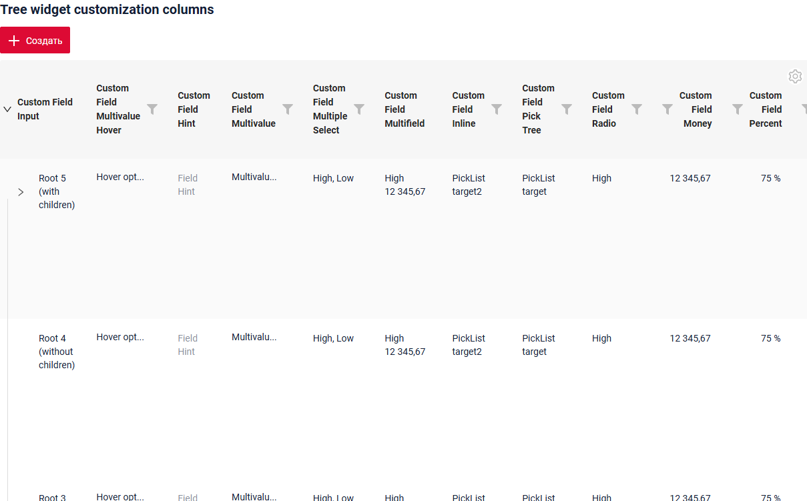
=== "Изначально скрытые"
    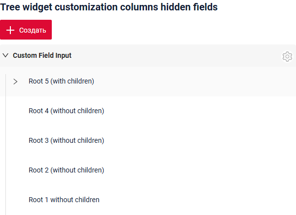

###### Как добавить? { #how-to-add_10 }
??? Example "Пример"
    === "Скрыть и поменять колонки местами"
    
        Добавьте в **options** параметр **additional** в соответствующий **.widget.json**.
            
        ```
        "additional": {
          "enabled": true
        }
        ```
        
        ```json
        --8<--
        {{ external_links.github_raw_doc }}/widgets/tree/customizationcolumns/widget/MyExample3268Tree.widget.json
        --8<--
        ```
        
        [:material-play-circle: Живой пример]({{ external_links.code_samples }}/ui/#/screen/myexample3268){:target="_blank"} ·
        [:fontawesome-brands-github: GitHub]({{ external_links.github_ui }}/{{ external_links.github_branch }}/src/main/java/org/demo/documentation/widgets/tree/customizationcolumns){:target="_blank"}
        

    === "Изначально скрытые колонки"
        
        Также можно задать изначально скрытые колонки — они будут скрыты при открытии виджета.
        
        Добавьте в **options** параметр **additional** в соответствующий **.widget.json**.
        
        Добавьте в **options** параметр **fields** со списком скрытых полей в соответствующий **.widget.json**.
            
        ```
           "additional": {
              "fields": ["customFieldPercent", "customFieldRadio"],
              "enabled": true
            }
        ```
        
        ```json
        --8<--
        {{ external_links.github_raw_doc }}/widgets/tree/customizationcolumns/widget/MyExample3268TreeHiddenFields.widget.json
        --8<--
        ```
        
        [:material-play-circle: Живой пример]({{ external_links.code_samples }}/ui/#/screen/myexample3268/view/myexample3268listhidden){:target="_blank"} ·
        [:fontawesome-brands-github: GitHub]({{ external_links.github_ui }}/{{ external_links.github_branch }}/src/main/java/org/demo/documentation/widgets/tree/customizationcolumns){:target="_blank"}

###### Обработка старых записей { #handling-old-records }
`Delete fields with widget`

Если поля, сохранённые в таблице дополнительных настроек, удалены из виджета, функциональность продолжает работать корректно, игнорируя эти старые поля.
#### Фильтрация { #filtration }
##### Основы { #basic_1 }
подробнее см. [Поля](/ru/widget/type/property/filtration/filtration/)

Фильтрация виджета Tree — стандартный запрос. Строки, соответствующие фильтру, возвращаются бэкендом без иерархии, а виджет решает, как их отображать, см. [Режимы поиска](#searchmodes).

Панель над деревом показывает:

* `Clear N filter(s)` — количество применённых фильтров и возможность их сбросить;
* `Shown N` — сколько найденных записей сейчас отображается;
* `More M` — сколько найденных записей ещё не отображено, где `M` — количество найденных записей минус количество показанных.

!!! info
    В режиме пагинации `nextAndPreviousWithCount` запрос `/count` после фильтрации **не** выполняется. Вместо количества найденных записей отображается иконка `i` с подсказкой **"Load more and show count"**.

###### Как это выглядит? { #how-does-it-look_10 }


###### Как добавить? { #how-to-add_11 }
??? Example "Пример"
    Найденные записи отображаются согласно [режимам поиска](#searchmodes).

    `Шаг 1` Добавьте **@SearchParameter** в соответствующий **DataResponseDTO**.
    ```java
    --8<--
    {{ external_links.github_raw_doc }}/widgets/property/filtration/filtergroup/MyExample3616DTO.java
    --8<--
    ```

    `Шаг 2` Добавьте **fields.enableFilter** в соответствующий **FieldMetaBuilder**.
    ```java
    --8<--
    {{ external_links.github_raw_doc }}/widgets/property/filtration/filtergroup/MyExample3616Meta.java:buildIndependentMeta
    --8<--
    ```

    [:material-play-circle: Живой пример]({{ external_links.code_samples }}/ui/#/screen/myexample3616/view/myexample3616tree){:target="_blank"} ·
    [:fontawesome-brands-github: GitHub]({{ external_links.github_ui }}/{{ external_links.github_branch }}/src/main/java/org/demo/documentation/widgets/property/filtration/filtergroup){:target="_blank"}

##### FullTextSearch
`FullTextSearch` — когда пользователь вводит текст в поле полнотекстового поиска, виджет фильтрует строки, соответствующие запросу.
см. [FullTextSearch](/ru/widget/type/property/filtration/filtration/#by-fulltextsearch)

Результат полнотекстового поиска отображается так же, как результат фильтрации, см. [Режимы поиска](#searchmodes).

###### Как это выглядит? { #how-does-it-look_11 }


###### Как добавить? { #how-to-add_12 }
??? Example "Пример"
    `Шаг 1` Добавьте файл расширения FullTextSearchExt.java
    ```java
    import java.util.Optional;
    import jakarta.persistence.criteria.CriteriaBuilder;
    import jakarta.persistence.criteria.Path;
    import jakarta.persistence.criteria.Predicate;
    import lombok.NonNull;
    import lombok.experimental.UtilityClass;
    import org.apache.commons.lang3.StringUtils;
    import org.cxbox.core.crudma.bc.BusinessComponent;

    @UtilityClass
    public class FullTextSearchExt {

        @NonNull
        public static Optional<String> getFullTextSearchFilterParam(BusinessComponent bc) {
            return Optional.ofNullable(bc.getParameters().getParameter("_fullTextSearch"));
        }

        public static Predicate likeIgnoreCase(String value, CriteriaBuilder cb, Path<String> path) {
            return cb.like(cb.lower(path), StringUtils.lowerCase("%" + value + "%"));
        }

    }
    ```

    `Шаг 2` Добавьте **specifications** для полей полнотекстового поиска в соответствующий **JpaRepository**.
    ```java
    --8<--
    {{ external_links.github_raw_doc }}/widgets/property/filtration/fulltextsearch/MyEntity3614Repository.java
    --8<--
    ```

    `Шаг 3` Добавьте **getSpecification** в соответствующий **VersionAwareResponseService**.
    ```java
    --8<--
    {{ external_links.github_raw_doc }}/widgets/property/filtration/fulltextsearch/MyExample3614Service.java:getSpecification
    --8<--
    ```

    `Шаг 4` Добавьте **fullTextSearch** в соответствующий **.widget.json**.

    `enabled` true/false

    `placeholder` — описание для fullTextSearch

    ```json
    --8<--
    {{ external_links.github_raw_doc }}/widgets/property/filtration/fulltextsearch/MyExample3614Tree.widget.json
    --8<--
    ```

    [:material-play-circle: Живой пример]({{ external_links.code_samples }}/ui/#/screen/myexample3616/view/myexample3614tree){:target="_blank"} ·
    [:fontawesome-brands-github: GitHub]({{ external_links.github_ui }}/{{ external_links.github_branch }}/src/main/java/org/demo/documentation/widgets/property/filtration/fulltextsearch){:target="_blank"}

##### Персональная группа фильтров { #personal-filter-group }
Заполненный пользователем фильтр можно сохранить для каждого отдельного пользователя.
см. [Персональная группа фильтров](/ru/widget/type/property/filtration/filtration/#by-personal-filter-group)

[:material-play-circle: Живой пример]({{ external_links.code_samples }}/ui/#/screen/myexample3616/view/myexample3616tree){:target="_blank"} ·
[:fontawesome-brands-github: GitHub]({{ external_links.github_ui }}/{{ external_links.github_branch }}/src/main/java/org/demo/documentation/widgets/property/filtration/filtergroup){:target="_blank"}

###### Как это выглядит? { #how-does-it-look_12 }


###### Как добавить? { #how-to-add_13 }
??? Example "Пример"
    Записи сохранённого фильтра отображаются согласно [режимам поиска](#searchmodes).

    Доступность фильтрации зависит от типа поля. Подробнее см. [типы полей](/ru/widget/fields/fieldtypes/)

    Для полей, по которым нужно сохранять индивидуальные фильтры, обязательно настройте параметры фильтрации. См. `Шаг 1` и `Шаг 2`

    **Шаг 1** Добавьте **@SearchParameter** в соответствующий **DataResponseDTO**. (Расширенная настройка [SearchParameter](/ru/advancedCustomization/element/searchparameter/searchparameter))
    ```java
    --8<--
    {{ external_links.github_raw_doc }}/widgets/property/filtration/filtergroup/MyExample3616DTO.java
    --8<--
    ```

    **Шаг 2**  Добавьте **fields.enableFilter** в соответствующий **FieldMetaBuilder**.
    ```java
    --8<--
    {{ external_links.github_raw_doc }}/widgets/property/filtration/filtergroup/MyExample3616Meta.java:buildIndependentMeta
    --8<--
    ```

    **Шаг 3** Добавьте **filterSetting** в соответствующий **.widget.json**.

    `enabled` true/false

    ```json
    --8<--
    {{ external_links.github_raw_doc }}/widgets/property/filtration/filtergroup/MyExample3616Tree.widget.json
    --8<--
    ```

    [:material-play-circle: Живой пример]({{ external_links.code_samples }}/ui/#/screen/myexample3616/view/myexample3616tree){:target="_blank"} ·
    [:fontawesome-brands-github: GitHub]({{ external_links.github_ui }}/{{ external_links.github_branch }}/src/main/java/org/demo/documentation/widgets/property/filtration/filtergroup){:target="_blank"}

##### Группа фильтров { #filter-group }
`Filter group` — предопределённые настройки фильтров, которые пользователи могут применять в приложении. Они позволяют быстро применить определённые критерии фильтрации без ручного ввода.
см. [Группа фильтров](/ru/widget/type/property/filtration/filtration/#by-filter-group)

[:material-play-circle: Живой пример]({{ external_links.code_samples }}/ui/#/screen/myexample3616/view/myexample3618tree){:target="_blank"} ·
[:fontawesome-brands-github: GitHub]({{ external_links.github_ui }}/{{ external_links.github_branch }}/src/main/java/org/demo/documentation/widgets/property/filtration/filtergroupsave){:target="_blank"}

###### Как это выглядит? { #how-does-it-look_13 }


###### Как добавить? { #how-to-add_14 }
??? Example "Пример"
    Записи группы отображаются согласно [режимам поиска](#searchmodes).

    !!! tips "Совет"
        Чтобы получить условия для колонки `filters`, выполните следующие шаги:

        * Добавьте функцию фильтрации для полей
        * Заполните нужные фильтры в интерфейсе.
        * Откройте панель разработчика.
        * Найдите нужный запрос.
        * Используйте часть этого запроса с фильтром как значение `filters`

        

    Добавьте бизнес-компонент в таблицу **BC_FILTER_GROUPS**

      `name` — имя предопределённого фильтра

      `BC` — имя бизнес-компонента

      `filters` — условия фильтрации

    ```csv
    name;bc;filters;ID
    Dictionary = High;myexample3618;customFieldDictionary.equalsOneOf=%5B%22High%22%5D;
    ```

    [:material-play-circle: Живой пример]({{ external_links.code_samples }}/ui/#/screen/myexample3616/view/myexample3618tree){:target="_blank"} ·
    [:fontawesome-brands-github: GitHub]({{ external_links.github_ui }}/{{ external_links.github_branch }}/src/main/java/org/demo/documentation/widgets/property/filtration/filtergroupsave){:target="_blank"}

#### <a id="searchmodes">Режимы поиска</a>
[:material-play-circle: Живой пример]({{ external_links.code_samples }}/ui/#/screen/myexample3280/view/myexample3280treecollapsehide){:target="_blank"} ·
[:fontawesome-brands-github: GitHub]({{ external_links.github_ui }}/{{ external_links.github_branch }}/src/main/java/org/demo/documentation/widgets/tree/treesearchmodes){:target="_blank"}

Способ отображения результата фильтрации и полнотекстового поиска задаётся **options**.**tree**.**searchModes**.

Есть два режима:

* `collapse` — **результаты поиска и дерево**. Дерево показывает найденные записи вместе с записями, необходимыми для навигации: путь навигации над каждой найденной записью восстанавливается на `onFilterApplyNestLevel` уровней вверх. Пользователь может перемещаться по дереву, раскрывать и сворачивать ветви, видеть соседние записи и подгружать дополнительные записи.
* `hide` — **только результаты поиска**. Дерево показывает только найденные записи, всё остальное скрыто. Пользователь работает только с результатом поиска и не может перемещаться по другим записям дерева.

Оба режима могут быть доступны одновременно. **Первый** элемент массива `searchModes` — режим, активный при применении фильтра; пользователь переключается между доступными режимами в виджете.

**Восстановление пути вверх**

В режиме `collapse` записи, родители которых ещё не загружены, помещаются под псевдоузел. Кнопка `>...` загружает недостающих родителей запросом `?id.equals=<parentId>` и перемещает записи в иерархию. Один клик восстанавливает до **2** уровней вложенности, поэтому для глубокой иерархии кнопку нужно нажать несколько раз.

###### Как это выглядит? { #how-does-it-look_14 }
=== "Результаты поиска и дерево (collapse)"
    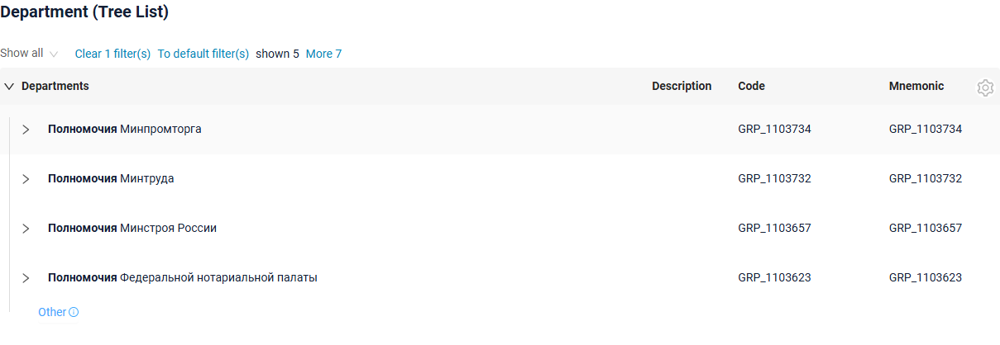
=== "Только результаты поиска (hide)"
    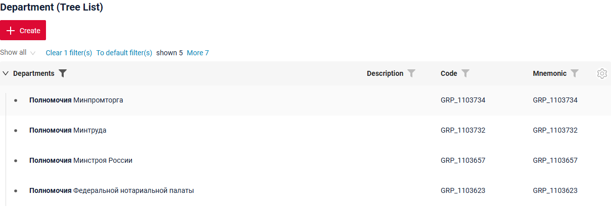
=== "Переключение между режимами"
    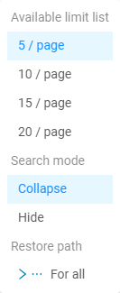

###### Как добавить? { #how-to-add_15 }
??? Example "Пример"
    **Шаг 1** Добавьте **options**.**tree**.**searchModes** в соответствующий **_.widget.json_**.

    Первый элемент массива — режим, активный при применении фильтра.

    ```
    "tree": {
      "searchModes": ["collapse", "hide"],
      "onFilterApplyNestLevel": 1
    }
    ```

    ```json
    --8<--
    {{ external_links.github_raw_doc }}/widgets/tree/treesearchmodes/widget/MyExample3280Tree.widget.json
    --8<--
    ```

    [:material-play-circle: Живой пример]({{ external_links.code_samples }}/ui/#/screen/myexample3280/view/myexample3280treecollapsehide){:target="_blank"} ·
    [:fontawesome-brands-github: GitHub]({{ external_links.github_ui }}/{{ external_links.github_branch }}/src/main/java/org/demo/documentation/widgets/tree/treesearchmodes){:target="_blank"}


#### <a id="pagination">Пагинация</a>
`Pagination` — разбиение содержимого на отдельные страницы, упрощающее навигацию и работу с большими объёмами информации.
см. [Пагинация](/ru/widget/type/property/pagination/pagination)
 
У виджета Tree нет стрелок навигации. Вместо стрелки «вперёд» последняя строка узла — кнопка **`More`**, которая загружает следующую страницу узла и добавляет её к уже загруженным записям. Выбор лимита (`availableLimitsList`) перенесён в меню шестерёнки виджета.

Кнопка `More` работает по тому же алгоритму, что и стрелка «вперёд» в трёх режимах пагинации:

| Режим пагинации              | Когда отображается `More`                                                                     | Счётчик                                     |
|------------------------------|-----------------------------------------------------------------------------------------------|---------------------------------------------|
| `nextAndPreviousWithHasNext` | `hasNext`, возвращённый бэкендом, равен `true`                                                  | не отображается                             |
| `nextAndPreviousWithCount`   | `count` больше количества уже загруженных записей                                               | сколько записей осталось загрузить          |
| `nextAndPreviousSmart`       | бэкенд вернул больше записей, чем лимит узла                                                    | не отображается                             |

подробнее см. [Режимы пагинации](/ru/widget/type/property/pagination/pagination)

###### Как это выглядит? { #how-does-it-look_15 }
=== "nextAndPreviousWithHasNext"
    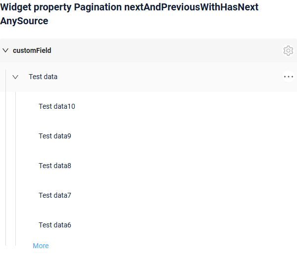
=== "nextAndPreviousWithCount"
    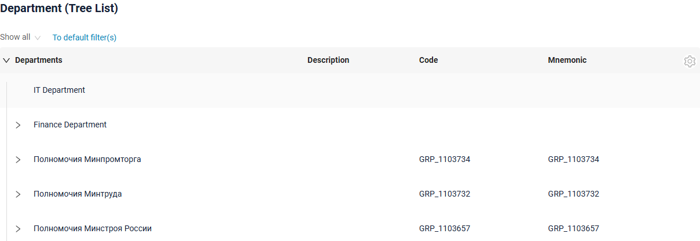
=== "nextAndPreviousSmart"
    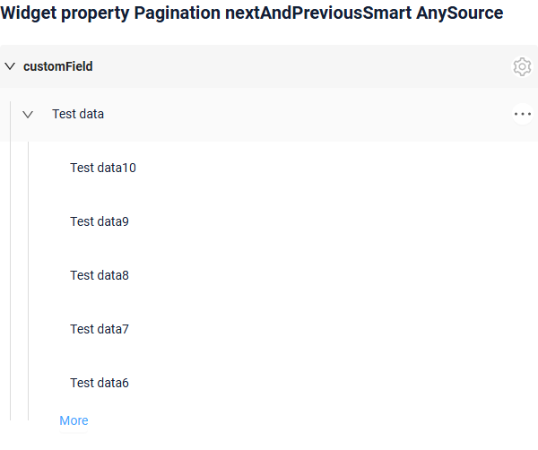

###### Как добавить? { #how-to-add_16 }
??? Example "Пример"
    === "nextAndPreviousWithHasNext"
        ```json
        --8<--
        {{ external_links.github_raw_doc }}/widgets/property/pagination/nextandpreviouswihhasnext/MyExample3860Tree.widget.json
        --8<--
        ```
        [:material-play-circle: Живой пример]({{ external_links.code_samples }}/ui/#/screen/myexample3861/view/myexample3860tree){:target="_blank"} ·
        [:fontawesome-brands-github: GitHub]({{ external_links.github_ui }}/{{ external_links.github_branch }}/src/main/java/org/demo/documentation/widgets/property/pagination/nextandpreviouswihhasnext){:target="_blank"}

    === "nextAndPreviousWithCount"
        ```json
        --8<--
        {{ external_links.github_raw_doc }}/widgets/property/pagination/nextandpreviouswithcount/MyExample3862Tree.widget.json
        --8<--
        ```
        [:material-play-circle: Живой пример]({{ external_links.code_samples }}/ui/#/screen/myexample3861/view/myexample3862tree){:target="_blank"} ·
        [:fontawesome-brands-github: GitHub]({{ external_links.github_ui }}/{{ external_links.github_branch }}/src/main/java/org/demo/documentation/widgets/property/pagination/nextandpreviouswithcount){:target="_blank"}

    === "nextAndPreviousSmart"
        ```json
        --8<--
        {{ external_links.github_raw_doc }}/widgets/property/pagination/nextandprevioussmart/MyExample3861Tree.widget.json
        --8<--
        ```
        [:material-play-circle: Живой пример]({{ external_links.code_samples }}/ui/#/screen/myexample3861/view/myexample3861tree){:target="_blank"} ·
        [:fontawesome-brands-github: GitHub]({{ external_links.github_ui }}/{{ external_links.github_branch }}/src/main/java/org/demo/documentation/widgets/property/pagination/nextandprevioussmart){:target="_blank"}

    === "availableLimitsList"
        Список доступных лимитов отображается в меню шестерёнки виджета.

        ```json
        --8<--
        {{ external_links.github_raw_doc }}/widgets/property/pagination/availablelimitselist/MyExample3867Tree.widget.json
        --8<--
        ```
        [:material-play-circle: Живой пример]({{ external_links.code_samples }}/ui/#/screen/myexample3861/view/myexample3867tree){:target="_blank"} ·
        [:fontawesome-brands-github: GitHub]({{ external_links.github_ui }}/{{ external_links.github_branch }}/src/main/java/org/demo/documentation/widgets/property/pagination/availablelimitselist){:target="_blank"}

#### Экспорт в Excel { #export-to-excel }
!!! info
    Экспорт в Excel в этом релизе **недоступен** для виджета `Tree`

#### Множественная загрузка файлов { #multi-upload-files }
**недоступно**

##### Сортировка { #sorting }
`Sorting` позволяет пользователю сортировать записи по колонке.
см. [Сортировка](/ru/widget/type/property/sorting/sorting)

Сортировка виджета Tree работает **внутри узла**: записи сортируются среди дочерних элементов одного родителя, сама иерархия не меняется. В остальном сортировка стандартная.

 
