# Widgets
<!-- 
## Widget Type Family

AdditionalInfo
SuggestionPickList
DashboardList
 
LevelMenu
Steps 
-->

The common properties of all widgets and the structure of **_.widget.json_** are described in [Widget basics](/widget/type/basic/basic/).

## Widget Types
The widgets are divided into groups by their purpose:

* [Charts](#charts) — widgets that show records as a chart or as blocks of aggregated values.
* [Data Display](#data-display) — widgets only for viewing records: the fields of one record or a list of records.
* [Data Entry & Editing](#data-entry-editing) — widgets for working with records: viewing, creating and editing them, and choosing values in a popup.
* [File Widgets](#file-widgets) — widgets for viewing and managing the files of records.
* [Layout & UI Elements](#layout-ui-elements) — widgets that structure the screen: headers and blocks of text.
* [Process & Workflow](#process-workflow) — widgets that show the stages of a business process.

### Charts
Widgets that turn records into a visual summary: a chart or blocks of aggregated values.

=== "Column2D"
    
=== "Line2D"
    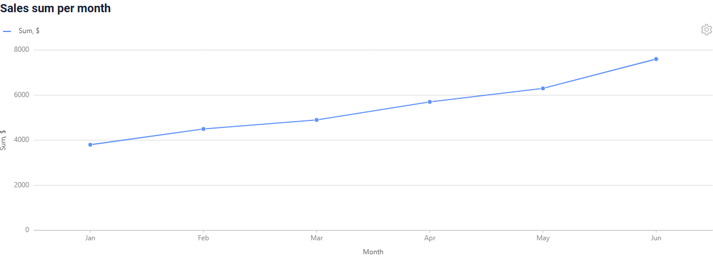
=== "Pie1D"
    
=== "StatsBlock"
    

*   [Column2D widget](/widget/type/column2d/column2d) draws a column chart: a bar per category on the X axis, a number on the Y axis. The user can switch it to a table.
*   [Line2D widget](/widget/type/line2d/line2d) draws a line chart from the records of a business component: one point per record, one line per group.
*   [Pie1D widget](/widget/type/pie1d/pie1d) shows how a whole is split into parts: every record is a segment of a ring, its size is the value of the record. The user can switch it to a table.
*   [StatsBlock widget](/widget/type/statblocks/statblocks) is a tool designed to display aggregated data in a visually accessible format.

### Data Display
Widgets only for viewing records of a business component: the fields of one record or a list of records.

=== "AdditionalInfo"
    
=== "AdditionalList"
    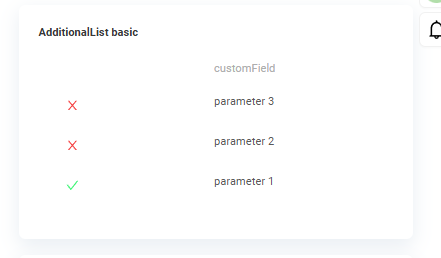
=== "Info"
    

*   [AdditionalInfo widget](/widget/type/additionalinfo/additionalinfo) is a component only for data viewing. Widget is always located **on the right**.
*   [AdditionalList widget](/widget/type/additionallist/additionallist) is list the general information for many records. Widget is always located **on the right**.
*   [Info widget](/widget/type/info/info) is a component only for data viewing.

### Data Entry & Editing
Widgets for working with records: viewing many records in a table, a tree or a calendar, creating and editing records, and choosing values from other entities in a popup.

=== "AssocListPopup"
    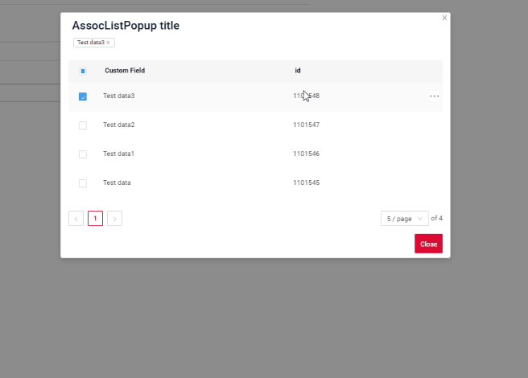
=== "AssocTreePopup"
    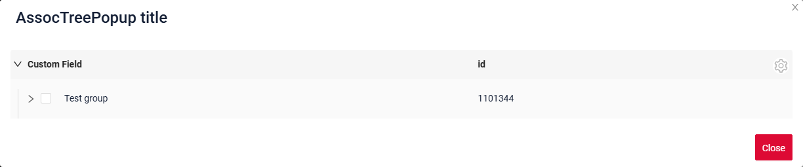
=== "CalendarList"
    
=== "Form"
    
=== "FormPopup"
    
=== "GroupingHierarchy"
    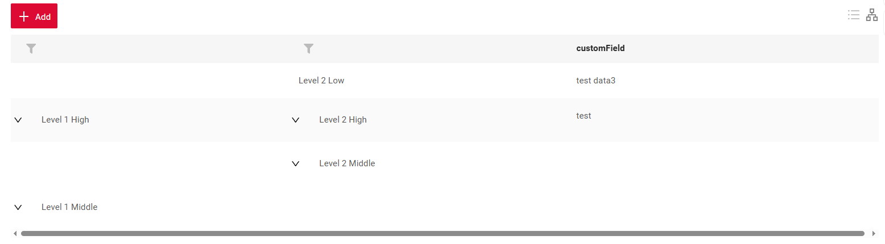
=== "List"
    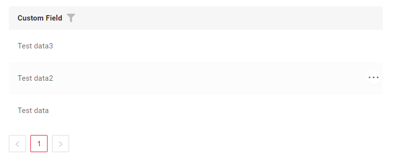
=== "PickListPopup"
    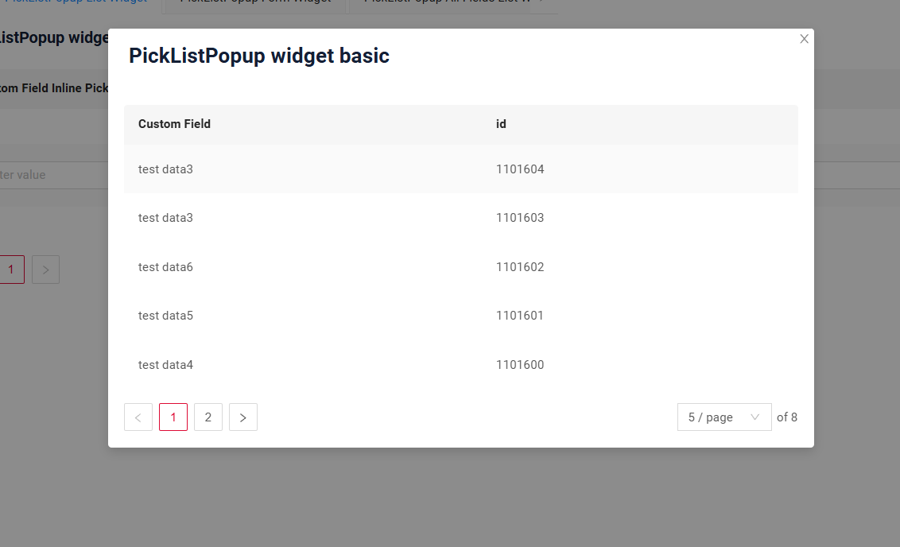
=== "PickTreePopup"
    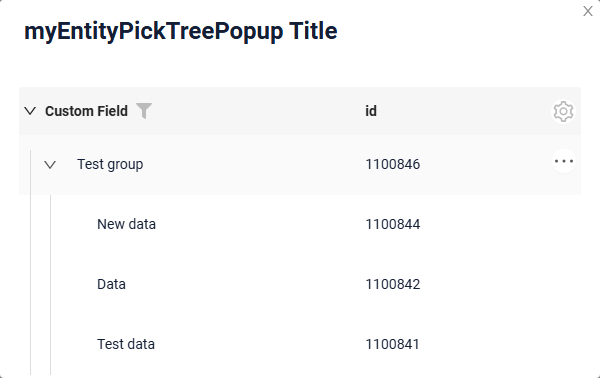
=== "Tree"
    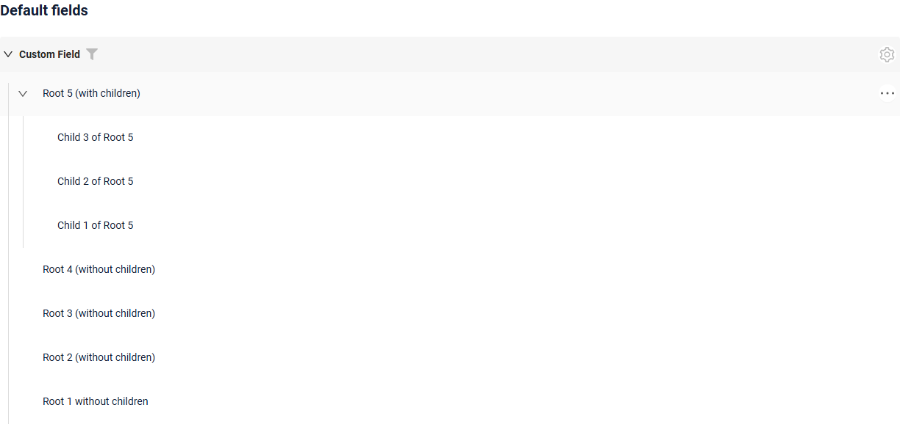

*   [AssocListPopup widget](/widget/type/assoclistpopup/assoclistpopup) is a popup component designed to the selection of multiple values.
*   [AssocTreePopup widget](/widget/type/assoctreepopup/assoctreepopup) is a popup component designed to the selection of multiple values from a hierarchical, lazily loaded tree.
*   [CalendarList widget](/widget/type/calendarlist/calendarlist) shows the records as events of a calendar: a month, a week or a day.
*   [Form widget](/widget/type/form/form) is a component for data viewing and editing.
*   [FormPopup widget](/widget/type/formpopup/formpopup) is a component for additional field checks in popup and the ability to add information inside the popup.
*   [GroupingHierarchy widget](/widget/type/groupinghierarchy/groupinghierarchy) presents shared information across multiple records, enabling rows to be grouped by one or more specified fields.
*   [List widget](/widget/type/list/list) is list the general information for many records and present it in a way that is easily interpretable for users.
*   [PickListPopup widget](/widget/type/picklistpopup/picklistpopup) is a component that allows the user to select a value from a Popup list of entities.
*   [PickTreePopup widget](/widget/type/picktreepopup/picktreepopup) is a component that allows the user to select a value from a Popup tree of entities.
*   [Tree widget](/widget/type/tree/tree) presents hierarchical records as an expandable tree, so users can browse parent and child rows in one table.

### File Widgets
Widgets for the files of records: viewing a file and showing records as file cards.

=== "CardCarouselList"
    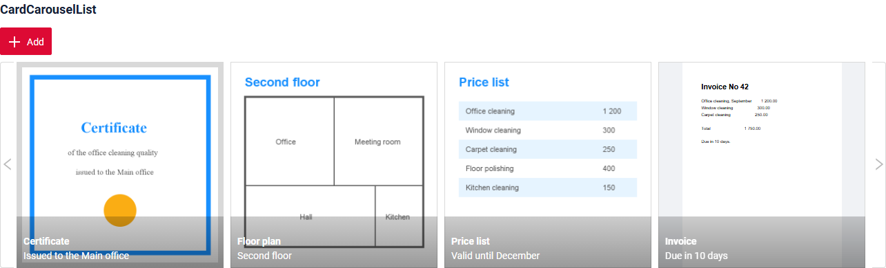
=== "CardList"
    
=== "FilePreview"
    

*   [CardCarouselList widget](/widget/type/cardcarousellist/cardcarousellist) shows records as file cards in a horizontal strip with a preview, a title and a description.
*   [CardList widget](/widget/type/cardlist/cardlist) shows records as file cards in rows with pages, with a preview, a title and a description.
*   [FilePreview widget](/widget/type/filepreview/filepreview) is a component for file viewing. It always occupies 50% of the main screen area and stays fixed at the top while scrolling.

### Layout & UI Elements
Widgets that do not work with records of a business component, but structure the screen.

=== "EmptyWidget"
    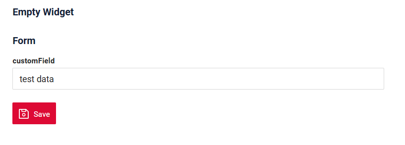
=== "HeaderWidget"
    

*   [EmptyWidget widget](/widget/type/emptywidget/emptywidget) is a component for displaying text.
*   [HeaderWidget widget](/widget/type/headerwidget/headerwidget) is a component for displaying a header.

### Process & Workflow
Widgets that show the stages of a business process and the current stage of a record.

=== "Steps"
    

*   [Steps](/widget/type/steps/steps) is used to define and manage sequential actions or stages within a business process in the application. They allow developers and users to structure complex behavior into smaller, manageable steps, improving readability, maintainability.
